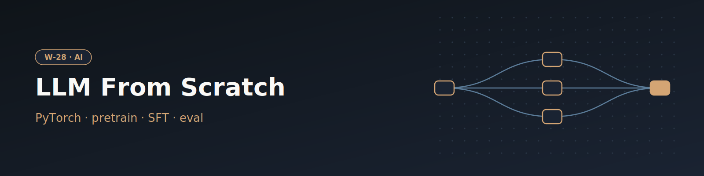

# W-28 · LLM From Scratch - Pretrain, SFT & Eval


Pretrain a decoder-only Transformer from scratch on the Pile, instruction-tune it on Alpaca/Dolly/GSM8K and score GSM8K accuracy, one resumable task per stage.

 

> [!WARNING]
> **This workflow is not yet complete.**
>
> The workflow is currently under development and should be considered a work in progress. Some stages may be incomplete, experimental, or subject to change. Use it for reference or testing only until it is finalized.




## Overview

Trains a small decoder-only Transformer from scratch, end to end: clone
[train-llm-from-scratch](https://github.com/FareedKhan-dev/train-llm-from-scratch) → tokenize
Pile text and instruction data → pretrain the base model → supervised fine-tune (SFT) it on
Alpaca/Dolly/GSM8K → evaluate GSM8K accuracy. It exists as a Horus workflow so each stage
(data prep, pretraining, fine-tuning, eval) is a resumable, individually-rerunnable task with
explicit inputs/outputs instead of one long shell script.

## Pipeline

```
clone_repo (local)
   │
   ├─► prepare_pretrain_val / prepare_pretrain_train  ──► pile_dev.h5 / pile_train.h5
   │        └─► train_pretrain (local)                ──► base_pretrained.pt
   │                 └─► train_sft (local)             ──► sft.pt
   │                          └─► eval_sft (local)      ──► stage_table.jsonl (GSM8K acc)
   │
   ├─► prepare_sft_data           ──► sft_packed.h5 (feeds train_sft)
   ├─► prepare_preference_data    ──► preferences.jsonl (unused here; for a future reward/DPO workflow)
   └─► prepare_rl_prompts         ──► rl_prompts_*.jsonl (unused here; for a future PPO/GRPO workflow)
```

Reward-model, DPO, PPO, and GRPO stages are out of scope for this workflow. The data they need
is already produced by `prepare_preference_data`/`prepare_rl_prompts`; a follow-up workflow can
pick those up.

## Quick start

```bash
# Install uv if you don't have it
curl -LsSf https://astral.sh/uv/install.sh | sh

# Install the horus-runtime and plugins (one time)
uv sync
# or: pip install horus-runtime horus-environments

# Run the workflow
uv run horus run workflow.yaml
```

Outputs land under `workflow_results/`: `repo/` (the cloned training repo), `data/` (tokenized
datasets), `ckpts/base_pretrained.pt` + `ckpts/sft.pt` (checkpoints), and `logs/stage_table.jsonl`
(GSM8K accuracy for the SFT checkpoint).

## Tools & Dependencies

- [train-llm-from-scratch](https://github.com/FareedKhan-dev/train-llm-from-scratch) (cloned at
  runtime by `clone_repo`, pinned to commit `bdd480a`) — pure PyTorch, no `transformers`/`trl`/`peft`.
- `torch`, `numpy`, `h5py`, `datasets`, `tiktoken`, `wandb` — provisioned via `conda_env.yaml`
  (micromamba) by the `conda_python_environment` executor.
- `git` — used by the `shell` executor to clone the repo.

## Horus Configuration

Every task runs `target: {kind: local}`, either on the bare `shell` executor (just `clone_repo`)
or the `conda_python_environment` executor (everything else), matching every other workflow in
this repository. There is no Docker or remote/SSH target here — the repo ships no Dockerfile,
and no example workflow in this repo currently exercises `ssh`/`slurm` targets. Data flows
between tasks purely through file/folder outputs wired via `edges:`, so a task only starts once
its upstream artifacts exist.

## Input / Output

**Input**: no files — the workflow clones its own source repo and downloads its own datasets
(Pile shards, Alpaca, Dolly, GSM8K, HH-RLHF, UltraFeedback) from Hugging Face. The knobs are
typed value inputs, see Parameterization.

**Output**:
- `ckpts/base_pretrained.pt`, `ckpts/sft.pt` — self-describing checkpoints (embed the resolved
  model config, training step, and metrics, so no separate architecture file is needed to load
  them for eval/inference).
- `logs/pretrain.jsonl`, `logs/sft.jsonl` — one JSON record per logged training step.
- `logs/stage_table.jsonl` — GSM8K accuracy row for the SFT checkpoint.

## Parameterization

| id | Kind | Default | Range | Meaning |
|---|---|---|---|---|
| `config_scale` | choice | `configs/smoke` | `configs/smoke`, `configs` | Config set for the model, pretraining and SFT: smoke (2 blocks, 20 steps, CPU, minutes) or full (24 blocks, 50k steps, days on one GPU) |
| `pretrain_steps` | number | 0 | 0–200000, step 10 | Pretraining optimizer steps; 0 keeps the config's value. An override also sets warmup to steps/20 + 1 |
| `sft_steps` | number | 0 | 0–100000, step 10 | SFT optimizer steps (`max_steps`); 0 keeps the config's epochs. An override also sets warmup to steps/20 + 1 |
| `num_shards` | number | 1 | 1–30, step 1 | Pile training shards to stream and tokenize |
| `pretrain_max_tokens` | number | 2000000000 | 0–5e10, step 1e6 | Stop tokenizing after this many tokens; 0 keeps all. One shard is ~7B tokens and ~30 GB of disk, so the default fits an auto-provisioned node |
| `max_per_source` | number | 40000 | 1000–200000, step 1000 | Preference pairs per source (HH-RLHF, UltraFeedback) |

To change a value locally, edit its `value:` in `workflow.yaml`, then `rm -rf params/`:
Horus writes `params/<id>.txt` only when it is missing.

- The full config targets the repo's ~400M-param model. It fits a 24 GB GPU (one L4) only
  with small batches, and the repo's own defaults target 2×H100 with `torchrun`, which this
  workflow does not wire up.
- Any other dataclass field on `PretrainConfig`/`SFTConfig`
  (`config/post_training_config.py` in the cloned repo) can be overridden by adding
  `--field value` to the relevant task's `command:` — e.g. `--lr`, `--batch_size`,
  `--use_wandb true --wandb_project ...`.

## Running in Temple Compute

Start a campaign from the library: the form shows the scale choice, the two step
overrides and the data-size sliders. The data-prep tasks carry CPU `resources` hints
(4 CPU / 16 GB; tokenizing the Pile shard gets 12 h) and the training and eval tasks ask
for one GPU (4 CPU, 16 GB, up to 72 h for pretraining), so an auto-provisioned target
puts them on a single-GPU node. The smoke config pins `device: cpu`, so at the default
scale the GPU sits idle; it matters for `config_scale: configs`.

## References

- [train-llm-from-scratch](https://github.com/FareedKhan-dev/train-llm-from-scratch) — source
  repo cloned by this workflow.
- [horus-runtime](https://github.com/temple-compute/horus-runtime) — workflow engine and plugin framework.
- [horus-environments](https://github.com/temple-compute/horus-environments) — horus plugin for conda-based Python environments.
