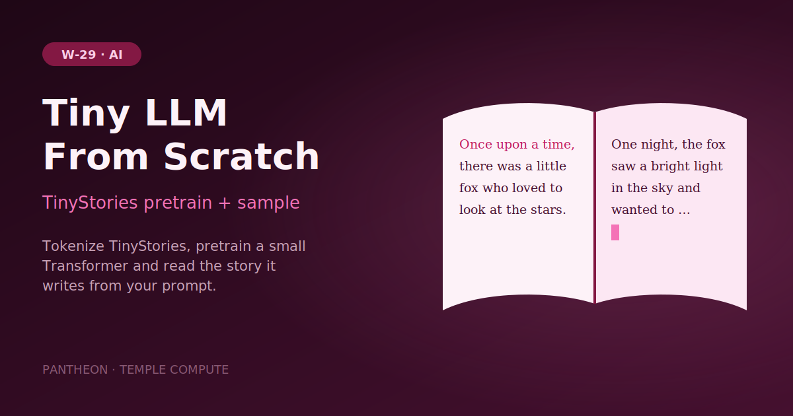

# W-29 · Tiny LLM From Scratch - TinyStories Pretrain & Sample


Pretrain a tiny decoder-only Transformer from scratch on TinyStories and sample a story from it, in minutes on a laptop.

 




## Overview

A fast, small-data companion to [W-28](../w01-train-llm/README.md): pretrains the same
from-scratch decoder-only Transformer, but on
[TinyStories](https://huggingface.co/datasets/roneneldan/TinyStories) (short, simple
GPT-generated children's stories, a couple hundred MB) instead of the Pile (~900GB). It exists
for people who want to see a from-scratch LLM learn something legible in minutes on a laptop,
without the Pile's disk/bandwidth requirements. It skips instruction tuning and eval entirely.
The deliverable is a pretrained checkpoint plus a sample generation proving it learned to
continue a story prompt.

## Pipeline

```
clone_repo (local)
   │
   ├─► prepare_tinystories_train / prepare_tinystories_val  ──► tinystories_{train,val}.h5
   │        └─► train_pretrain_tiny (local)                 ──► tinystories_pretrained.pt
   │                 └─► sample_story (local)                ──► tinystories_sample.txt
```

## Quick start

```bash
# Install uv if you don't have it
curl -LsSf https://astral.sh/uv/install.sh | sh

# Install the horus-runtime and plugins (one time)
uv sync
# or: pip install horus-runtime horus-environments

# Run the workflow
uv run horus run workflow.yaml
```

Outputs land under `workflow_results/`: `repo/` (the cloned training repo), `data/` (tokenized
TinyStories), `ckpts/tinystories_pretrained.pt` (checkpoint), and
`samples/tinystories_sample.txt` (a greedy continuation of "Once upon a time,").

## Tools & Dependencies

- [train-llm-from-scratch](https://github.com/FareedKhan-dev/train-llm-from-scratch) (cloned at
  runtime by `clone_repo`). Pure PyTorch, no `transformers`/`trl`/`peft`. Only
  `scripts/pretrain_base.py` and `scripts/chat.py` are used from it.
- [TinyStories](https://huggingface.co/datasets/roneneldan/TinyStories). Downloaded via the
  `datasets` library.
- `scripts/prepare_tinystories.py` (this workflow's own script, not from the cloned repo),
  tokenizes TinyStories with `tiktoken` into the same flat-token HDF5 layout
  (`data_loader/data_loader.py`'s `{"tokens": int32[N]}`) that `pretrain_base.py` expects.
  The cloned repo's own `scripts/prepare_pretrain_data.py` is hardcoded to the Pile, so this
  workflow can't reuse it directly.
- `torch`, `numpy`, `h5py`, `datasets`, `tiktoken`, provisioned via `conda_env.yaml`
  (micromamba) by the `conda_python_environment` ([horus-environments](https://github.com/temple-compute/horus-environments)) plugin executor.

## Horus Configuration

Every task runs `target: {kind: local}`, either on the bare `shell` executor (just `clone_repo`)
or the `conda_python_environment` executor. `prepare_tinystories_{train,val}` take `repo_dir` as an input purely to give
every task in this workflow one shared root (`clone_repo`), even though the tokenizer script
itself doesn't read from the checkout.

## Input / Output

**Input**: no files. Clones its own source repo (pinned to commit `bdd480a`) and downloads
TinyStories from Hugging Face; the knobs are typed value inputs, see Parameterization.

**Output**:
- `ckpts/tinystories_pretrained.pt`. Self-describing checkpoint (embeds the resolved model
  config, training step, and metrics).
- `logs/pretrain.jsonl`. One JSON record per logged training step.
- `samples/tinystories_sample.txt`. A greedy, raw (non-chat-template) continuation of
  "Once upon a time," from the trained model.

## Parameterization

| id | Kind | Default | Range | Meaning |
|---|---|---|---|---|
| `config_scale` | choice | `configs/smoke` | `configs/smoke`, `configs` | Smoke (`n_embed=128`, 2 blocks, 20 steps, CPU, minutes) or the repo's full 24-block, 50k-step config |
| `pretrain_steps` | number | 0 | 0–200000, step 10 | Pretraining optimizer steps; 0 keeps the config's value. Try 500 for a more legible tiny model |
| `train_docs` | number | 20000 | 1000–2200000, step 1000 | TinyStories training stories to tokenize (full split ~2.1M) |
| `val_docs` | number | 2000 | 100–22000, step 100 | Validation stories to tokenize |
| `prompt` | string | `Once upon a time,` | ≤ 500 chars | Opening the model continues in the sample |
| `max_new_tokens` | number | 200 | 8–1024, step 8 | Length of the sample story |

To change a value locally, edit its `value:` in `workflow.yaml`, then `rm -rf params/`:
Horus writes `params/<id>.txt` only when it is missing. Any other `PretrainConfig` field
(`config/post_training_config.py` in the cloned repo) can be overridden by adding
`--field value` to the `train_pretrain_tiny` command, e.g. `--lr 3e-4`.

## Running in Temple Compute

Start a campaign from the library: the form shows the scale choice, the step override, the
two dataset sliders and the prompt. Tokenizing carries CPU `resources` hints (4 CPU / 16 GB
for the train split), and training asks for one GPU (4 CPU, 16 GB, 24 h), so an
auto-provisioned target puts it on a single-GPU node. The smoke config pins `device: cpu`, so
at the default scale the GPU sits idle; it matters for `config_scale: configs`.

## Implementation Notes

- TinyStories tokens still use `tiktoken`'s `r50k_base` (50,257 vocab), matching the smoke
  config's `vocab_size=50304` (padded up) inherited from `configs/smoke/base.json`, no vocab
  mismatch with the cloned repo's model/tokenizer.
- `sample_story` uses `--raw` (base-model continuation) since this workflow never runs SFT: the
  checkpoint has no instruction-following behavior, only next-token continuation.

## References

- [train-llm-from-scratch](https://github.com/FareedKhan-dev/train-llm-from-scratch) — source
  repo cloned by this workflow.
- [TinyStories dataset](https://huggingface.co/datasets/roneneldan/TinyStories) ·
  [paper](https://arxiv.org/abs/2305.07759) — short, simple GPT-generated children's stories.
- [horus-runtime](https://github.com/temple-compute/horus-runtime) — workflow engine and plugin framework.
- [horus-environments](https://github.com/temple-compute/horus-environments) — horus plugin for conda-based Python environments.
