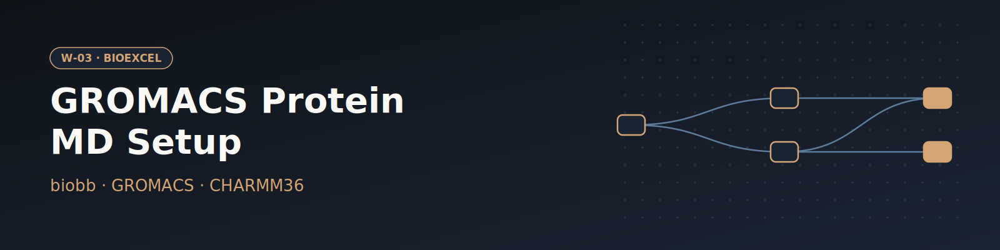

# W-03 · GROMACS Protein MD Setup


Set up and run a GROMACS MD simulation of a protein: fetch a PDB entry (or upload a structure), solvate, add ions, minimize, equilibrate and run production MD.




## Overview

This workflow runs a complete molecular dynamics setup for a protein (by default hen egg-white lysozyme, PDB 1AKI) using GROMACS and the CHARMM36 force field. Starting from the raw PDB file, it builds a topology, solvates the protein in a water box, adds neutralizing NaCl ions, energy-minimizes the system, runs NVT and NPT equilibration, and finishes with a free production MD simulation. Horus provisions the full GROMACS/biobb conda environment automatically for each stage and routes every task to the local machine — swapping any stage to a remote cluster is a one-line `target:` change.

## Pipeline

```
fetch_pdb          Download pdb_id (default 1AKI) or use the uploaded structure
   │
fix_side_chain     Model missing side-chain atoms (biobb_structure_utils)
   │
build_topology     Build GROMACS topology (pdb2gmx, CHARMM36)
   │
editconf           Define cubic simulation box
   │
solvate            Solvate box with SPC water
   │
grompp_ions ──► genion        Add neutralizing NaCl ions
   │
grompp_minimize ──► mdrun_minimize   Energy minimization (steepest descent)
   │
grompp_nvt ──► mdrun_nvt     NVT equilibration (restrained, 10 ps)
   │
grompp_npt ──► mdrun_npt     NPT equilibration (restrained, 10 ps)
   │
grompp_free ──► mdrun_free   Free production MD (100 ps)
   │
gmx_image          Re-center protein, fix periodic boundary conditions
   │
gmx_trjconv_str    Extract final dry protein structure
```

## Prerequisites

- **uv** (recommended) or pip — to install horus-runtime
- **micromamba**, **mamba**, or **conda** — the workflow executor builds a shared conda environment from `conda_env.yaml` to provision GROMACS and the biobb stack

## Quick Start

```bash
# Install uv if you don't have it
curl -LsSf https://astral.sh/uv/install.sh | sh

# From the workflow directory, install horus-runtime
cd workflows/bioexcel_building_blocks/w01-gromacs-md-setup
uv sync
# or: pip install horus-runtime horus-environments

# Run the workflow
uv run horus run workflow.yaml
```

The first run builds the conda environment (this takes a few minutes). Every task and later runs reuse that one environment at `workflow_results/.horus_conda_env`.

## Inputs

| id | Kind | Default | Range | Meaning |
|---|---|---|---|---|
| `pdb_id` | string | `1AKI` | PDB code or empty | RCSB PDB code to download (default 1AKI). Clear it to use the uploaded structure instead. |
| `structure` | file | `examples/1aki.pdb` | PDB | Structure used when PDB ID is empty. Default: examples/1aki.pdb (1AKI). |
| `box_padding_nm` | number | `1.0` | 0.5–3.0, step 0.1 | Minimum distance between the protein and the cubic box edge. |
| `ion_concentration_m` | number | `0` | 0–1, step 0.01 | Salt concentration added on top of the neutralizing ions; 0 only neutralizes. |
| `equilibration_steps` | number | `5000` | 500–5000000, step 500 | Steps of each restrained equilibration stage (2 fs per step; 5000 = 10 ps). |
| `production_steps` | number | `50000` | 1000–50000000, step 1000 | Steps of the free production run (2 fs per step; 50000 = 100 ps). |

`pdb_id` wins when set; clear it to run on the uploaded `structure`. Everything else (force field, water model, thermostat, restraints) stays in the biobb property files under `configs/`.

To change a value locally, edit its `value:` in `workflow.yaml`, then `rm -rf params/`: Horus writes `params/<id>.txt` only when it is missing and fingerprints that file for the skip check, so a stale file keeps the old value. In Temple Compute, set it in the campaign form.

## Inputs / Outputs

The structure comes from `pdb_id` (fetched from the RCSB) or, when that is empty, from the `structure` upload; see Inputs.

**Outputs** (all under `workflow_results/`):
- `results/downloaded.pdb` — raw PDB from RCSB
- `results/fixed.pdb` — PDB with modelled side chains
- `results/structure.gro`, `results/topol.top`, `results/posre.itp` — GROMACS topology
- `results/mdrun_nvt.trr`, `results/mdrun_npt.trr` — equilibration trajectories
- `results/mdrun_free.trr` — production MD trajectory
- `results/structure.dry.pdb` — final dry protein structure (solvent stripped)

## Configuration

Box padding, salt concentration and the step counts are workflow inputs (see Inputs) and are passed to biobb as inline JSON configs. The remaining config files in `configs/` control the other GROMACS `mdp` parameters (time step, temperature, pressure, restraints); edit them before running for expert changes.

## Running in Temple Compute

Import the workflow (or open it from the library) and start a campaign. The form shows the PDB ID, the structure upload (with a Mol* preview) and the simulation knobs above as sliders. The four `mdrun` tasks carry `resources` hints (8 CPU / 16 GB; walltime 30 min to 12 h), so an auto-provisioned target sizes a CPU node from them; the short biobb preparation steps run without hints on the orchestrator's default target. Expert settings (force field, thermostat, restraints) stay in `configs/*.yaml`, which also show up as editable file inputs.

## References

- [BioExcel Building Blocks (biobb)](https://github.com/bioexcel/biobb)
- [GROMACS](https://www.gromacs.org)
- [CHARMM36 force field](http://mackerell.umaryland.edu/charmm_ff.shtml)
- [BioExcel MD setup tutorial](https://biobb-wf-md-setup.readthedocs.io)
