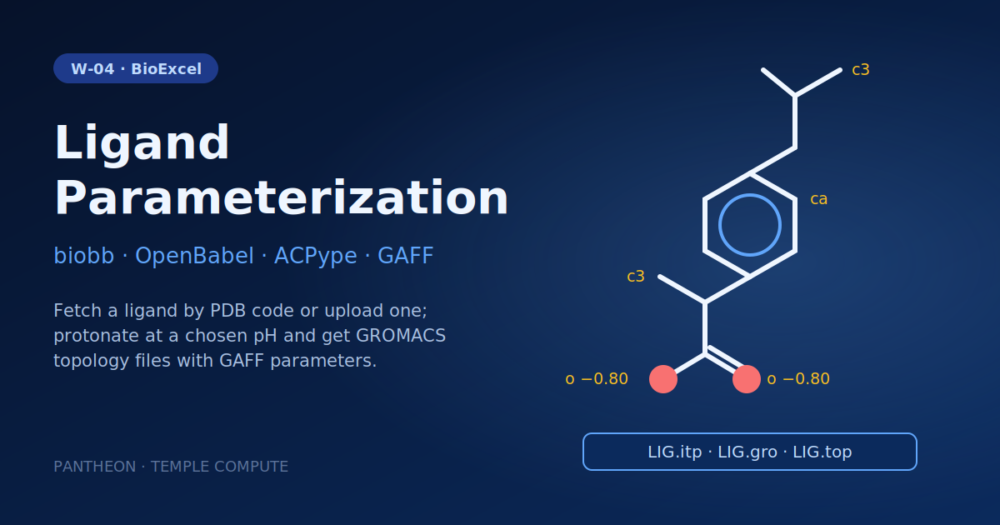

# W-04 · Ligand Parameterization (GAFF / ACPype)


GAFF force-field parameters for a small molecule, ready for GROMACS: give a PDB ligand code (or upload a ligand), set the pH and net charge, get .itp/.gro/.top files.




## Overview

This workflow generates GROMACS-compatible force-field parameters for a small-molecule ligand using the GAFF (General AMBER Force Field) via ACPype. Starting from a PDB ligand structure fetched by its PDB code (default IBP, ibuprofen) or uploaded, it adds hydrogens with OpenBabel, minimizes their positions energetically, then produces the `.gro`, `.itp`, and `.top` files needed to include the ligand in a GROMACS simulation. Horus provisions the biobb/OpenBabel/ACPype conda environment automatically and runs all stages locally.

## Pipeline

```
fetch_ligand       Fetch ligand_code from the PDB, or use the uploaded ligand
   │
add_hydrogens      Add hydrogen atoms at the chosen pH (OpenBabel)
   │
minimize_hydrogens Energetically minimize hydrogen positions (OpenBabel + GAFF)
   │
parameterize       Generate GROMACS force-field parameters (ACPype / GAFF)
                   → ligand.params.gro  ligand.params.itp  ligand.params.top
```

## Prerequisites

- **uv** (recommended) or pip — to install horus-runtime
- **micromamba**, **mamba**, or **conda** — the workflow executor builds a shared conda environment from `conda_env.yaml` to provision OpenBabel, ACPype, and the biobb stack

## Quick Start

```bash
# Install uv if you don't have it
curl -LsSf https://astral.sh/uv/install.sh | sh

# From the workflow directory, install horus-runtime
cd workflows/bioexcel_building_blocks/w02-ligand-parameterization
uv sync
# or: pip install horus-runtime horus-environments

# Run the workflow
uv run horus run workflow.yaml
```

The first run builds the conda environment (this takes a few minutes). Subsequent runs reuse the cached environment at `../.horus_conda_env`.

## Inputs

| id | Kind | Default | Range | Meaning |
|---|---|---|---|---|
| `ligand_code` | string | `IBP` | `([A-Za-z0-9]{1,3})?` | Three-character PDB Chemical Component code to download (default IBP, ibuprofen). Clear it to use the uploaded ligand instead. |
| `ligand` | file | `examples/ibp.pdb` | PDB | Ligand structure used when the ligand code is empty (heavy atoms are enough; hydrogens are added). Default: examples/ibp.pdb. |
| `ph` | number | `7.4` | 0–14, step 0.1 | pH at which OpenBabel adds hydrogens. |
| `net_charge` | number | `-1` | -5–5, step 1 | Formal net charge of the ligand at that pH, passed to ACPype (ibuprofen: -1). |

`ligand_code` wins when set; clear it to parameterize the uploaded `ligand`. Set `net_charge` to the formal charge of the ligand at the chosen pH: ACPype (AM1-BCC) fails or gives wrong charges otherwise.

To change a value locally, edit its `value:` in `workflow.yaml`, then `rm -rf params/`: Horus writes `params/<id>.txt` only when it is missing and fingerprints that file for the skip check, so a stale file keeps the old value. In Temple Compute, set it in the campaign form.

## Inputs / Outputs

The ligand comes from `ligand_code` or the `ligand` upload; see Inputs.

**Outputs** (all under `workflow_results/`):
- `results/ligand.pdb` — raw ligand structure from RCSB
- `results/ligand.H.mol2` — ligand with added hydrogens (MOL2 format)
- `results/ligand.H.min.pdb` — hydrogen-minimized ligand (PDB)
- `results/ligand.params.gro` — GROMACS structure file
- `results/ligand.params.itp` — GROMACS include topology (force-field parameters)
- `results/ligand.params.top` — GROMACS top file

## Configuration

Ligand, pH and net charge are workflow inputs, passed to biobb as inline JSON configs. `configs/minimize_h.yaml` controls the hydrogen minimization (force field, convergence criteria).

## Running in Temple Compute

Import the workflow (or open it from the library) and start a campaign: the form shows the ligand code, the ligand upload (with a Mol* preview), the pH and the net charge. Only the ACPype step carries a `resources` hint (2 CPU / 8 GB, 30 min); the whole workflow finishes in minutes on a small CPU node.

## References

- [BioExcel Building Blocks (biobb)](https://github.com/bioexcel/biobb)
- [ACPype](https://github.com/alanwilter/acpype)
- [OpenBabel](https://openbabel.org)
- [GAFF (General AMBER Force Field)](https://ambermd.org/antechamber/gaff.html)
- [BioExcel ligand parameterization tutorial](https://biobb-wf-ligand-parameterization.readthedocs.io)
