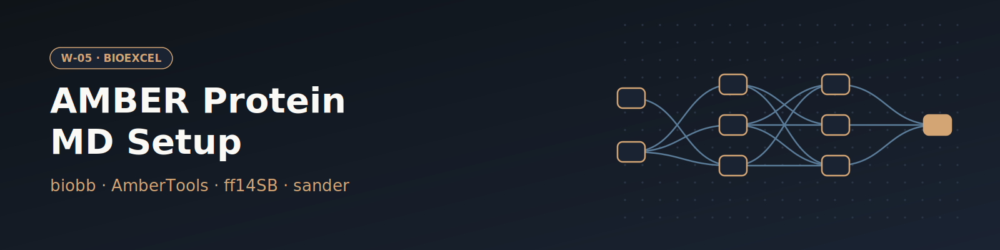

# W-05 · AMBER Protein MD Setup


Set up, run and analyze an AMBER MD simulation of a protein: fetch a PDB entry (or upload a structure), solvate in TIP3P, add NaCl, heat, equilibrate, run production with sander and analyze with cpptraj.




## Overview

This workflow runs a complete molecular dynamics setup and analysis for a protein (by default hen egg-white lysozyme, PDB 1AKI) using the AMBER toolchain (LEaP, sander, cpptraj) and the ff14SB + TIP3P force field. Starting from the raw PDB, it builds an AMBER topology, minimizes the structure in vacuo, solvates in a TIP3P water box, adds neutralizing ions, energy-minimizes the solvated system, heats from 0 to 300 K, runs NVT and NPT equilibration, and finishes with a free production MD simulation. Post-processing with cpptraj computes RMSd (vs. first snapshot and vs. the experimental structure), radius of gyration, and produces an imaged trajectory with solvent stripped. Horus provisions the full AMBER/biobb conda environment automatically for each stage.

## Pipeline

```
fetch_pdb              Download pdb_id (default 1AKI) or use the uploaded structure
   │
pdb4amber              Prepare PDB for AMBER (rename residues, strip waters)
   │
gen_top                Build AMBER topology and coordinates (LEaP, ff14SB)
   │                   → structure.leap.pdb / .top / .crd
   ├──► sander_h_min ──► process_h_min   Minimize hydrogens in vacuo; extract energy
   │
sander_n_min ──► process_n_min           Minimize full system in vacuo; extract energy
   │
amber_to_pdb           Convert minimized structure to PDB (ambpdb)
   │
leap_solvate           Solvate in TIP3P water box (LEaP)
   │
leap_add_ions          Neutralize and add NaCl (salt_mm, default 150 mM) (LEaP)
   │
sander_min ──► process_min               Energy minimize solvated system
   │
sander_heat ──► process_heat             Heat 0 → 300 K (NVT, 2 ns)
   │
sander_nvt ──► process_nvt               NVT equilibration at 300 K
   │
sander_npt ──► process_npt               NPT equilibration (pressure coupling)
   │
sander_free            Free production MD simulation
   │
   ├──► cpptraj_rms_first   RMSd vs. first trajectory snapshot
   ├──► cpptraj_rms_exp     RMSd vs. experimental crystal structure
   ├──► cpptraj_rgyr        Radius of gyration over trajectory
   └──► cpptraj_image       Image trajectory, strip solvent → .trr
```

## Prerequisites

- **uv** (recommended) or pip, to install horus-runtime and horus-environments.
- **micromamba**, **mamba**, or **conda**. The workflow executor builds a shared conda environment from `conda_env.yaml` for the biobb I/O and analysis steps
- **Docker**. The AMBER steps (pdb4amber, LEaP, sander) run in `quay.io/biocontainers/biobb_amber:5.2.1--py312hc5e4ab4_0`

## Quick Start

```bash
# Install uv if you don't have it
curl -LsSf https://astral.sh/uv/install.sh | sh

# From the workflow directory, install horus-runtime
cd workflows/bioexcel_building_blocks/w03-amber-md-setup
uv sync
# or: pip install horus-runtime horus-environments

# Run the workflow
uv run horus run workflow.yaml
```

The first run builds the conda environment (this takes a few minutes). Every task and later runs reuse that one environment at `workflow_results/.horus_conda_env`.

## Inputs

| id | Kind | Default | Range | Meaning |
|---|---|---|---|---|
| `pdb_id` | string | `1AKI` | PDB code or empty | RCSB PDB code to download (default 1AKI). Clear it to use the uploaded structure instead. |
| `structure` | file | `examples/1aki.pdb` | PDB | Structure used when PDB ID is empty. Default: examples/1aki.pdb (1AKI). |
| `box_padding_a` | number | `9.0` | 6–20, step 0.5 | Minimum distance between the solute and the edge of the truncated-octahedron TIP3P box. |
| `salt_mm` | number | `150` | 0–1000, step 10 | Ionic concentration added on top of the neutralizing ions. |
| `equilibration_steps` | number | `500` | 100–5000000, step 100 | sander steps of each restrained equilibration stage (2 fs per step; 500 = 1 ps). |
| `production_steps` | number | `2500` | 500–50000000, step 500 | sander steps of the free production run (2 fs per step; 2500 = 5 ps). |

`pdb_id` wins when set; clear it to run on the uploaded `structure`. Everything else (force field, restraints, heating protocol, cpptraj masks) stays in the biobb property files under `configs/`.

To change a value locally, edit its `value:` in `workflow.yaml`, then `rm -rf params/`: Horus writes `params/<id>.txt` only when it is missing and fingerprints that file for the skip check, so a stale file keeps the old value. In Temple Compute, set it in the campaign form.

## Inputs / Outputs

The structure comes from `pdb_id` (fetched from the RCSB) or, when that is empty, from the `structure` upload; see Inputs.

**Outputs** (all under `workflow_results/`):
- `results/downloaded.pdb` — raw PDB from RCSB
- `results/structure.leap.top`, `.crd` — AMBER topology and coordinates
- `results/structure.ions.parmtop`, `.crd` — solvated + ionized system
- `results/sander.free.netcdf` — production MD trajectory
- `results/1aki_rms_first.dat` — RMSd vs. first snapshot (per-frame)
- `results/1aki_rms_exp.dat` — RMSd vs. experimental structure (per-frame)
- `results/1aki_rgyr.dat` — radius of gyration (per-frame)
- `results/1aki_imaged_traj.trr` — imaged, solvent-stripped trajectory

## Configuration

Water padding, salt concentration and the step counts are workflow inputs (see Inputs), passed to biobb as inline JSON configs. The remaining config files in `configs/` control the other sander `mdin` parameters (restraints, heating, output frequency) and the cpptraj analysis options; edit them before running for expert changes.

## Running in Temple Compute

Import the workflow (or open it from the library) and start a campaign: the form shows the PDB ID, the structure upload (with a Mol* preview) and the simulation knobs as sliders. The sander tasks carry `resources` hints (2 CPU / 8 GB; 2 h per preparation stage, 24 h for production; serial sander uses one core), so an auto-provisioned target picks a small CPU node; the AMBER steps run in the `biobb_amber` Docker image, so the target needs Docker. Expert settings (restraints, thermostat, analysis masks) stay in `configs/*.yaml`, which also show up as editable file inputs.

## References

- [BioExcel Building Blocks (biobb)](https://github.com/bioexcel/biobb)
- [AMBER](https://ambermd.org)
- [ff14SB force field](https://pubs.acs.org/doi/10.1021/acs.jctc.5b00255)
- [BioExcel AMBER MD setup tutorial](https://biobb-wf-amber-md-setup.readthedocs.io)
