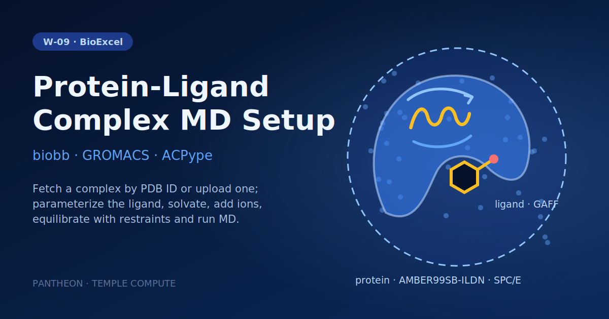

# W-09 · GROMACS Protein-Ligand Complex MD Setup


Set up and run GROMACS MD of a protein-ligand complex: fetch a complex by PDB ID (or upload one), name the ligand, and get a GAFF-parameterized, solvated, equilibrated system and a production trajectory.




## Overview

This workflow runs a complete molecular dynamics setup for a protein-ligand complex using GROMACS. The default is the **T4 lysozyme L99A/M102Q** protein (PDB: 3HTB) in complex with the small molecule **2-propylphenol** (ligand code JZ4). Starting from the raw PDB file, it splits the structure into protein and ligand, builds an AMBER99SB-ILDN topology for the protein and a GAFF/ACPype topology for the ligand, merges them into a single restrained complex, solvates and ionizes the system, energy-minimizes it, runs NVT/NPT equilibration, and finishes with a free production MD simulation. Horus provisions the full GROMACS/biobb conda environment (biobb_io, biobb_model, biobb_chemistry, biobb_gromacs, biobb_analysis, biobb_structure_utils) automatically for each stage and routes every task to the local machine — swapping any stage to a remote cluster is a one-line `target:` change.

## Pipeline

```
fetch_pdb                    Download pdb_id (default 3HTB) or use the uploaded complex
   │
   ├─ extract_heteroatoms     Extract the ligand_code ligand (biobb_structure_utils)
   │     │
   │  reduce_add_hydrogens    Add hydrogens to ligand (Reduce)
   │     │
   │  babel_minimize          Energetically minimize ligand hydrogens (OpenBabel GAFF)
   │     │
   │  acpype_params_gmx       Generate ligand GROMACS topology (ACPype / amberGAFF)
   │     │
   │  make_ndx_ligand ──► genrestr   Ligand position restraints (1000 kJ/mol·nm²)
   │
   └─ extract_molecule        Extract protein chain
         │
      fix_side_chain          Model missing side-chain atoms
         │
      pdb2gmx                 Build protein topology (amber99sb-ildn, SPC/E)
         │
trjconv_protein + trjconv_ligand   Convert GRO → PDB (with hydrogens)
         │
      cat_pdb_complex          Concatenate protein + ligand → complex structure
         │
      append_ligand             Merge ligand topology into protein topology
         │
      editconf                  Define truncated octahedron box (0.8 nm)
         │
      solvate                   Fill box with SPC water molecules
         │
grompp_ions ──► genion            Add neutralizing NaCl ions
         │
grompp_minimize ──► mdrun_minimize ──► gmx_energy_min   Energy minimization (steepest descent)
         │
      make_ndx_complex           Index file for protein-ligand complex group
         │
grompp_nvt ──► mdrun_nvt ──► gmx_energy_nvt   NVT equilibration (restrained)
         │
grompp_npt ──► mdrun_npt ──► gmx_energy_npt   NPT equilibration (restrained)
         │
grompp_free ──► mdrun_free        Free production MD (50 ps, unrestrained)
         │
gmx_rms_first / gmx_rms_exp / gmx_rgyr   RMSd (vs minimized & experimental) and radius of gyration
         │
gmx_image                          Center complex, strip periodic-boundary artifacts
         │
gmx_trjconv_str_dry                Extract final dry protein-ligand structure
```

## Prerequisites

- **uv** (recommended) or pip — to install horus-runtime
- **micromamba**, **mamba**, or **conda** — the workflow executor builds a shared conda environment from `conda_env.yaml` to provision GROMACS and the biobb stack

## Quick Start

```bash
# Install uv if you don't have it
curl -LsSf https://astral.sh/uv/install.sh | sh

# From the workflow directory, install horus-runtime
cd workflows/bioexcel_building_blocks/w04-gromacs-protein-ligand-complex-md-setup
uv sync
# or: pip install horus-runtime horus-environments

# Run the workflow
uv run horus run workflow.yaml
```

The first run builds the conda environment (this takes a few minutes). Subsequent runs reuse the cached environment at `../.horus_conda_env`.

## Inputs

| id | Kind | Default | Range | Meaning |
|---|---|---|---|---|
| `pdb_id` | string | `3HTB` | PDB code or empty | RCSB PDB code to download (default 3HTB). Clear it to use the uploaded structure instead. |
| `structure` | file | `examples/3htb.pdb` | PDB | Protein-ligand complex used when PDB ID is empty; must contain the ligand as HETATM records with the residue name given in Ligand code. Default: examples/3htb.pdb (3HTB). |
| `ligand_code` | string | `JZ4` | `[A-Za-z0-9]{1,3}` | Residue name of the ligand in the structure (default JZ4); it is extracted, parameterized with GAFF and restrained during equilibration. |
| `ligand_charge` | number | `0` | -5–5, step 1 | Formal net charge of the ligand, passed to ACPype (JZ4: 0). |
| `equilibration_steps` | number | `5000` | 500–5000000, step 500 | Steps of each restrained equilibration stage (2 fs per step; 5000 = 10 ps). |
| `production_steps` | number | `25000` | 1000–50000000, step 1000 | Steps of the free production run (2 fs per step; 25000 = 50 ps). |

`pdb_id` wins when set; clear it to run on the uploaded `structure`. `ligand_code` must match the ligand's residue name in that structure: it selects the heteroatoms to extract, names the ligand position restraints (`POSRES_<code>`) and switches them on in NVT/NPT. Set `ligand_charge` to its formal charge.

To change a value locally, edit its `value:` in `workflow.yaml`, then `rm -rf params/`: Horus writes `params/<id>.txt` only when it is missing and fingerprints that file for the skip check, so a stale file keeps the old value. In Temple Compute, set it in the campaign form.

## Inputs / Outputs

The complex comes from `pdb_id` (fetched from the RCSB) or, when that is empty, from the `structure` upload; the protein and the `ligand_code` ligand are both extracted from it. See Inputs.

**Outputs** (all under `workflow_results/results/`):
- `downloaded.pdb`, `ligand.pdb`, `protein.pdb`, `fixed.pdb` — fetched and split structures
- `pdb2gmx.gro`, `pdb2gmx_top.zip` — protein topology
- `ligand.params.gro`, `ligand.params.itp`, `ligand.params.top` — ligand (GAFF) topology
- `ligand_posres.itp` — ligand position restraints
- `complex_H.pdb`, `complex_top.zip` — merged protein-ligand complex and topology
- `ionized.gro`, `ionized_top.zip` — solvated, neutralized system
- `min_energy.xvg`, `nvt_temp.xvg`, `npt_PD.xvg` — energy/temperature/pressure-density traces
- `md.gro`, `md.trr` — free production MD trajectory
- `rms_first.xvg`, `rms_exp.xvg`, `rgyr.xvg` — analysis (RMSd, radius of gyration)
- `dry.gro` — final dry protein-ligand structure (solvent stripped)

## Configuration

- PDB ID, ligand code and charge, and the NVT/NPT/production step counts are workflow inputs (see Inputs), passed to biobb as inline JSON configs
- `configs/pdb2gmx.yaml` — protein force field and water model
- `configs/babel_minimize.yaml`, `configs/reduce_add_hydrogens.yaml` — ligand hydrogens and minimization
- `configs/editconf.yaml`, `configs/genion.yaml`, `configs/genrestr.yaml` — box geometry, ion concentration, restraint force constants
- `configs/grompp_minimize.yaml`, `configs/grompp_ions.yaml` — minimization and ion-step `mdp` parameters

## Running in Temple Compute

Import the workflow (or open it from the library) and start a campaign: the form shows the PDB ID, the complex upload (with a Mol* preview), the ligand code and charge, and the step counts as sliders. ACPype and the four `mdrun` tasks carry `resources` hints (2 CPU / 8 GB for ACPype; 8 CPU / 16 GB and 30 min to 12 h for MD), so an auto-provisioned target sizes a CPU node from them. Expert settings (force field, box, ions, restraints, analysis groups) stay in `configs/*.yaml`, which also show up as editable file inputs.

## References

- [BioExcel Building Blocks (biobb)](https://github.com/bioexcel/biobb)
- [GROMACS](https://www.gromacs.org)
- [ACPype](https://github.com/alanwilter/acpype)
- [Official GROMACS protein-ligand complex tutorial](http://www.mdtutorials.com/gmx/complex/index.html)
- [BioExcel protein-ligand complex MD setup tutorial](https://biobb-wf-protein-complex-md-setup.readthedocs.io)
