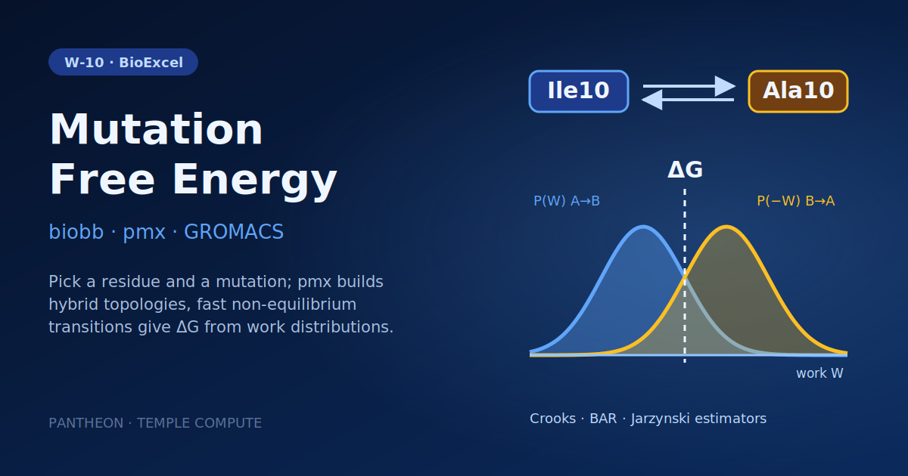

# W-10 · Mutation Free Energy (pmx, non-equilibrium TI)


Alchemical free energy of a point mutation with pmx and GROMACS: from wild-type and mutant equilibrium trajectories, run fast non-equilibrium transitions both ways and estimate ΔG with Crooks, BAR and Jarzynski.




## Overview

This workflow computes a **fast-growth non-equilibrium mutation free energy** (ΔΔG) using GROMACS and **pmx**, by default on the Staphylococcal nuclease protein (PDB: 1STN), mutating residue Ile10 to Ala (and back); the residue and both residue types are workflow inputs. Starting from pre-equilibrated wild-type (stateA) and mutant (stateB) trajectories, it models the alchemical hybrid structure and topology for each state, minimizes and equilibrates the dummy atoms introduced by the mutation, runs fast thermodynamic-integration (TI) transitions in both directions (WT→Mut and Mut→WT), and estimates the free-energy difference from the accumulated dHdl work values using the Crooks Gaussian Intersection (CGI), BAR, and Jarzynski estimators. Horus provisions the GROMACS/pmx/biobb conda environment automatically and runs all stages locally.

## Pipeline

```
gmx_trjconv_str_ens_stateA    Extract snapshots from WT (stateA) equilibrium trajectory
gmx_trjconv_str_ens_stateB    Extract snapshots from Mutant (stateB) equilibrium trajectory
   │
pmxmutate_stateA               Model stateA mutated structure (wt → mut, e.g. Ile10 → Ala)
pmxmutate_stateB               Model stateB mutated structure (mut → wt, e.g. Ala10 → Ile)
   │
pdb2gmx_stateA / pdb2gmx_stateB      Build GROMACS topology per state (pdb2gmx)
   │
pmxgentop_stateA / pmxgentop_stateB   Generate hybrid dual-topology parameters (pmxgentop)
   │
make_ndx_stateB                 Create FREEZE index for stateB dummy atoms (make_ndx)
   │
grompp_min_stateB ──► mdrun_min_stateB ──► gmx_energy_min_stateB   Minimize stateB dummy atoms
   │
grompp_eq_stateA ──► mdrun_eq_stateA ──► gmx_energy_eq_stateA      NPT equilibration, stateA
grompp_eq_stateB ──► mdrun_eq_stateB ──► gmx_energy_eq_stateB      NPT equilibration, stateB
   │
grompp_ti_stateA ──► mdrun_ti_stateA    Fast thermodynamic integration, WT→Mut
grompp_ti_stateB ──► mdrun_ti_stateB    Fast thermodynamic integration, Mut→WT
   │
pmxanalyse                      Compute ΔΔG (CGI / BAR / Jarzynski) from dhdl work values
```

## Prerequisites

- **uv** (recommended) or pip — to install horus-runtime
- **micromamba**, **mamba**, or **conda** — the workflow executor builds a shared conda environment from `conda_env.yaml` to provision GROMACS, pmx, and the biobb stack

## Quick Start

```bash
# Install uv if you don't have it
curl -LsSf https://astral.sh/uv/install.sh | sh

# From the workflow directory, install horus-runtime
cd workflows/bioexcel_building_blocks/w05-mutation-free-energy-calculations
uv sync
# or: pip install horus-runtime horus-environments

# Run the workflow
uv run horus run workflow.yaml
```

The first run builds the conda environment (this takes a few minutes). Every task and later runs reuse that one environment at `workflow_results/.horus_conda_env`.

## Inputs

| id | Kind | Default | Range | Meaning |
|---|---|---|---|---|
| `mutation_resnum` | number | `10` | 1–10000, step 1 | Residue number to mutate, as numbered in the input structures (default 10). |
| `wt_residue` | choice | `Ile` | 20 options (`Ala` … `Val`) | Residue in state A (wild type); the reverse transition in state B mutates back to it. |
| `mut_residue` | choice | `Ala` | 20 options (`Ala` … `Val`) | Residue in state B (mutant); the forward transition in state A mutates to it. |
| `frame_interval_ps` | number | `200` | 20–1000, step 20 | Spacing of the snapshots taken from each 1 ns equilibrium trajectory; each snapshot seeds one non-equilibrium transition (200 ps = 5 per state). |
| `stateA_tpr` | file | `pmx_tutorial/stateA.tpr` | TPR | GROMACS run input (tpr) file for the wild-type (stateA) equilibrium trajectory. |
| `stateA_traj` | file | `pmx_tutorial/stateA_1ns.xtc` | XTC | Pre-equilibrated wild-type (stateA) trajectory (xtc). |
| `stateB_tpr` | file | `pmx_tutorial/stateB.tpr` | TPR | GROMACS run input (tpr) file for the mutant (stateB) equilibrium trajectory. |
| `stateB_traj` | file | `pmx_tutorial/stateB_1ns.xtc` | XTC | Pre-equilibrated mutant (stateB) trajectory (xtc). |
| `dhdlA_zip` | file | `pmx_tutorial/dhdlA.zip` | ZIP | Bundle of pre-computed replicate dHdl work curves for the WT to Mut transition, used by the CGI, BAR, and Jarzynski estimators. |
| `dhdlB_zip` | file | `pmx_tutorial/dhdlB.zip` | ZIP | Bundle of pre-computed replicate dHdl work curves for the Mut to WT transition, used by the CGI, BAR, and Jarzynski estimators. |

The mutation must match the structures: state A (`stateA_tpr` / `stateA_traj`) is the wild type with `wt_residue` at `mutation_resnum`, state B the mutant with `mut_residue` there. For a new mutation, upload your own 1 ns equilibrium runs of both states. The defaults are the pmx tutorial runs (Staphylococcal nuclease, Ile10Ala). **Limitation:** the final `pmxanalyse` estimate is computed from `dhdlA_zip`/`dhdlB_zip`, the pmx tutorial's precomputed work values for Ile10Ala, not from this run's own transitions (each state runs one illustrative transition). Changing the mutation changes the modelled structures and the TI runs, but the reported ΔG stays the tutorial's until you upload dHdl bundles from your own transitions. Running one transition per snapshot as a `horus_map` and analysing those is the planned fix.

To change a value locally, edit its `value:` in `workflow.yaml`, then `rm -rf params/`: Horus writes `params/<id>.txt` only when it is missing and fingerprints that file for the skip check, so a stale file keeps the old value. In Temple Compute, set it in the campaign form.

## Inputs / Outputs

**Inputs** — pre-generated equilibrium trajectories bundled in `pmx_tutorial/`: `stateA_1ns.xtc`/`stateA.tpr` (wild type) and `stateB_1ns.xtc`/`stateB.tpr` (mutant). The final `pmxanalyse` step also reads `pmx_tutorial/dhdlA.zip` and `pmx_tutorial/dhdlB.zip` — bundles of many pre-computed replicate dHdl curves, since the CGI/BAR/Jarzynski estimators need dozens of independent transitions to converge (the single `tiA_dhdl.xvg`/`tiB_dhdl.xvg` this workflow's own `mdrun_ti_stateA`/`mdrun_ti_stateB` steps produce are illustrative of the method, not the statistical sample analyzed).

**Outputs** (all under `workflow_results/results/`):
- `mutA.pdb`, `mutB.pdb` — modelled mutant structures per state
- `pmxA_top.zip`, `pmxB_top.zip` — hybrid dual-topology files
- `eqoutA.gro`, `eqoutB.gro` — equilibrated structures per state
- `tiA.gro`, `tiA_dhdl.xvg` / `tiB.gro`, `tiB_dhdl.xvg` — TI run outputs per direction
- `pmx.txt` — computed free energy estimate and statistics
- `pmx.plots.png` — work-distribution and convergence plots

## Configuration

- the mutation and the frame spacing are workflow inputs (see Inputs), passed to biobb as inline JSON configs (force field: amber99sb-star-ildn-mut)
- `configs/pdb2gmx_stateA.yaml`, `configs/pdb2gmx_stateB.yaml` — protein topology settings per state
- `configs/grompp_min_stateB.yaml`, `configs/grompp_eq_stateA.yaml`, `configs/grompp_eq_stateB.yaml`, `configs/grompp_ti_stateA.yaml`, `configs/grompp_ti_stateB.yaml` — GROMACS `mdp` parameters for each minimization/equilibration/TI run
- `configs/pmxanalyse.yaml` — free-energy estimator selection and analysis options

## Running in Temple Compute

Import the workflow (or open it from the library) and start a campaign: the form shows the mutation (residue number, wild-type and mutant residue as selects), the frame spacing, and the four equilibrium inputs as uploads. The `mdrun` tasks carry `resources` hints (8 CPU / 16 GB; 1–6 h), so an auto-provisioned target sizes a CPU node from them; the pmx steps run in the `biobb_pmx` Docker image, so the target needs Docker.

## References

- [BioExcel Building Blocks (biobb)](https://github.com/bioexcel/biobb)
- [biobb_pmx](https://github.com/bioexcel/biobb_pmx)
- [pmx](https://github.com/deGrootLab/pmx)
- [Official pmx Sardinia 2018 tutorial](http://pmx.mpibpc.mpg.de/sardinia2018_tutorial1/index.html)
- [BioExcel mutation free energy tutorial](https://biobb-wf-pmx-tutorial.readthedocs.io)
