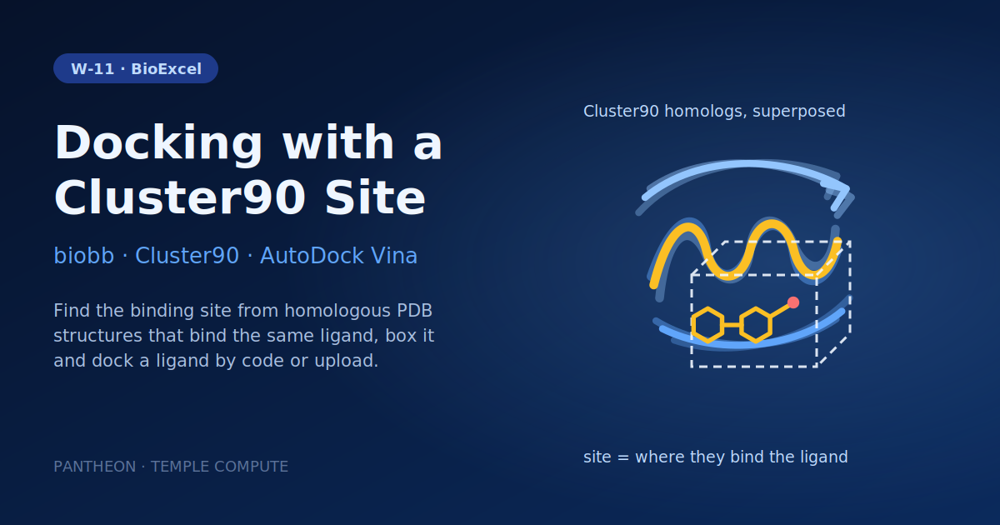

# W-11 · Protein-Ligand Docking with a Cluster90 Binding Site


Dock a ligand into a receptor whose binding site is inferred from PDB Cluster90 homologs that bind a chosen ligand: give a PDB ID and a site ligand, dock a ligand by code or SDF upload with AutoDock Vina.




## Overview

This workflow performs structure-based virtual screening of a single ligand against a protein target using **AutoDock Vina**, locating the docking box from a **PDB Cluster90** sequence-cluster analysis of known co-crystallized ligands. The target is **p38-α MAP kinase** (PDB: 3HEC) and the ligand is the FDA-approved kinase inhibitor **Imatinib** (PDB ligand code STI). The workflow downloads the receptor and a Cluster90 collection of homologous structures, infers the binding site from where ligands cluster across those homologs, builds a docking box around it, prepares both receptor and ligand as PDBQT, runs the docking, and assembles the top pose back into a full protein-ligand complex. Horus provisions the biobb/OpenBabel/AutoDock Vina conda environment automatically and runs all stages locally.

## Pipeline

```
create_results_folder      Create results folder
   │
fetch_pdb                   Download pdb_id (default 3HEC) from the PDB
   │
   ├─ extract_molecule       Extract protein structure from downloaded PDB
   │
   └─ pdb_cluster_zip        Download the PDB Cluster90 collection for pdb_id
         │
      bindingsite             Extract binding site from Cluster90 collection
         │
      box                     Generate cavity box around binding site
         │
ideal_sdf                   Download ligand_code (default STI, imatinib) as SDF, or use the upload
   │
babel_convert_sdf2pdb        Convert small molecule from SDF to PDB format
   │
babel_convert_pdb2pdbqt      Prepare ligand for docking (PDB → PDBQT)
   │
str_check_add_hydrogens      Prepare receptor protein for docking (PDB → PDBQT)
   │
autodock_vina_run            Run AutoDock Vina docking
   │
extract_model_pdbqt          Extract top docking pose from Vina output
   │
babel_convert_pdbqt2pdb      Convert docking pose from PDBQT to PDB format
   │
cat_pdb                      Combine protein and docked ligand into final structure
```

## Prerequisites

- **uv** (recommended) or pip — to install horus-runtime
- **micromamba**, **mamba**, or **conda** — the workflow executor builds a shared conda environment from `conda_env.yaml` to provision AutoDock Vina, OpenBabel, and the biobb stack

## Quick Start

```bash
# Install uv if you don't have it
curl -LsSf https://astral.sh/uv/install.sh | sh

# From the workflow directory, install horus-runtime
cd workflows/bioexcel_building_blocks/w06-protein-ligand-docking-cluster90
uv sync
# or: pip install horus-runtime horus-environments

# Run the workflow
uv run horus run workflow.yaml
```

The first run builds the conda environment (this takes a few minutes). Every task and later runs reuse that one environment at `workflow_results/.horus_conda_env`.

## Inputs

| id | Kind | Default | Range | Meaning |
|---|---|---|---|---|
| `pdb_id` | string | `3HEC` | PDB code or empty | RCSB PDB code of the receptor (default 3HEC, p38 MAP kinase). Required: the binding site is inferred from the PDB Cluster90 homologs of this entry. |
| `site_ligand` | string | `STI` | `[A-Za-z0-9]{1,3}` | Ligand whose binding pose in the Cluster90 homologs defines the binding site (default STI, imatinib). |
| `ligand_code` | string | `STI` | `([A-Za-z0-9]{1,3})?` | PDB Chemical Component code of the ligand to dock, downloaded as an idealized SDF (default STI, imatinib). Clear it to dock the uploaded ligand instead. |
| `ligand_sdf` | file | `examples/sti_ideal.sdf` | SDF | 3D ligand structure used when the ligand code is empty. Default: examples/sti_ideal.sdf (imatinib). |
| `box_offset_a` | number | `12` | 2–30, step 1 | Extra space added around the binding site on each side of the docking box. |

The receptor must be a PDB entry: the Cluster90 collection and the binding site are looked up by `pdb_id`, so there is no receptor upload here (W-13 takes an uploaded receptor). `site_ligand` must bind at least one Cluster90 homolog of that entry. `ligand_code` wins when set; clear it to dock the uploaded `ligand_sdf` (any 3D SDF; it is converted to PDBQT with OpenBabel).

To change a value locally, edit its `value:` in `workflow.yaml`, then `rm -rf params/`: Horus writes `params/<id>.txt` only when it is missing and fingerprints that file for the skip check, so a stale file keeps the old value. In Temple Compute, set it in the campaign form.

## Inputs / Outputs

By default it fetches the 3HEC receptor, its PDB Cluster90 collection and the imatinib (STI) ligand; see Inputs to change them or upload a ligand.

**Outputs** (all under `workflow_results/results/`):
- `download.pdb`, `pdb_protein.pdb` — fetched receptor structure
- `pdb_cluster.zip` — PDB Cluster90 collection used to locate the binding site
- `bindingsite.pdb`, `box.pdb` — inferred binding site and docking box
- `ideal.sdf`, `ligand.pdb`, `prep_ligand.pdbqt` — ligand structure and docking-ready PDBQT
- `prep_receptor.pdbqt` — docking-ready receptor PDBQT
- `output_vina.pdbqt`, `output_vina.log` — all Vina docking poses and scores
- `output_model.pdbqt`, `output_model.pdb` — top-ranked pose
- `output_structure.pdb` — final assembled protein-ligand complex

## Configuration

- PDB ID, site ligand, docking ligand and box padding are workflow inputs (see Inputs), passed to biobb as inline JSON configs (Cluster90 threshold 90%, BLOSUM62 alignment)
- `configs/babel_convert_sdf2pdb.yaml`, `configs/babel_convert_pdb2pdbqt.yaml`, `configs/babel_convert_pdbqt2pdb.yaml` — OpenBabel format conversion options
- `configs/str_check_add_hydrogens.yaml` — receptor protonation settings
- `configs/extract_model_pdbqt.yaml` — which Vina pose to extract

## Running in Temple Compute

Import the workflow (or open it from the library) and start a campaign: the form shows the receptor PDB ID, the site ligand, the ligand code or SDF upload (with a Mol* preview) and the box padding. AutoDock Vina carries a `resources` hint (8 CPU / 16 GB, 2 h), so an auto-provisioned target picks an 8-core node; the other steps take seconds. Several steps run in the `biobb_vs` Docker image, so the target needs Docker. Expert settings (OpenBabel conversions, protonation, pose to extract) stay in `configs/*.yaml`, which also show up as editable file inputs.

## References

- [BioExcel Building Blocks (biobb)](https://github.com/bioexcel/biobb)
- [biobb_vs](https://github.com/bioexcel/biobb_vs)
- [AutoDock Vina](https://vina.scripps.edu)
- [OpenBabel](https://openbabel.org)
- [BioExcel protein-ligand docking tutorial (Cluster90 variant)](https://biobb-wf-virtual-screening.readthedocs.io)
