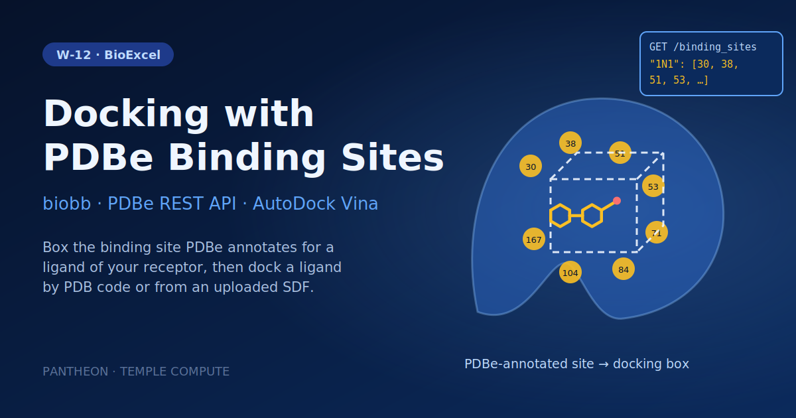

# W-12 · Protein-Ligand Docking with PDBe Binding Sites


Dock a ligand into the binding site PDBe annotates for a chosen ligand of your receptor: give a PDB ID and a site ligand, dock a ligand by code or SDF upload with AutoDock Vina.




## Overview

This workflow performs structure-based virtual screening of a single ligand against a protein target using **AutoDock Vina**, locating the docking box by querying the **PDBe REST API** for known ligand-binding sites instead of computing one locally. The target is **p38-α MAP kinase** (PDB: 3LFA) and the ligand is the kinase inhibitor **Dasatinib** (PDB ligand code 1N1). The workflow downloads the receptor, queries PDBe for its annotated binding sites, builds a docking box around the selected cavity, prepares both receptor and ligand as PDBQT, runs the docking, and assembles the top pose back into a full protein-ligand complex. Horus provisions the biobb/OpenBabel/AutoDock Vina conda environment automatically and runs all stages locally.

## Pipeline

```
download_pdb                Download pdb_id (default 3LFA) from the PDB (protein + ligand complex)
   │
   ├─ extract_protein         Extract protein chain (remove ligands, water, ions)
   │
   ├─ get_binding_sites       Query PDBe REST-API for binding sites (residues.json)
   │
   ├─ select_binding_site     Pick the PDBe site of site_ligand (scripts/select_site.py)
   │
   └─ generate_cavity_box     Generate docking box around those residues
         │
download_ligand_sdf          Download ligand_code (default 1N1, dasatinib) as SDF, or use the upload
   │
convert_sdf_to_pdb            Convert ligand SDF to PDB format (OpenBabel)
   │
prepare_ligand_pdbqt          Convert ligand PDB to PDBQT for AutoDock Vina (OpenBabel)
   │
prepare_receptor_pdbqt        Add hydrogens and convert receptor to PDBQT
   │
run_docking                   Run AutoDock Vina protein-ligand docking
   │
extract_docking_pose          Extract best docking pose (model 1) from Vina output
   │
convert_pose_to_pdb           Convert docking pose PDBQT to PDB format (OpenBabel)
   │
assemble_complex              Merge receptor and docking pose into final complex PDB
```

## Prerequisites

- **uv** (recommended) or pip — to install horus-runtime
- **micromamba**, **mamba**, or **conda** — the workflow executor builds a shared conda environment from `conda_env.yaml` to provision AutoDock Vina, OpenBabel, and the biobb stack

## Quick Start

```bash
# Install uv if you don't have it
curl -LsSf https://astral.sh/uv/install.sh | sh

# From the workflow directory, install horus-runtime
cd workflows/bioexcel_building_blocks/w07-protein-ligand-docking-pdbe-rest-api
uv sync
# or: pip install horus-runtime horus-environments

# Run the workflow
uv run horus run workflow.yaml
```

The first run builds the conda environment (this takes a few minutes). Every task and later runs reuse that one environment at `workflow_results/.horus_conda_env`.

## Inputs

| id | Kind | Default | Range | Meaning |
|---|---|---|---|---|
| `pdb_id` | string | `3LFA` | PDB code or empty | RCSB PDB code of the receptor (default 3LFA, p38 MAP kinase). Required: the binding sites come from the PDBe annotations of this entry. |
| `site_ligand` | string | `1N1` | `[A-Za-z0-9]{1,3}` | Ligand whose PDBe-annotated binding site defines the docking box (default 1N1, dasatinib); the run fails with the list of available sites if this entry has none for it. |
| `ligand_code` | string | `1N1` | `([A-Za-z0-9]{1,3})?` | PDB Chemical Component code of the ligand to dock, downloaded as an idealized SDF (default 1N1, dasatinib). Clear it to dock the uploaded ligand instead. |
| `ligand_sdf` | file | `examples/1n1_ideal.sdf` | SDF | 3D ligand structure used when the ligand code is empty. Default: examples/1n1_ideal.sdf (dasatinib). |
| `box_offset_a` | number | `12` | 2–30, step 1 | Extra space added around the binding-site residues on each side of the docking box. |

The receptor must be a PDB entry: its binding sites come from the PDBe REST API by `pdb_id`, so there is no receptor upload here (W-13 takes an uploaded receptor). `select_binding_site` picks the PDBe site of `site_ligand` from `residues.json`; when the entry has none for it, the run stops and lists the ligands it does have sites for. `ligand_code` wins when set; clear it to dock the uploaded `ligand_sdf` (any 3D SDF; it is converted to PDBQT with OpenBabel).

To change a value locally, edit its `value:` in `workflow.yaml`, then `rm -rf params/`: Horus writes `params/<id>.txt` only when it is missing and fingerprints that file for the skip check, so a stale file keeps the old value. In Temple Compute, set it in the campaign form.

## Inputs / Outputs

By default it fetches the 3LFA receptor and the dasatinib (1N1) ligand and queries the PDBe REST API for binding-site annotations; see Inputs to change them or upload a ligand.

The original tutorial picks the binding-site residues by hand after a first pass. Here `select_binding_site` (`scripts/select_site.py`, stdlib, `--selftest`) takes the site of `site_ligand` from `residues.json` and writes the `box_residues` config, so the workflow runs in one pass.

**Outputs** (all under `workflow_results/results/`):
- `download.pdb`, `pdb_protein.pdb` — fetched receptor structure
- `residues.json` — PDBe-annotated binding sites for 3LFA
- `box.pdb` — docking box around the selected cavity
- `ideal.sdf`, `ligand.pdb`, `prep_ligand.pdbqt` — ligand structure and docking-ready PDBQT
- `prep_receptor.pdbqt` — docking-ready receptor PDBQT
- `output_vina.pdbqt`, `output_vina.log` — all Vina docking poses and scores
- `output_model.pdbqt`, `output_model.pdb` — top-ranked pose
- `output_structure.pdb` — final assembled protein-ligand complex

## Configuration

- PDB ID, site ligand, docking ligand and box padding are workflow inputs (see Inputs); the residue list comes from `select_binding_site`
- `configs/convert_sdf_to_pdb.yaml`, `configs/prepare_ligand_pdbqt.yaml`, `configs/convert_pose_to_pdb.yaml` — OpenBabel format conversion options
- `configs/prepare_receptor_pdbqt.yaml` — receptor protonation settings
- `configs/extract_docking_pose.yaml` — which Vina pose to extract

## Running in Temple Compute

Import the workflow (or open it from the library) and start a campaign: the form shows the receptor PDB ID, the site ligand, the ligand code or SDF upload (with a Mol* preview) and the box padding. AutoDock Vina carries a `resources` hint (8 CPU / 16 GB, 2 h), so an auto-provisioned target picks an 8-core node; the other steps take seconds. Several steps run in the `biobb_vs` Docker image, so the target needs Docker. Expert settings (OpenBabel conversions, protonation, pose to extract) stay in `configs/*.yaml`, which also show up as editable file inputs.

## References

- [BioExcel Building Blocks (biobb)](https://github.com/bioexcel/biobb)
- [biobb_vs](https://github.com/bioexcel/biobb_vs)
- [AutoDock Vina](https://vina.scripps.edu)
- [PDBe REST API](https://www.ebi.ac.uk/pdbe/pdbe-rest-api)
- [BioExcel protein-ligand docking tutorial (PDBe REST-API variant)](https://biobb-wf-virtual-screening.readthedocs.io)
