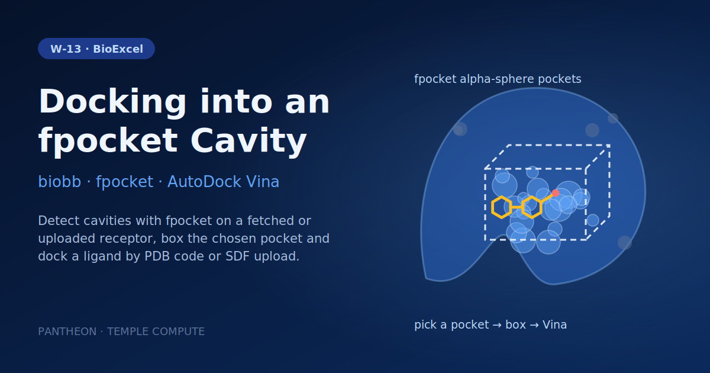

# W-13 · Protein-Ligand Docking into an fpocket Cavity


Dock a ligand into a cavity found by fpocket: fetch a receptor by PDB ID (or upload one), pick a pocket, dock a ligand by code or SDF upload with AutoDock Vina.




## Overview

This workflow performs structure-based virtual screening of a single ligand against a protein target using **AutoDock Vina**, locating the docking box by computing candidate cavities directly on the receptor with **fpocket** instead of relying on homolog clustering or external annotations. The target is **p38-α MAP kinase** (PDB: 3HEC) and the ligand is the FDA-approved kinase inhibitor **Imatinib** (PDB ligand code STI). The workflow downloads the receptor, runs fpocket to detect all cavities, filters them by volume and selects the target pocket, builds a docking box around it, prepares both receptor and ligand as PDBQT, runs the docking, and superposes the top pose onto the receptor. Horus provisions the biobb/OpenBabel/fpocket/AutoDock Vina conda environment automatically and runs all stages locally.

## Pipeline

```
fetch_pdb                    Download pdb_id (default 3HEC) or use the uploaded receptor
   │
extract_protein               Extract protein structure (remove ligands, ions, water)
   │
   ├─ fpocket_run              Compute protein cavities with fpocket
   │     │
   │  fpocket_filter           Filter cavities by volume (800-2000 ų)
   │     │
   │  fpocket_select           Extract the selected pocket (pocket, default 6)
   │     │
   │  box                      Generate docking box around cavity (offset 12 Å)
   │
   └─ str_check_add_hydrogens  Prepare receptor protein for docking (PDB → PDBQT)
   │
ideal_sdf                     Download ligand_code (default STI, imatinib) as SDF, or use the upload
   │
babel_convert_sdf_to_pdb       Convert small molecule from SDF to PDB format
   │
babel_convert_pdb_to_pdbqt     Prepare ligand for docking (PDB → PDBQT, partial charges)
   │
autodock_vina_run              Run AutoDock Vina docking
   │
extract_model_pdbqt            Extract docking pose (model 1) from Vina output
   │
babel_convert_pdbqt_to_pdb     Convert docking pose from PDBQT to PDB format
   │
cat_pdb                        Superpose ligand docking pose onto target protein structure
```

## Prerequisites

- **uv** (recommended) or pip — to install horus-runtime
- **micromamba**, **mamba**, or **conda** — the workflow executor builds a shared conda environment from `conda_env.yaml` to provision AutoDock Vina, fpocket, OpenBabel, and the biobb stack

## Quick Start

```bash
# Install uv if you don't have it
curl -LsSf https://astral.sh/uv/install.sh | sh

# From the workflow directory, install horus-runtime
cd workflows/bioexcel_building_blocks/w08-protein-ligand-docking-fpocket
uv sync
# or: pip install horus-runtime horus-environments

# Run the workflow
uv run horus run workflow.yaml
```

The first run builds the conda environment (this takes a few minutes). Subsequent runs reuse the cached environment at `../.horus_conda_env`.

## Inputs

| id | Kind | Default | Range | Meaning |
|---|---|---|---|---|
| `pdb_id` | string | `3HEC` | PDB code or empty | RCSB PDB code to download (default 3HEC). Clear it to use the uploaded structure instead. |
| `structure` | file | `examples/3hec.pdb` | PDB | Structure used when PDB ID is empty. Default: examples/3hec.pdb (3HEC). |
| `pocket` | number | `6` | 1–50, step 1 | Pocket (by fpocket rank, after the volume filter) that defines the docking box; inspect the fpocket output to choose one for a new receptor (3HEC: 6). |
| `box_offset_a` | number | `12` | 2–30, step 1 | Extra space added around the selected pocket on each side of the docking box. |
| `ligand_code` | string | `STI` | `([A-Za-z0-9]{1,3})?` | PDB Chemical Component code of the ligand to dock, downloaded as an idealized SDF (default STI, imatinib). Clear it to dock the uploaded ligand instead. |
| `ligand_sdf` | file | `examples/sti_ideal.sdf` | SDF | 3D ligand structure used when the ligand code is empty. Default: examples/sti_ideal.sdf (imatinib). |

`pdb_id` wins when set; clear it to dock into the uploaded `structure`. Pocket numbers are fpocket's ranking after the volume filter (800–2000 ų), so they differ per receptor: for a new receptor, run once, look at the fpocket output and set `pocket`. `ligand_code` wins when set; clear it to dock the uploaded `ligand_sdf` (any 3D SDF; it is converted to PDBQT with OpenBabel).

To change a value locally, edit its `value:` in `workflow.yaml`, then `rm -rf params/`: Horus writes `params/<id>.txt` only when it is missing and fingerprints that file for the skip check, so a stale file keeps the old value. In Temple Compute, set it in the campaign form.

## Inputs / Outputs

By default it fetches the 3HEC receptor and the imatinib (STI) ligand, and computes candidate cavities on the receptor itself with fpocket; see Inputs to change them or upload your own.

**Outputs** (all under `workflow_results/results/`):
- `download.pdb`, `pdb_protein.pdb` — fetched receptor structure
- `fpocket_all_pockets.zip`, `fpocket_summary.json` — all detected cavities
- `fpocket_filter_pockets.zip` — cavities filtered by volume
- `fpocket_cavity.pdb`, `fpocket_pocket.pqr` — selected pocket
- `box.pdb` — docking box around the selected cavity
- `ideal.sdf`, `ligand.pdb`, `prep_ligand.pdbqt` — ligand structure and docking-ready PDBQT
- `prep_receptor.pdbqt` — docking-ready receptor PDBQT
- `output_vina.pdbqt` — all Vina docking poses and scores
- `output_model.pdbqt`, `output_model.pdb` — top-ranked pose
- `output_structure.pdb` — final assembled protein-ligand complex

## Configuration

- receptor, pocket, box padding and ligand are workflow inputs (see Inputs), passed to biobb as inline JSON configs
- `configs/fpocket_run.yaml` — fpocket cavity-detection parameters
- `configs/fpocket_filter.yaml` — volume range used to filter candidate cavities
- `configs/babel_convert_sdf_to_pdb.yaml`, `configs/babel_convert_pdb_to_pdbqt.yaml`, `configs/babel_convert_pdbqt_to_pdb.yaml` — OpenBabel format conversion options
- `configs/str_check_add_hydrogens.yaml` — receptor protonation settings
- `configs/extract_model_pdbqt.yaml` — which Vina pose to extract

## Running in Temple Compute

Import the workflow (or open it from the library) and start a campaign: the form shows the PDB ID, the receptor upload, the pocket number, the box padding and the ligand code or SDF upload (uploads get a Mol* preview). AutoDock Vina carries a `resources` hint (8 CPU / 16 GB, 2 h), so an auto-provisioned target picks an 8-core node; the other steps take seconds. Several steps run in the `biobb_vs` Docker image, so the target needs Docker. Expert settings (OpenBabel conversions, protonation, pose to extract) stay in `configs/*.yaml`, which also show up as editable file inputs.

## References

- [BioExcel Building Blocks (biobb)](https://github.com/bioexcel/biobb)
- [biobb_vs](https://github.com/bioexcel/biobb_vs)
- [AutoDock Vina](https://vina.scripps.edu)
- [fpocket](https://github.com/Discngine/fpocket)
- [BioExcel protein-ligand docking tutorial (fpocket variant)](https://biobb-wf-virtual-screening.readthedocs.io)
