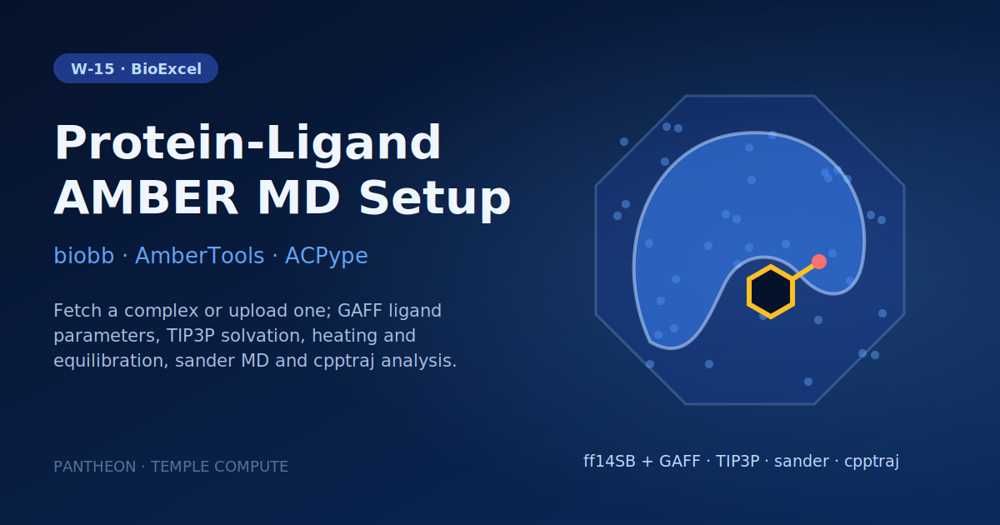

# W-15 · AMBER Protein-Ligand Complex MD Setup


Set up, run and analyze AMBER MD of a protein-ligand complex: fetch a complex by PDB ID (or upload one), name the ligand, and get GAFF ligand parameters, a solvated and equilibrated system, a sander production run and cpptraj analysis.




## Overview

This workflow sets up a molecular dynamics simulation of a protein-ligand complex using AmberTools, illustrated by default with T4 lysozyme (PDB: 3HTB, mutant L99A/M102Q) bound to the small ligand 2-propylphenol (JZ4). Starting from the raw PDB file, it strips crystallographic water and co-crystallized ligands (PO4, BME), prepares the structure for AMBER, generates GAFF ligand parameters with ACPype, builds a combined protein-ligand topology with `leap`, minimizes, solvates, neutralizes with ions, and runs a full heat/NVT/NPT/production MD protocol with `sander`, finishing with cpptraj-based trajectory analysis (RMSD, radius of gyration, imaging). Horus provisions the AmberTools/biobb conda environment automatically for each stage and runs locally.

## Pipeline

```
fetch_pdb              Download pdb_id (default 3HTB) or use the uploaded complex
   │
remove_pdb_water        Strip crystallographic waters
   │
remove_ligand_po4        Remove PO4 co-crystallized ligand
   │
remove_ligand_bme         Remove BME co-crystallized ligand
   │
pdb4amber                  Prepare structure for AMBER
   ├──────────────────────────────────┐
extract_heteroatoms                    │
   │                                   │
reduce_add_hydrogens (Reduce)          │
   │                                   │
babel_minimize (OpenBabel/GAFF)        │
   │                                   │
acpype_params_ac (ACPype)              │
   │  lib, frcmod                      │
   └──────────► leap_gen_top ◄─────────┘   Build protein-ligand complex topology (leap)
                    │
               sander_h_min ──► process_h_min      Minimize ligand hydrogens in vacuo
                    │
               sander_n_min ──► process_n_min      Minimize full system in vacuo
                    │
               amber_to_pdb (ambpdb)                Convert minimized structure to PDB
                    │
               leap_solvate                         Solvate in truncated octahedron box
                    │
               leap_add_ions                        Neutralize and add ions
                    │
               sander_min ──► process_min           Energy minimize solvated system
                    │
               sander_heat ──► process_heat          Heat 0 → 300 K
                    │
               sander_nvt ──► process_nvt             NVT equilibration
                    │
               sander_npt ──► process_npt              NPT equilibration
                    │
               sander_free                              Free production MD
                    │
        ┌───────────┼───────────┬───────────────┐
   cpptraj_rms_first  cpptraj_rms_exp  cpptraj_rgyr  cpptraj_image
   (RMSd vs frame 0)  (RMSd vs exp.)   (Rgyr)        (image + strip solvent)
```

## Prerequisites

- **uv** (recommended) or pip — to install horus-runtime
- **micromamba**, **mamba**, or **conda** — the workflow executor builds a shared conda environment from `conda_env.yaml` to provision AmberTools, ACPype, and the biobb stack

## Quick Start

```bash
# Install uv if you don't have it
curl -LsSf https://astral.sh/uv/install.sh | sh

# From the workflow directory, install horus-runtime
cd workflows/bioexcel_building_blocks/w10-amber-protein-ligand-complex-md-setup
uv sync
# or: pip install horus-runtime horus-environments

# Run the workflow
uv run horus run workflow.yaml
```

The first run builds the conda environment (this takes a few minutes). Subsequent runs reuse the cached environment at `../.horus_conda_env`.

## Inputs

| id | Kind | Default | Range | Meaning |
|---|---|---|---|---|
| `pdb_id` | string | `3HTB` | PDB code or empty | RCSB PDB code to download (default 3HTB). Clear it to use the uploaded structure instead. |
| `structure` | file | `examples/3htb.pdb` | PDB | Protein-ligand complex used when PDB ID is empty; must contain the ligand as HETATM records with the residue name given in Ligand code. Default: examples/3htb.pdb (3HTB). |
| `ligand_code` | string | `JZ4` | `[A-Za-z0-9]{1,3}` | Residue name of the ligand in the structure (default JZ4); it is extracted, parameterized with GAFF and restrained during the in-vacuo minimization. |
| `ligand_charge` | number | `0` | -5–5, step 1 | Formal net charge of the ligand, passed to ACPype (JZ4: 0). |
| `equilibration_steps` | number | `500` | 100–5000000, step 100 | sander steps of each restrained equilibration stage (2 fs per step; 500 = 1 ps). |
| `production_steps` | number | `2500` | 500–50000000, step 500 | sander steps of the free production run (2 fs per step; 2500 = 5 ps). |

`pdb_id` wins when set; clear it to run on the uploaded `structure`. `ligand_code` must match the ligand's residue name in that structure: it selects the heteroatoms to extract and the in-vacuo restraint mask. Set `ligand_charge` to its formal charge. The PO4 and BME removal steps target the 3HTB crystallization additives and leave other structures unchanged.

To change a value locally, edit its `value:` in `workflow.yaml`, then `rm -rf params/`: Horus writes `params/<id>.txt` only when it is missing and fingerprints that file for the skip check, so a stale file keeps the old value. In Temple Compute, set it in the campaign form.

## Inputs / Outputs

The complex comes from `pdb_id` (fetched from the RCSB) or, when that is empty, from the `structure` upload; the ligand is `ligand_code`. See Inputs.

**Outputs** (all under `workflow_results/`):
- `results/complex.pdb`, `results/complex.noBME.pdb` — downloaded and cleaned structures
- `results/ligand.pdb`, `results/ligand.reduce.H.pdb`, `results/ligand.H.min.mol2` — ligand extraction, protonation, and minimization intermediates
- `results/ligand_params.{inpcrd,frcmod,lib,prmtop}` — ACPype-generated GAFF ligand parameters
- `results/structure.leap.{pdb,top,crd}` — protein-ligand complex topology
- `results/structure.ions.{pdb,parmtop,crd}` — solvated, ion-neutralized system
- `results/sander.free.netcdf` — production MD trajectory
- `results/complex_rms_first.dat`, `results/complex_rms_exp.dat`, `results/complex_rgyr.dat` — RMSD and radius-of-gyration time series
- `results/complex_imaged_traj.trr` — PBC-imaged, solvent-stripped trajectory

## Configuration

PDB ID, ligand code and charge, and the equilibration/production step counts are workflow inputs (see Inputs), passed to biobb as inline JSON configs. `configs/babel_minimize.yaml` controls the ligand minimization. `configs/leap_*.yaml` control force field selection, water model, and box geometry. `configs/sander_*.yaml` control simulation length, restraints, and thermostat/barostat settings for each minimization/equilibration/production stage.

## Running in Temple Compute

Import the workflow (or open it from the library) and start a campaign: the form shows the PDB ID, the complex upload (with a Mol* preview), the ligand code and charge, and the step counts as sliders. ACPype and the sander tasks carry `resources` hints (2 CPU / 8 GB; 2 h per preparation stage, 24 h for production; serial sander uses one core), so an auto-provisioned target picks a small CPU node; the AMBER steps run in the `biobb_amber` Docker image, so the target needs Docker. Expert settings (force fields, restraints, heating, analysis masks) stay in `configs/*.yaml`, which also show up as editable file inputs.

## References

- [BioExcel Building Blocks (biobb)](https://github.com/bioexcel/biobb)
- [biobb_amber](https://github.com/bioexcel/biobb_amber)
- [biobb_wf_amber tutorial notebooks](https://github.com/bioexcel/biobb_wf_amber)
- [AmberTools](https://ambermd.org/AmberTools.php)
- [ACPype](https://github.com/alanwilter/acpype)
