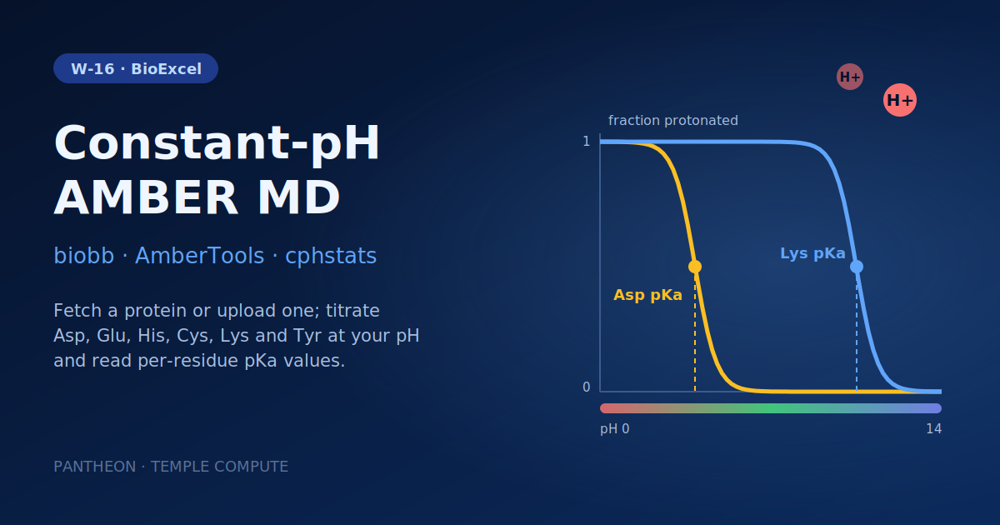

# W-16 · AMBER Constant-pH MD Setup


Predict per-residue pKa values with constant-pH MD in AMBER: fetch a protein by PDB ID (or upload one), pick the titratable residue types and the solvent pH, and get protonation-state populations from cphstats.




## Overview

This workflow sets up and runs a constant-pH molecular dynamics simulation using AmberTools, illustrated with Bovine Pancreatic Trypsin Inhibitor (BPTI, PDB: 6PTI). Starting from the raw PDB file, it prepares the structure for constant-pH AMBER, builds a protein topology with the ff14SB force field and `constph` residue templates, solvates in a truncated octahedron box, neutralizes with ions, generates the constant-pH input file (`cpinutil`) for titratable residues (ASP, GLU, CYS, LYS, TYR), runs a heat/NVT/NPT equilibration protocol, performs the constant-pH production MD with `sander`, and finishes by analyzing protonation states to predict per-residue pKa values with `cphstats`. Horus provisions the biobb conda environment automatically; the sander stages run in the `biobb_amber` Docker image.

## Pipeline

```
fetch_pdb          Download pdb_id (default 6PTI) or use the uploaded structure
   │
pdb4amber          Prepare structure for constant-pH AMBER
   │
leap_gen_top       Build protein topology (ff14SB + constph, leap)
   │
leap_solvate       Solvate in truncated octahedron box (TIP3P, leap)
   │
leap_add_ions      Neutralize and add ions (leap)
   │
parmed_cpinutil    Generate constant-pH input file (cpinutil, titratable residues)
   │
sander_min ──► process_min       Energy minimize with backbone restraints
   │
sander_heat ──► process_heat      Heat 0 → 300 K
   │
sander_nvt ──► process_nvt         NVT equilibration
   │
sander_npt ──► process_npt          NPT equilibration
   │
sander_cph_free    Constant pH production MD (sander, solvph = solvent_ph)
   │
cphstats           Analyse protonation states, predict pKa values
```

## Prerequisites

- **uv** (recommended) or pip — to install horus-runtime
- **micromamba**, **mamba**, or **conda** — the workflow executor builds a shared conda environment from `conda_env.yaml` to provision AmberTools and the biobb stack

## Quick Start

```bash
# Install uv if you don't have it
curl -LsSf https://astral.sh/uv/install.sh | sh

# From the workflow directory, install horus-runtime
cd workflows/bioexcel_building_blocks/w11-amber-constant-ph-md-setup
uv sync
# or: pip install horus-runtime horus-environments

# Run the workflow
uv run horus run workflow.yaml
```

The first run builds the conda environment (this takes a few minutes). Every task and later runs reuse that one environment at `workflow_results/.horus_conda_env`.

## Inputs

| id | Kind | Default | Range | Meaning |
|---|---|---|---|---|
| `pdb_id` | string | `6PTI` | PDB code or empty | RCSB PDB code to download. Clear it to use the uploaded structure instead. |
| `structure` | file | `examples/6pti.pdb` | PDB | Protein used when PDB ID is empty. Default: a copy of 6PTI (BPTI). |
| `solvent_ph` | number | `7.0` | 0–14, step 0.1 | pH of the proton bath for the constant-pH Monte Carlo moves (`solvph`). |
| `titratable_residues` | multichoice | `AS4`, `GL4`, `CYS`, `LYS`, `TYR` | those and `HIP`; at least 1 | Residue types allowed to change protonation state (`cpinutil` resnames). |
| `salt_m` | number | `0.1` | 0–1, step 0.01 | Ionic strength for the generalized-Born protonation energies (`saltcon`, M). |
| `production_steps` | number | `2500` | 500–50000000, step 500 | sander steps of the constant-pH production run (2 fs per step; 2500 = 5 ps; protonation moves every 100 steps). |

`pdb_id` wins when set; clear it to run on the uploaded `structure`. The default 5 ps production is a demo length: meaningful pKa estimates need nanoseconds (hundreds of thousands of steps).

To change a value locally, edit its `value:` in `workflow.yaml`, then `rm -rf params/`: Horus writes `params/<id>.txt` only when it is missing and fingerprints that file for the skip check, so a stale file keeps the old value. In Temple Compute, set it in the campaign form.

## Inputs / Outputs

The protein comes from `pdb_id` (fetched from the RCSB) or, when that is empty, from the `structure` upload. See Inputs.

**Outputs** (all under `workflow_results/`):
- `results/structure.pdb` — downloaded or uploaded structure
- `results/structure.pdb4amber.pdb` — AMBER-ready structure
- `results/structure.leap.{pdb,top,crd}` — protein topology (ff14SB + constph)
- `results/structure.ions.{pdb,parmtop,crd}` — solvated, ion-neutralized system
- `results/structure.cpin`, `results/structure.cpH.parmtop` — constant-pH input file and topology
- `results/sander.pH.{netcdf,rst,cpout,cprst,log,mdinfo}` — constant-pH production MD outputs
- `results/cphstats.pH.dat`, `results/cphstats.pH.pop.dat` — pKa predictions and protonation-state populations

## Configuration

PDB ID, titratable residues, solvent pH, salt and production length are workflow inputs (see Inputs), passed to biobb as inline JSON configs; `cpinutil` keeps `igb: 2`. `configs/leap_*.yaml` control force field, water model, box geometry, and ion neutralization. `configs/sander_*.yaml` control the minimization and heat/NVT/NPT equilibration stages. `configs/cphstats.yaml` controls the pKa-analysis running-average window.

## Running in Temple Compute

Import the workflow (or open it from the library) and start a campaign: the form shows the PDB ID, the structure upload (with a Mol* preview), the titratable residue picker, and pH, salt and production length as sliders. The sander tasks carry `resources` hints (2 CPU / 8 GB; 2 h per equilibration stage, 24 h for production; serial sander uses one core), so an auto-provisioned target picks a small CPU node; the sander steps run in the `biobb_amber` Docker image, so the target needs Docker. Expert settings stay in `configs/*.yaml`, which also show up as editable file inputs.

## References

- [BioExcel Building Blocks (biobb)](https://github.com/bioexcel/biobb)
- [biobb_amber](https://github.com/bioexcel/biobb_amber)
- [biobb_wf_amber tutorial notebooks](https://github.com/bioexcel/biobb_wf_amber)
- [AmberTools](https://ambermd.org/AmberTools.php)
- [AMBER Constant pH MD Tutorial](https://ambermd.org/tutorials/advanced/tutorial18/index.htm)
