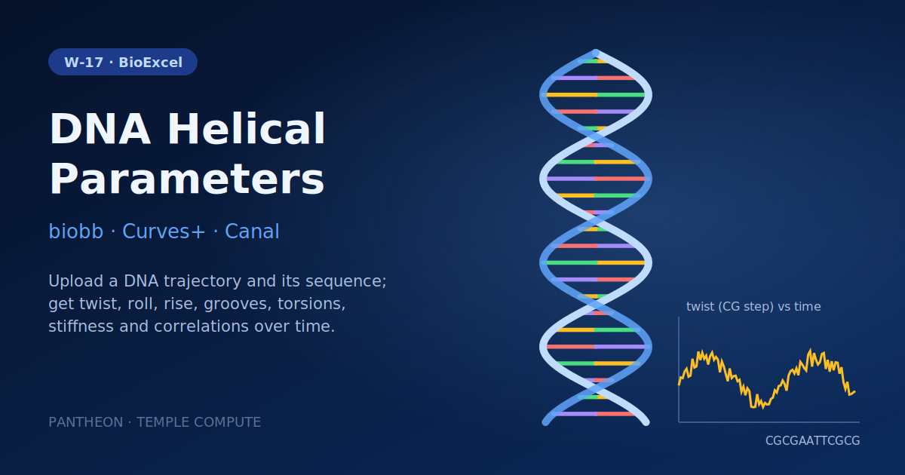

# W-17 · DNA Helical Parameters


Extract every DNA helical parameter, backbone torsion, stiffness and correlation from an MD trajectory with Curves+ and Canal: upload a trajectory and topology, give the sequence, and get averages and time series for each.




## Overview

This workflow extracts structural and dynamical helical parameters from a DNA MD trajectory using the `biobb_dna` package (wrapping Curves+ and Canal). The example system is the Drew-Dickerson Dodecamer (sequence CGCGAATTCGCG, PDB code 1BNA), analyzed from a 500 ns MD trajectory taken from the BigNASim database. Curves+ extracts per-base-pair and per-base-pair-step helical parameters from the raw trajectory, Canal converts these into time series and histograms, and a large fan-out of downstream stages computes averages, time series, stiffness, bimodality, and correlations for every helical parameter (rise, roll, twist, shift, slide, tilt, shear, stretch, stagger, buckle, propeller, opening, inclination, tip, X/Y-displacement, groove widths/depths, backbone torsions, and sugar puckering/backbone conformational populations). Every stage runs in the `biobb_dna` Docker image.

## Pipeline

```
curves              Extract helical parameters from trajectory (Curves+)
   │
canal               Generate time series and histograms (Canal)
   │
   ├── avg_*   (20 stages)   Average helical parameters: base-pair step (rise, roll, twist,
   │                         shift, slide, tilt), base pair (shear, stretch, stagger, buckle,
   │                         propeller, opening), axis (inclination, tip, x/y-disp), grooves
   │                         (major/minor width & depth)
   │
   ├── puckering, canonicalag, bipopulations
   │                         Sugar pucker, canonical alpha/gamma, and BI/BII backbone
   │                         conformational populations
   │
   ├── ts_*    (~34 stages)  Time series of every helical parameter and backbone torsion
   │                         (alpha/beta/gamma/delta/epsilon/zeta/chi, phase) per strand
   │
   ├── average_stiffness, basepair_stiffness
   │                         Stiffness / elastic constants for Twist and the CG step
   │
   ├── dna_bimodality        Bimodality analysis of Twist at the CG step
   │
   └── intraseqcorr, interseqcorr, intrahpcorr, interhpcorr, intrabpcorr, interbpcorr
                             Sequence and helical-parameter correlations (intra/inter base
                             pair, neighboring steps)
```

## Prerequisites

- **uv** (recommended) or pip — to install horus-runtime
- **Docker** — every stage runs in `quay.io/biocontainers/biobb_dna:5.2.1`

## Quick Start

```bash
# Install uv if you don't have it
curl -LsSf https://astral.sh/uv/install.sh | sh

# From the workflow directory, install horus-runtime
cd workflows/bioexcel_building_blocks/w12-dna-helical-parameters
uv sync
# or: pip install horus-runtime horus-environments

# Run the workflow
uv run horus run workflow.yaml
```

The first run pulls the `biobb_dna` image (a few minutes); later runs reuse it.

## Inputs

| id | Kind | Default | Range | Meaning |
|---|---|---|---|---|
| `traj` | file | `TRAJ/structure.stripped.nc` | NetCDF trajectory | Solvent-stripped DNA MD trajectory. Default: 500 ns Drew-Dickerson dodecamer (BigNASim, NAFlex_DDD_II). |
| `top` | file | `TRAJ/structure.stripped.top` | AMBER topology | Topology matching the trajectory. |
| `sequence` | string | `CGCGAATTCGCG` | `[ACGT]{5,200}` | Strand 1, 5' to 3'. Sets the Curves+ strand ranges (strand 1 = 1..N, strand 2 = 2N..N+1) and labels every parameter. |

The stiffness, bimodality and correlation stages read the series at position 3, the first interior step and base pair (Curves+ writes no series for the terminal steps): `series_<param>_step3.csv` for base-pair steps and `series_<param>_bp3.csv` for base pairs. For the default sequence that is the C3G4 CpG step. The trajectory must hold one double-stranded DNA with strand 2 numbered right after strand 1, as Curves+ expects. Every analysis setting is inline in its task (helical parameter name, Canal series/histograms on, bimodality `max_iter` 500).

To change `sequence` locally, edit its `value:` in `workflow.yaml`, then `rm -rf params/`: Horus writes `params/<id>.txt` only when it is missing and fingerprints that file for the skip check, so a stale file keeps the old value. In Temple Compute, set it in the campaign form.

## Inputs / Outputs

The trajectory and topology are uploads (defaults committed in `TRAJ/`); `.curvesplus/standard_{b,i,s}.lib` are the Curves+ reference libraries `biobb_curves` uses internally.

**Outputs** (all under `workflow_results/`):
- `results/curves.out.lis`, `results/curves.out.cda` — raw Curves+ helical parameter output
- `results/canal.out.zip` — Canal time series/histogram bundle
- `results/avg_<param>.csv` — average value per helical parameter
- `results/ts_<param>.csv` — time series per helical parameter/torsion
- `results/stiffness.csv`, `results/bimodality.csv` — elastic and bimodality analysis
- `results/*corr.csv` — sequence and helical-parameter correlation matrices

## Configuration

All biobb settings are inline JSON in each task's command; the only per-run setting is `sequence`. The Curves+ task computes `s1range`/`s2range` from the sequence length in the shell.

## Running in Temple Compute

Import the workflow (or open it from the library) and start a campaign: the form shows the trajectory and topology uploads and the sequence. Curves+ and Canal carry `resources` hints (2 CPU / 8 GB, 2 h and 1 h); the ~70 analysis stages are light and run on the same machine. Every stage runs in the `biobb_dna` Docker image, so the target needs Docker.

## References

- [BioExcel Building Blocks (biobb)](https://github.com/bioexcel/biobb)
- [biobb_dna](https://github.com/bioexcel/biobb_dna)
- [biobb_wf_dna_helparms tutorial notebook](https://github.com/bioexcel/biobb_wf_dna_helparms)
- [Curves+](https://curvesplus.bsc.es/)
- [BigNASim database](https://mmb.irbbarcelona.org/BIGNASim/)
- [NAFlex server](https://mmb.irbbarcelona.org/NAFlex)
