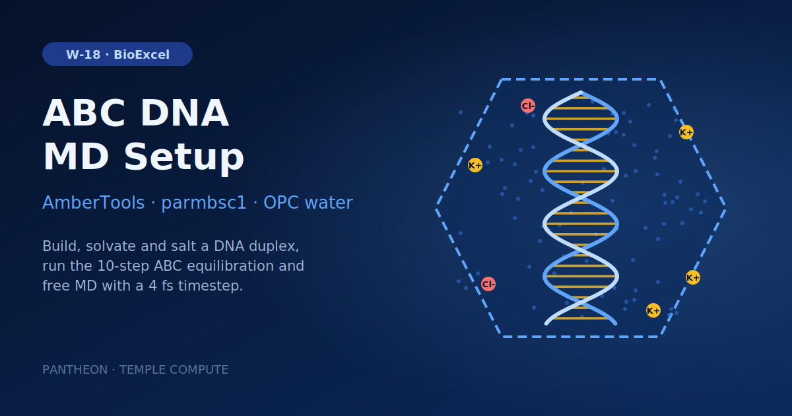

# W-18 · ABC MD Setup


Ascona B-DNA Consortium MD setup for a DNA duplex with AmberTools: parmbsc1 topology, OPC water box, salt, hydrogen mass repartitioning, 10-step equilibration and free MD.




## Overview

This workflow implements the Ascona B-DNA Consortium (ABC) structure-preparation pipeline using AmberTools, providing a single reproducible protocol for setting up DNA MD simulations across consortium members. The example system is the Drew-Dickerson Dodecamer (CGCGAATTCGCG). It builds a DNA topology with the parmbsc1 force field, solvates in a truncated octahedron box with OPC water, neutralizes with potassium and adds 100 mM KCl by default, randomizes ion placement with cpptraj, applies hydrogen-mass repartitioning (via parmed) to enable a 4 fs production timestep, runs a 10-step equilibration protocol (Roe & Brooks protocol), and finishes with a free production MD run. Horus provisions the AmberTools/biobb conda environment automatically and runs all stages locally.

## Pipeline

```
leap_gen_top              Build DNA topology (parmbsc1 force field, leap)
   │
leap_solvate               Solvate in truncated octahedron box (SPC/E water, leap)
   │
leap_add_ions               Neutralize + salt (ionic_concentration_mm, default 100 mM)
   │
cpptraj_randomize_ions        Randomize ion positions (cpptraj)
   │
parmed_hmassrepartition         Hydrogen-mass repartition topology for 4fs timestep (parmed)
   │
sander_eq1  ──► process_eq1       Eq step 1: minimization with restraints
   │
sander_eq2  ──► process_eq2       Eq step 2: heating with restraints
   │
sander_eq3  ──► process_eq3       Eq step 3: minimization with restraints
   │
sander_eq4  ──► process_eq4       Eq step 4: minimization with restraints
   │
sander_eq5  ──► process_eq5       Eq step 5: minimization without restraints
   │
sander_eq6  ──► process_eq6       Eq step 6: NPT with restraints
   │
sander_eq7  ──► process_eq7       Eq step 7: NPT with restraints
   │
sander_eq8  ──► process_eq8       Eq step 8: NPT with backbone restraints
   │
sander_eq9  ──► process_eq9       Eq step 9: NPT without restraints
   │
sander_eq10 ──► process_eq10      Eq step 10: NPT production equilibration
   │
sander_md                  Free production MD (4 fs timestep)
```

## Prerequisites

- **uv** (recommended) or pip — to install horus-runtime
- **micromamba**, **mamba**, or **conda** — the workflow executor builds a shared conda environment from `conda_env.yaml` to provision AmberTools and the biobb stack

## Quick Start

```bash
# Install uv if you don't have it
curl -LsSf https://astral.sh/uv/install.sh | sh

# From the workflow directory, install horus-runtime
cd workflows/bioexcel_building_blocks/w13-abc-md-setup
uv sync
# or: pip install horus-runtime horus-environments

# Run the workflow
uv run horus run workflow.yaml
```

The first run builds the conda environment (this takes a few minutes). Subsequent runs reuse the cached environment at `../.horus_conda_env`.

## Inputs

Root artifacts in `workflow.yaml`; tc-os shows them in the campaign form.

| id | Kind | Default | Range | Meaning |
|---|---|---|---|---|
| `dna_pdb` | file | `CGCGAATTCGCG.pdb` | PDB | Initial Drew-Dickerson dodecamer DNA structure. |
| `positive_ion` | choice | K+ | `K+`, `Na+` | Cation used to neutralise the DNA and set the salt concentration. |
| `box_padding_a` | number | 15.0 | 8–25, step 0.5 | Minimum distance between the DNA and the edge of the truncated octahedron box. |
| `ionic_concentration_mm` | number | 100 | 0–1000, step 10 | Added salt on top of neutralisation. |
| `md_steps` | number | 500 | 100–50000000, step 100 | Free MD steps at 4 fs (500 = 2 ps, the tutorial length; 25,000,000 = 100 ns). |
| `step1_mdin` … `step10_mdin`, `md_mdin` | file | `ABCix_config_files/*.in` | IN | sander MDIN files of the 10 ABC equilibration steps and of production (expert) |

Expert settings stay in the biobb property files under `configs/`.
To change a value locally, edit its `value:` in `workflow.yaml`, then `rm -rf params/`: Horus writes
`params/<id>.txt` only when it is missing and fingerprints that file for the skip check.

## Running in Temple Compute

Import the workflow (or open it from the library) and start a campaign: upload a DNA duplex
PDB (default: the Drew-Dickerson dodecamer) and set the counter-ion, box padding, salt
concentration and production length. The tutorial runs only 500 production steps (2 ps);
set `md_steps` to 25,000,000 for 100 ns. The sander equilibration steps and the production
run carry `resources` hints (2 CPU, 8 GB; 24 h walltime for production), so an
auto-provisioned target picks a small general-purpose machine. sander is serial: for long
production runs a GPU `pmemd.cuda` build is the faster route, which this workflow does not use.

## Inputs / Outputs

This workflow uses **real input data** checked into the directory (not fetched at runtime):
- `CGCGAATTCGCG.pdb` — Drew-Dickerson Dodecamer starting DNA structure, used by `leap_gen_top`
- `ABCix_config_files/step1.in` … `step10.in` — the 10-step ABC equilibration protocol `sander` input files (referenced directly by the `sander_eq1`…`sander_eq10` stages)
- `ABCix_config_files/md.in` — production MD `sander` input file

**Outputs** (all under `workflow_results/`):
- `results/structure.leap.{pdb,top,crd}` — DNA topology (parmbsc1)
- `results/structure.solv.{pdb,parmtop,crd}` — solvated system
- `results/structure.ions.{pdb,parmtop,crd}` — ion-neutralized system
- `results/structure.randIons.{pdb,crd}` — system with randomized ion placement
- `results/structure.leap.4fs.top` — hydrogen-mass-repartitioned topology
- `results/sander.eq1.nc` … `results/sander.eq10.nc` — equilibration trajectories, with matching `.log`/`.mdinfo`/`.ncrst` and energy/pressure-density `.dat` files per step
- `results/sander.md.nc` — free production MD trajectory (4 fs timestep)

## Configuration

`configs/leap_gen_top.yaml` sets the force field; the solvation, ion and production settings are inlined in the `leap_solvate`, `leap_add_ions` and `sander_md` commands, with the knobs above as variables. `configs/cpptraj_randomize_ions.yaml` controls ion randomization. The `ABCix_config_files/step*.in` files (not `configs/*.yaml`) are the actual AMBER `sander` MDIN files defining each equilibration step's restraints, thermostat/barostat, and timestep; the `configs/sander_eq*.yaml` and `configs/process_eq*.yaml` files select which of these MDIN files to run and which terms to extract from the logs.

## References

- [BioExcel Building Blocks (biobb)](https://github.com/bioexcel/biobb)
- [biobb_amber](https://github.com/bioexcel/biobb_amber)
- [biobb_wf_amber tutorial notebooks](https://github.com/bioexcel/biobb_wf_amber)
- [AmberTools](https://ambermd.org/AmberTools.php)
- [Ascona B-DNA Consortium / NAFlex ABC](http://mmb.irbbarcelona.org/NAFlex/ABC)
- [The static and dynamic structural heterogeneities of B-DNA](https://doi.org/10.1093/nar/gkz905)
