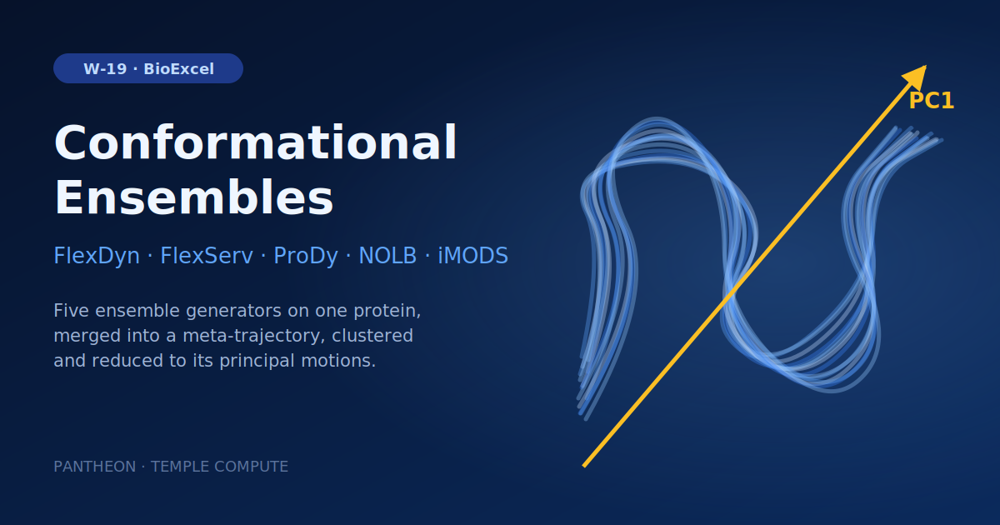

# W-19 · Protein Conformational Ensembles


Generate protein conformational ensembles with five coarse-grained methods (CONCOORD, ProDy ANM, FlexServ BD/DMD/NMA, NOLB, iMODS), cluster the meta-trajectory and analyse its principal motions.




## Overview

This workflow generates protein conformational ensembles using several complementary methods and analyzes the resulting flexibility properties, illustrated with adenylate kinase (PDB: 1AKE, chain A). It benchmarks five ensemble-generation approaches — CONCOORD (atomistic distance-restraint sampling), ProDy Anisotropic Network Model, FlexServ (Brownian Dynamics, Discrete Molecular Dynamics, and Normal Mode Analysis), NOLB (non-linear rigid-block NMA), and iMODS (internal-coordinate NMA + Monte Carlo) — then concatenates all ensembles into a single meta-trajectory, clusters it with GROMACS, and runs principal component analysis (PCA) to derive B-factors, hinge points, apparent stiffness, and collectivity index. Horus provisions the FlexServ/FlexDyn/biobb conda environment automatically and runs all stages locally.

## Pipeline

```
fetch_pdb                Download pdb_id from the PDB, or take the uploaded structure
   │
extract_model             Extract first model
   │
extract_chain              Extract the selected chain (default A)
   │
   ├── cpptraj_mask_backbone / cpptraj_mask_ca      Extract backbone / Cα atom masks
   │
   ├── concoord_dist ──► concoord_disco ──► cpptraj_rms_concoord ──► cpptraj_convert_concoord
   │                     CONCOORD distance-restraint ensemble
   │
   ├── prody_anm ──► cpptraj_rms_prody ──► cpptraj_convert_prody
   │                 ProDy Anisotropic Network Model ensemble
   │
   ├── bd_run ──► cpptraj_rms_bd                     FlexServ Brownian Dynamics
   ├── dmd_run ──► cpptraj_rms_dmd                    FlexServ Discrete Molecular Dynamics
   ├── nma_run ──► cpptraj_rms_nma ──► cpptraj_convert_nma   FlexServ Normal Mode Analysis
   │
   ├── nolb_nma ──► cpptraj_rms_nolb ──► cpptraj_convert_nolb   NOLB rigid-block NMA
   │
   └── imod_imode ──► imod_imc ──► cpptraj_rms_imods ──► cpptraj_convert_imods
                       iMODS internal-coordinate NMA + Monte Carlo sampling
   │
zip_trajectories ──► trjcat            Concatenate all ensemble trajectories into meta-trajectory
   │
make_ndx ──► gmx_cluster ──► cpptraj_rms_meta    Cluster meta-trajectory, fit representatives (GROMACS)
   │
pcz_zip_classic / pcz_zip_gaussian      PCA-compress meta-trajectory (classical / Gaussian-weighted)
   │
   ├── pcz_info, pcz_evecs               PCA statistics, variance profile, eigenvectors
   ├── pcz_animate ──► cpptraj_convert_proj   Animate along PC1, convert projection to XTC
   ├── pcz_bfactor                        B-factor analysis from PCA modes
   ├── pcz_hinges_bfactor / pcz_hinges_dyndom / pcz_hinges_fcte   Hinge-point detection (3 methods)
   ├── pcz_stiffness                      Apparent stiffness analysis
   └── pcz_collectivity                   Collectivity index
```

## Prerequisites

- **uv** (recommended) or pip — to install horus-runtime
- **micromamba**, **mamba**, or **conda** — the workflow executor builds a shared conda environment from `conda_env.yaml` to provision CONCOORD, ProDy, FlexServ, NOLB, iMODS, GROMACS, and the biobb stack

## Quick Start

```bash
# Install uv if you don't have it
curl -LsSf https://astral.sh/uv/install.sh | sh

# From the workflow directory, install horus-runtime
cd workflows/bioexcel_building_blocks/w14-protein-conformational-ensembles
uv sync
# or: pip install horus-runtime horus-environments

# Run the workflow
uv run horus run workflow.yaml
```

The first run builds the conda environment (this takes a few minutes). Subsequent runs reuse the cached environment at `../.horus_conda_env`.

## Inputs

Root artifacts in `workflow.yaml`; tc-os shows them in the campaign form.

| id | Kind | Default | Range | Meaning |
|---|---|---|---|---|
| `pdb_id` | string | 1ake | PDB ID, or empty | 4-character PDB code to download (default 1ake). Leave empty to use the uploaded structure instead. |
| `structure` | file | `examples/1ake.pdb` | PDB | PDB file used when pdb_id is empty. Default: 1AKE from the RCSB PDB. |
| `chain` | string | A | `[A-Za-z0-9]` | Chain to analyse (one letter or digit). |
| `n_structures` | number | 300 | 10–5000, step 10 | Conformations generated by each ensemble method (CONCOORD, ProDy ANM, NOLB, iMODS) and frames for DMD/NMA. |
| `cluster_cutoff_nm` | number | 0.12 | 0.02–1.0, step 0.01 | RMSD cutoff of the GROMACS linkage clustering of the meta-trajectory. |

Expert settings stay in the biobb property files under `configs/`.
To change a value locally, edit its `value:` in `workflow.yaml`, then `rm -rf params/`: Horus writes
`params/<id>.txt` only when it is missing and fingerprints that file for the skip check.

## Running in Temple Compute

Import the workflow (or open it from the library) and start a campaign: give a PDB ID
(default 1AKE) or clear it and upload a structure, pick the chain, and set how many
conformations each method generates and the clustering cutoff. The ensemble generators and
PCA steps carry `resources` hints (2 CPU / 8 GB and 4 CPU / 16 GB, 2 h), so an
auto-provisioned target picks a small general-purpose machine; everything is CPU-only.

## Inputs / Outputs

By default the workflow fetches PDB 1AKE from PDBe (chain A, model 1). Set `pdb_id` to another code, or clear it and upload a PDB as `structure`.

**Outputs** (all under `workflow_results/`):
- `results/input.pdb` — downloaded or uploaded structure; `results/1ake_*.pdb` — model/chain-extracted monomer and masks (file names keep the tutorial prefix)
- Per-method ensemble trajectories and RMSD analyses (CONCOORD, ProDy ANM, FlexServ BD/DMD/NMA, NOLB, iMODS), each converted to `.trr`
- `results/meta_traj.*` — concatenated meta-trajectory and GROMACS cluster output
- `results/pcz_classic.pcz`, `results/pcz_gaussian.pcz` — compressed PCA trajectories
- `results/pcz_bfactor.dat`, `results/pcz_hinges_*.dat`, `results/pcz_stiffness.dat`, `results/pcz_collectivity.dat` — flexibility analysis results

## Configuration

The PDB code, chain, ensemble size and clustering cutoff are the inputs above; `configs/extract_model.yaml` picks the model. `configs/concoord_*.yaml`, `configs/prody_anm.yaml`, `configs/{bd,dmd,nma}_run.yaml`, `configs/nolb_nma.yaml`, and `configs/imod_i*.yaml` control the parameters of each ensemble-generation method. `configs/gmx_cluster.yaml` controls the clustering algorithm/cutoff. `configs/pcz_*.yaml` files control PCA compression, animation, hinge-detection method, and stiffness/collectivity analysis options.

## References

- [BioExcel Building Blocks (biobb)](https://github.com/bioexcel/biobb)
- [biobb_flexdyn](https://github.com/bioexcel/biobb_flexdyn)
- [biobb_flexserv](https://github.com/bioexcel/biobb_flexserv)
- [biobb_wf_flexdyn tutorial notebook](https://github.com/bioexcel/biobb_wf_flexdyn)
- [CONCOORD](https://www3.mpibpc.mpg.de/groups/de_groot/concoord/concoord.html)
- [ProDy](https://prody.csb.pitt.edu/)
- [FlexServ](https://mmb.irbbarcelona.org/FlexServ/)
- [NOLB](https://team.inria.fr/nano-d/software/nolb-normal-modes)
- [iMODS](https://imods.chaconlab.org/)
