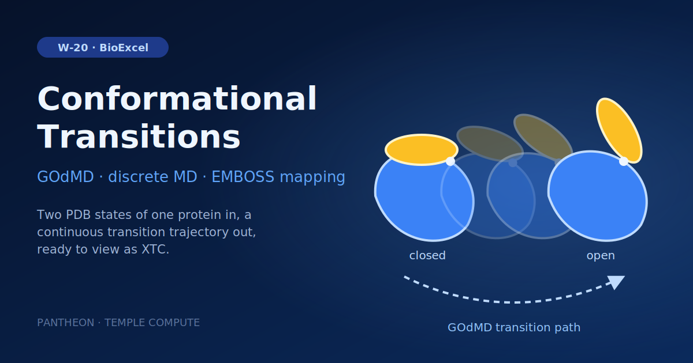

# W-20 · Protein Conformational Transitions


Compute a conformational transition pathway between two states of a protein with GOdMD (discrete MD guided by a Maxwell-demon bias), from two PDB IDs or two uploaded structures.




## Overview

This workflow computes a conformational transition pathway between two known structural states of a protein using GOdMD, illustrated with adenylate kinase transitioning from its closed state (PDB: 1AKE) to its open state (PDB: 4AKE). It fetches both structures, extracts chain A from each, removes the AP5 inhibitor ligand from the origin structure, computes a residue mapping between origin and target via EMBOSS sequence alignment, runs the GOdMD discrete-molecular-dynamics/Maxwell-Demon transition simulation, and converts the resulting trajectory to XTC format for visualization. Horus provisions the GOdMD/EMBOSS/biobb conda environment automatically and runs all stages locally.

## Pipeline

```
fetch_pdb_origin          origin_pdb_id (default 1AKE, closed) or upload
   │
extract_chain_origin       Extract chain A
   │
remove_molecules_origin     Remove ligand_to_remove (AP5)
   │                                    fetch_pdb_target          target_pdb_id (default 4AKE, open) or upload
   │                                       │
   │                                    extract_chain_target       Extract chain A
   │                                       │
   └───────────────────► godmd_prep ◄──────┘   Compute residue mapping (EMBOSS water alignment)
                              │
                         godmd_run              Run GOdMD conformational transition (1AKE → 4AKE)
                              │
                         cpptraj_convert         Convert trajectory mdcrd → XTC
```

## Prerequisites

- **uv** (recommended) or pip — to install horus-runtime
- **micromamba**, **mamba**, or **conda** — the workflow executor builds a shared conda environment from `conda_env.yaml` to provision GOdMD, EMBOSS, and the biobb stack

## Quick Start

```bash
# Install uv if you don't have it
curl -LsSf https://astral.sh/uv/install.sh | sh

# From the workflow directory, install horus-runtime
cd workflows/bioexcel_building_blocks/w15-protein-conformational-transitions
uv sync
# or: pip install horus-runtime horus-environments

# Run the workflow
uv run horus run workflow.yaml
```

The first run builds the conda environment (this takes a few minutes). Subsequent runs reuse the cached environment at `../.horus_conda_env`.

## Inputs

Root artifacts in `workflow.yaml`; tc-os shows them in the campaign form.

| id | Kind | Default | Range | Meaning |
|---|---|---|---|---|
| `origin_pdb_id` | string | 1ake | PDB ID, or empty | 4-character PDB code to download (default 1ake). Leave empty to use the uploaded origin structure instead. |
| `origin_structure` | file | `examples/1ake.pdb` | PDB | PDB file used when origin_pdb_id is empty. Default: 1AKE from the RCSB PDB. |
| `target_pdb_id` | string | 4ake | PDB ID, or empty | 4-character PDB code to download (default 4ake). Leave empty to use the uploaded target structure instead. |
| `target_structure` | file | `examples/4ake.pdb` | PDB | PDB file used when target_pdb_id is empty. Default: 4AKE from the RCSB PDB. |
| `origin_chain` | string | A | `[A-Za-z0-9]` | Chain of the origin structure to use. |
| `target_chain` | string | A | `[A-Za-z0-9]` | Chain of the target structure to use. |
| `ligand_to_remove` | string | AP5 | `[A-Za-z0-9]{1,3}` | Residue name of the ligand removed from the origin structure (AP5 in 1AKE). |
| `temperature_k` | number | 400 | 200–600, step 10 | Simulation temperature of the discrete MD run. |

Expert settings stay in the biobb property files under `configs/`.
To change a value locally, edit its `value:` in `workflow.yaml`, then `rm -rf params/`: Horus writes
`params/<id>.txt` only when it is missing and fingerprints that file for the skip check.

## Running in Temple Compute

Import the workflow (or open it from the library) and start a campaign: give the origin
and target PDB IDs (default 1AKE closed → 4AKE open adenylate kinase), or clear them and
upload two structures; pick the chains, the ligand to strip from the origin and the GOdMD
temperature. Both states must be the same protein (the residue mapping comes from an EMBOSS
alignment). `godmd_run` carries a `resources` hint (2 CPU, 8 GB, 4 h), so an
auto-provisioned target picks a small general-purpose machine.

## Inputs / Outputs

By default the workflow fetches PDB 1AKE (origin) and 4AKE (target) from the RCSB. Set other codes, or clear a code and upload that structure instead. Output file names keep the tutorial `1ake`/`4ake` prefixes whatever the inputs.

**Outputs** (all under `workflow_results/`):
- `results/1ake.pdb`, `results/4ake.pdb` — downloaded origin/target structures
- `results/1ake.chains.pdb`, `results/4ake.chains.pdb` — chain-A-only structures
- `results/1ake.chains.nolig.pdb` — origin structure with AP5 ligand removed
- `results/1ake.aln`, `results/4ake.aln` — residue-mapping sequence alignments
- `results/1ake-4ake.godmd.mdcrd` — raw GOdMD transition trajectory
- `results/1ake-4ake.godmd.pdb` — GOdMD topology/reference structure
- `results/1ake-4ake.godmd.xtc` — transition trajectory converted to XTC for visualization

## Configuration

The PDB codes, chains, removed ligand and GOdMD temperature are the inputs above. `configs/godmd_prep.yaml` controls the EMBOSS alignment used for residue mapping. `configs/cpptraj_convert.yaml` controls the output trajectory format.

## References

- [BioExcel Building Blocks (biobb)](https://github.com/bioexcel/biobb)
- [biobb_godmd](https://github.com/bioexcel/biobb_godmd)
- [biobb_wf_godmd tutorial notebook](https://github.com/bioexcel/biobb_wf_godmd)
- [GOdMD web server](https://mmb.irbbarcelona.org/GOdMD/index.php)
- [Exploration of conformational transition pathways from coarse-grained simulations (Sfriso et al., Bioinformatics)](https://doi.org/10.1093/bioinformatics/btt324)
- [EMBOSS](https://www.ebi.ac.uk/Tools/emboss/)
