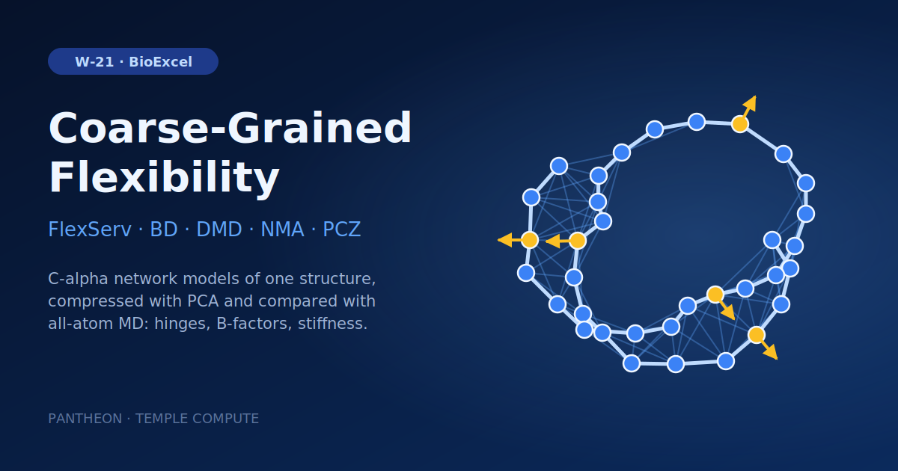

# W-21 · Macromolecular Coarse-Grained Flexibility


FlexServ coarse-grained flexibility from a single structure: Brownian dynamics, discrete MD and normal-mode ensembles, PCA compression, B-factors, hinges, stiffness and cross-ensemble similarity.




## Overview

This workflow reproduces the **FlexServ** protocol for analyzing macromolecular flexibility from a single static structure, using the BioExcel Building Blocks (biobb_flexserv, biobb_io, biobb_structure_utils, biobb_analysis) and PCA suite. Starting from the Ribosomal Protein S15 structure (PDB: 1A32), it reduces the protein to a coarse-grained Cα representation and generates three independent conformational ensembles — Brownian Dynamics (BD), Discrete Molecular Dynamics (DMD), and Normal Mode Analysis (NMA) — then compresses each trajectory with PCA (PCZ format) and runs a large battery of flexibility analyses (eigenvectors, B-factors, hinge-point detection, stiffness, collectivity, and cross-ensemble similarity, including comparison against a reference all-atom MD trajectory from the MoDEL database). Horus provisions the full FlexServ/biobb conda environment automatically for each stage.

## Pipeline

```
fetch_pdb            pdb_id (default 1A32) from the PDB, or the uploaded structure
   │
extract_atoms_ca      Reduce structure to Cα-only coarse-grained model (extract_atoms)
   │
   ├── bd_run          Brownian Dynamics ensemble (bd_run)
   │      └── cpptraj_rms_bd         RMSD + convert to XTC (cpptraj_rms)
   ├── dmd_run         Discrete Molecular Dynamics ensemble (dmd_run)
   │      └── cpptraj_rms_dmd        RMSD + convert to XTC (cpptraj_rms)
   └── nma_run         Normal Mode Analysis ensemble (nma_run)
          └── cpptraj_rms_nma        RMSD + convert to XTC (cpptraj_rms)
   │
   ├── pcz_zip_bd / pcz_zip_dmd / pcz_zip_nma     PCA-compress each trajectory to PCZ (pcz_zip)
   │      └── pcz_unzip_*                          Decompress back to CRD (pcz_unzip)
   │             └── cpptraj_rms_*_uncompressed     RMSD of decompressed trajectory (cpptraj_rms)
   │
   ├── pcz_info                     PCA report: eigenvalues, variance, dimensionality (pcz_info)
   ├── pcz_evecs                    Extract eigenvectors for NMA PC1 (pcz_evecs)
   ├── pcz_animate ──► cpptraj_convert_proj1   Animate NMA PC1 mode, convert to XTC (pcz_animate / cpptraj_convert)
   ├── pcz_bfactor_all / pcz_bfactor_mode1-5   B-factors per PCA mode (pcz_bfactor)
   ├── pcz_hinges_bfactor / _dyndom / _fcte    Hinge-point detection, 3 methods (pcz_hinges)
   ├── pcz_stiffness                Apparent inter-residue stiffness (pcz_stiffness)
   ├── pcz_collectivity             Collectivity index (pcz_collectivity)
   └── pcz_similarity_*             All-pairs BD/DMD/NMA/MD(MoDEL) similarity matrix (pcz_similarity, 16 comparisons)
```

## Prerequisites

- **uv** (recommended) or pip — to install horus-runtime
- **micromamba**, **mamba**, or **conda** — the workflow executor builds a shared conda environment from `conda_env.yaml` to provision FlexServ, PCA suite, and the biobb stack

## Quick Start

```bash
# Install uv if you don't have it
curl -LsSf https://astral.sh/uv/install.sh | sh

# From the workflow directory, install horus-runtime
cd workflows/bioexcel_building_blocks/w16-macromolecular-coarse-grained-flexibility
uv sync
# or: pip install horus-runtime horus-environments

# Run the workflow
uv run horus run workflow.yaml
```

The first run builds the conda environment (this takes a few minutes). Subsequent runs reuse the cached environment at `../.horus_conda_env`.

## Inputs

Root artifacts in `workflow.yaml`; tc-os shows them in the campaign form.

| id | Kind | Default | Range | Meaning |
|---|---|---|---|---|
| `pdb_id` | string | 1a32 | PDB ID, or empty | 4-character PDB code to download (default 1a32). Leave empty to use the uploaded structure instead. |
| `structure` | file | `examples/1a32.pdb` | PDB | PDB file used when pdb_id is empty. Default: 1A32 from the RCSB PDB. |
| `bd_time` | number | 10000 | 1000–1000000, step 1000 | Brownian dynamics length (biobb bd_run `time`, ps). |
| `nma_frames` | number | 50 | 10–2000, step 10 | Frames generated along the normal modes. |
| `pca_variance` | number | 90 | 50–99, step 1 | Explained variance kept when compressing each ensemble to PCZ. |
| `md_pcz` | file | `Files/1a32.MoDEL.pcz` | PCZ | Reference all-atom MD trajectory in PCZ format for the similarity analyses; must be the same protein (C-alpha) as the input structure. Default 10 ns of 1A32 from the MoDEL database. |

Expert settings stay in the biobb property files under `configs/`.
To change a value locally, edit its `value:` in `workflow.yaml`, then `rm -rf params/`: Horus writes
`params/<id>.txt` only when it is missing and fingerprints that file for the skip check.

## Running in Temple Compute

Import the workflow (or open it from the library) and start a campaign: give a PDB ID
(default 1A32) or clear it and upload a structure, set the BD length, NMA frames and PCA
variance, and upload a matching reference MD trajectory (`md_pcz`) when you change the
protein. The three ensemble generators carry `resources` hints (2 CPU, 8 GB, 2 h); the
PCZ analyses are light. An auto-provisioned target picks a small general-purpose machine.

## Inputs / Outputs

By default the workflow fetches 1A32 from the PDB; set another code, or clear it and upload a structure. It also reads one reference file, `md_pcz` (default `Files/1a32.MoDEL.pcz`, a pre-compressed 10 ns all-atom MD trajectory of 1A32 from the MoDEL database), used only as a comparison baseline in the similarity analyses. **For another protein, upload a matching PCZ as `md_pcz`**: the MD comparisons assume the same C-alpha atoms. Output file names keep the tutorial `1a32` prefix.

**Outputs** (all under `workflow_results/results/`):
- `1a32.pdb`, `1a32_ca.pdb` — downloaded and Cα-reduced structures
- `bd_ensemble.mdcrd`, `dmd_ensemble.mdcrd`, `nma_ensemble.mdcrd` — raw coarse-grained ensembles (+ `.log`, `.xtc`, RMSD `.dat`)
- `bd_ensemble.pcz`, `dmd_ensemble.pcz`, `nma_ensemble.pcz` — PCA-compressed trajectories
- `*_uncompressed.crd` / `.rmsd.dat` / `.xtc` — decompressed trajectories and RMSD for compression-quality checks
- `pcz_report.json`, `pcz_evecs.json` — PCA report and eigenvector data
- `pcz_proj1.crd` / `.xtc` — PC1 mode animation
- `bfactor_all.dat/.pdb`, `bfactor_mode1-5.dat/.pdb` — B-factor profiles per mode
- `hinges_bfactor_report.json`, `hinges_dyndom_report.json`, `hinges_fcte_report.json` — hinge-point predictions
- `pcz_stiffness.json`, `pcz_collectivity.json` — stiffness and collectivity metrics
- `pcz_similarity_*.json` — pairwise similarity indices across BD/DMD/NMA/MD ensembles

## Configuration

The PDB code, BD length, NMA frames and PCA variance are the inputs above; the other BD/NMA/PCZ settings are inlined in those commands. The remaining `configs/pcz_*.yaml` files control eigenvector selection, B-factor mode, and hinge-detection method for each analysis stage.

## References

- [BioExcel Building Blocks (biobb)](https://github.com/bioexcel/biobb)
- [biobb_flexserv](https://github.com/bioexcel/biobb_flexserv)
- [FlexServ web server](https://mmb.irbbarcelona.org/FlexServ/)
- [PCA suite](https://mmb.irbbarcelona.org/software/pcasuite/)
- [BioExcel FlexServ tutorial](https://biobb-wf-flexserv.readthedocs.io)
