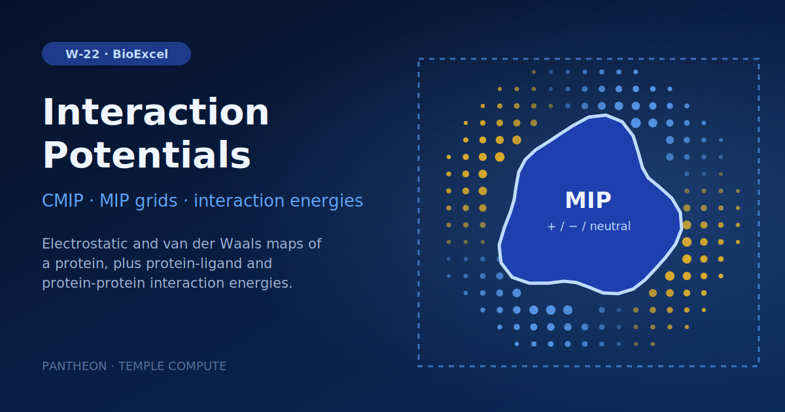

# W-22 · Classical Molecular Interaction Potentials


Classical molecular interaction potentials with CMIP: MIP grids and water/ion titration for a protein, protein-ligand (EGFR-Erlotinib) and protein-protein (RBD-hACE2) interaction energies.




## Overview

This workflow computes **Classical Molecular Interaction Potentials (CMIP)** from protein structures, using the BioExcel Building Blocks (biobb_io, biobb_cmip, biobb_structure_utils, biobb_chemistry, biobb_amber) around the CMIP code. It runs three independent case studies: (1) Molecular Interaction Potential (MIP) grids and structural-water/ion titration on Lysozyme (PDB: 1AKI); (2) protein-ligand interaction energies for the EGFR kinase domain bound to the Erlotinib inhibitor (PDB: 4HJO), including AMBER topology generation (tleap), energy minimization (sander), and ligand parameterization (ACPype/GAFF); and (3) protein-protein interaction energies between the SARS-CoV-2 receptor-binding domain (RBD) and human ACE2, computed from a pre-existing AMBER MD structure/topology. Horus provisions the full CMIP/AMBER/biobb conda environment automatically for each stage.

## Pipeline

```
Case 1 — Lysozyme MIP & titration
fetch_pdb_lysozyme        pdb_id (default 1AKI) from the PDB, or the uploaded protein
   │
cmip_prepare_pdb_lysozyme Add CMIP charges/elements (cmip_prepare_pdb)
   ├── cmip_titration_lysozyme ──► cat_pdb_titration   Structural waters/ions (cmip_titration / cat_pdb)
   ├── cmip_run_mip_pos       Positive MIP grid (cmip_run)
   ├── cmip_run_mip_neg       Negative MIP grid (cmip_run)
   └── cmip_run_mip_neutral   Neutral MIP grid (cmip_run)

Case 2 — EGFR–Erlotinib protein-ligand interaction
fetch_pdb_complex ──► remove_pdb_water ──► extract_heteroatoms ──► reduce_add_hydrogens ──► acpype_params_ac
   (download 4HJO, strip water, extract AQ4 ligand, add H, GAFF params via ACPype)
   │
leap_gen_top ──► sander_mdrun ──► amber_to_pdb   AMBER topology, minimization, PDB conversion
   │
cmip_prepare_structure_complex ──► remove_ligand
   ├── cmip_ignore_residues_protein   Mask protein for interaction calc (cmip_ignore_residues)
   └── cmip_run_egfr_interaction      EGFR–Erlotinib interaction energies (cmip_run)

Case 3 — RBD–hACE2 protein-protein interaction (from a pre-run MD structure)
cmip_prepare_structure_md (Files/RBD-hACE2-ZN.pdb + .top)
   ├── extract_chain_hace2 / extract_chain_rbd     Split complex by chain (extract_chain)
   ├── cmip_run_rbd_box / cmip_run_hace2_box / cmip_run_complex_box   Grid boxes (cmip_run)
   ├── cmip_ignore_residues_rbd ──► cmip_run_rbd_interaction     RBD vs hACE2 energies
   └── cmip_ignore_residues_hace2 ──► cmip_run_hace2_interaction hACE2 vs RBD energies
```

## Prerequisites

- **uv** (recommended) or pip — to install horus-runtime
- **micromamba**, **mamba**, or **conda** — the workflow executor builds a shared conda environment from `conda_env.yaml` to provision CMIP, AMBER, ACPype, and the biobb stack

## Quick Start

```bash
# Install uv if you don't have it
curl -LsSf https://astral.sh/uv/install.sh | sh

# From the workflow directory, install horus-runtime
cd workflows/bioexcel_building_blocks/w17-classical-molecular-interaction-potentials
uv sync
# or: pip install horus-runtime horus-environments

# Run the workflow
uv run horus run workflow.yaml
```

The first run builds the conda environment (this takes a few minutes). Subsequent runs reuse the cached environment at `../.horus_conda_env`.

## Inputs

Root artifacts in `workflow.yaml`; tc-os shows them in the campaign form.

| id | Kind | Default | Range | Meaning |
|---|---|---|---|---|
| `pdb_id` | string | 1aki | PDB ID, or empty | 4-character PDB code to download (default 1aki). Leave empty to use the uploaded protein instead. |
| `structure` | file | `examples/1aki.pdb` | PDB | PDB file used when pdb_id is empty. Default: 1AKI from the RCSB PDB. |
| `titration_waters` | number | 20 | 0–500, step 1 | Water molecules placed by the CMIP titration. |
| `titration_ions` | number | 5 | 0–100, step 1 | Positive and negative ions placed by the CMIP titration (same count each). |
| `md_pdb` | file | `Files/RBD-hACE2-ZN.pdb` | PDB | AMBER structure of a two-chain complex (partners are chains A and B) for case 3; must match md_top. Default the pre-run RBD-hACE2 MD structure. |
| `md_top` | file | `Files/RBD-hACE2-ZN.top` | TOP | AMBER topology matching md_pdb for case 3. Default the pre-run RBD-hACE2 topology. |

Expert settings stay in the biobb property files under `configs/`.
To change a value locally, edit its `value:` in `workflow.yaml`, then `rm -rf params/`: Horus writes
`params/<id>.txt` only when it is missing and fingerprints that file for the skip check.

## Running in Temple Compute

Import the workflow (or open it from the library) and start a campaign: give a PDB ID
for the MIP case (default 1AKI) or clear it and upload a protein, set the titration counts,
and optionally upload an AMBER structure/topology pair for the protein-protein case. The
CMIP runs and the sander minimization carry `resources` hints (2 CPU, 8 GB, 1 h), so an
auto-provisioned target picks a small general-purpose machine.

## Inputs / Outputs

Case 1 fetches `pdb_id` (default 1AKI) or uses the uploaded `structure`. Case 2 is fixed to 4HJO with Erlotinib (AQ4): its ligand name, charge and dielectric residue list are specific to that entry, so it is not exposed as an input. Case 3 reads `md_pdb` and `md_top` (default `Files/RBD-hACE2-ZN.pdb` / `.top`, a pre-run AMBER structure/topology of the RBD-hACE2 complex); upload your own matching pair to analyse another two-chain complex (chain A and chain B are the partners). Output file names keep the tutorial prefixes.

**Outputs** (all under `workflow_results/results/`):
- `1aki.pdb`, `1aki.cmip.pdb`, `1aki.wat_ions.pdb`, `1aki.tit.pdb` — Lysozyme structure preparation and titration
- `1aki.mip_pos.cube`, `1aki.mip_neg.cube`, `1aki.mip_neutral.cube` — MIP grid files (Gaussian cube format)
- `4hjo.pdb`, `AQ4.pdb`, `AQ4.reduce.H.pdb`, `AQ4params.*` — EGFR complex and Erlotinib ligand parameterization
- `structure.leap.prmtop/.crd/.pdb`, `structure.amber.rst/.crd`, `structure.amber-min.pdb` — AMBER topology and minimized complex
- `4hjo.EGFR.energies.log`, `4hjo.EGFR.ener.byat.out` — EGFR–Erlotinib interaction energies
- `RBD-hACE2-ZN.cmip.pdb`, `RBD-hACE2-ZN.hACE2.cmip.pdb`, `RBD-hACE2-ZN.RBD.cmip.pdb` — split RBD/hACE2 chains
- `RBD.box.json`, `hACE2.box.json`, `COMPLEX.box.json` — grid box definitions
- `RBD.energies.log/.byat.out`, `hACE2.energies.log/.byat.out` — RBD–hACE2 protein-protein interaction energies

## Configuration

`configs/fetch_pdb_complex.yaml` sets the case 2 PDB code (4HJO); case 1's protein and titration counts are inputs. `configs/cmip_run_mip_*.yaml` control MIP grid type (positive/negative/neutral). `configs/cmip_ignore_residues_*.yaml` define which residues/chains are masked out for each interaction calculation. `configs/leap_gen_top.yaml` and `configs/sander_mdrun.yaml` control AMBER topology generation and minimization parameters.

## References

- [BioExcel Building Blocks (biobb)](https://github.com/bioexcel/biobb)
- [biobb_cmip](https://github.com/bioexcel/biobb_cmip)
- [CMIP](https://anaconda.org/bioconda/cmip)
- [AMBER / AmberTools](https://ambermd.org)
- [ACPype](https://github.com/alanwilter/acpype)
- [BioExcel CMIP tutorial](https://biobb-wf-cmip.readthedocs.io)
