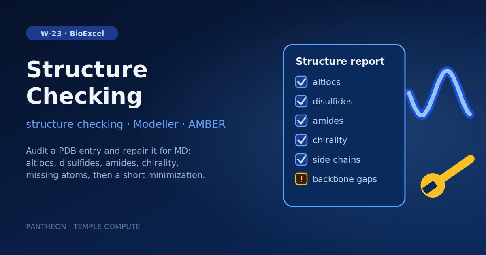

# W-23 · Molecular Structure Checking


Check and repair a PDB entry before MD: model/chain selection, alternate locations, disulfides, amides, chirality, missing side chains and backbone (Modeller), then a short AMBER minimization and a final quality report.




## Overview

This workflow runs a comprehensive structure-quality check and repair pipeline on a raw PDB structure before it is used as input for Molecular Dynamics, using the BioExcel Building Blocks (biobb_io, biobb_structure_utils, biobb_model, biobb_chemistry, biobb_amber) plus Modeller. Starting from the crystal structure of human Adenylate Kinase 1A in complex with the AP5A inhibitor (PDB: 1Z83), it selects a single model and chain, resolves alternate locations and disulfide bonds, strips metals/ligands/waters/hydrogens, fixes amide and chirality assignments, models missing side-chain and backbone atoms (the latter via Modeller), builds an AMBER topology, and runs a short energy minimization (sander) to relieve clashes before a final structure-quality report. Horus provisions the full biobb/AMBER/Modeller conda environment automatically for each stage.

## Pipeline

```
fetch_pdb                Download pdb_id (default 1Z83) from the PDB
   │
structure_check           Initial structure-quality report (structure_check)
   │
extract_model              Select model 1 (extract_model)
   │
extract_chain               Extract chain A (extract_chain)
   │
fix_altlocs                  Resolve alternate locations, keep altloc A (fix_altlocs)
   │
fix_ssbonds                   Identify/mark disulfide bridges as CYX (fix_ssbonds)
   │
remove_molecules_metals        Remove zinc ions (remove_molecules)
   │
remove_molecules_ligands        Remove SO4 and AP5 ligands (remove_molecules)
   │
reduce_remove_hydrogens           Strip existing hydrogen atoms (reduce_remove_hydrogens)
   │
remove_pdb_water                   Remove crystallographic waters (remove_pdb_water)
   │
fix_amides                          Fix ASN/GLN amide assignments (fix_amides)
   │
fix_chirality                        Fix THR/ILE chirality (fix_chirality)
   │
fix_side_chain                        Model missing side-chain atoms (fix_side_chain)
   │
canonical_fasta ──► fix_backbone       Model missing backbone atoms via Modeller (canonical_fasta / fix_backbone)
   │
leap_gen_top ──► sander_mdrun ──► amber_to_pdb   AMBER topology + energy minimization (leap_gen_top / sander_mdrun / amber_to_pdb)
   │
fix_pdb                                Renumber residues, restore chain IDs (fix_pdb)
   │
structure_check_final                   Final structure-quality report (structure_check)
```

## Prerequisites

- **uv** (recommended) or pip — to install horus-runtime
- **micromamba**, **mamba**, or **conda** — the workflow executor builds a shared conda environment from `conda_env.yaml` to provision AMBER, Modeller, and the biobb stack

## Quick Start

```bash
# Install uv if you don't have it
curl -LsSf https://astral.sh/uv/install.sh | sh

# From the workflow directory, install horus-runtime
cd workflows/bioexcel_building_blocks/w18-molecular-structure-checking
uv sync
# or: pip install horus-runtime horus-environments

# Run the workflow
uv run horus run workflow.yaml
```

The first run builds the conda environment (this takes a few minutes). Subsequent runs reuse the cached environment at `../.horus_conda_env`.

## Inputs

Root artifacts in `workflow.yaml`; tc-os shows them in the campaign form.

| id | Kind | Default | Range | Meaning |
|---|---|---|---|---|
| `pdb_id` | string | 1z83 | PDB ID | 4-character PDB code to check and repair. Also used to fetch the canonical sequence that Modeller rebuilds missing backbone from, so an upload is not offered. |
| `chain` | string | A | `[A-Za-z0-9]` | Chain to keep. |
| `altlocs` | string | `["A45:A","A67:A","A85:A"]` | JSON list | JSON list of alternate-location picks, one "A45:A" per residue (chain A, residue 45, keep altloc A); [] skips the step. The default is for 1Z83. |
| `minimization_steps` | number | 500 | 0–20000, step 50 | sander steepest-descent/conjugate-gradient cycles used to relieve clashes. |

Expert settings stay in the biobb property files under `configs/`.
To change a value locally, edit its `value:` in `workflow.yaml`, then `rm -rf params/`: Horus writes
`params/<id>.txt` only when it is missing and fingerprints that file for the skip check.

## Running in Temple Compute

Import the workflow (or open it from the library) and start a campaign: give a PDB ID
(default 1Z83), the chain, the alternate-location picks for that entry and the minimization
length. Modeller (`fix_backbone`) and sander carry `resources` hints (2 CPU, 8 GB, 1 h);
the checks are light. An auto-provisioned target picks a small general-purpose machine.

## Inputs / Outputs

The workflow fetches `pdb_id` (default 1Z83) from the RCSB PDB. It takes a PDB ID rather than an upload because `canonical_fasta` fetches the entry's canonical sequence, which Modeller needs to rebuild missing backbone. The metal (ZN) and ligand (SO4, AP5) removal lists stay in `configs/`; for another entry they are no-ops unless you edit them, and set `altlocs` to that entry's picks (or `[]`).

**Outputs** (all under `workflow_results/results/`):
- `downloaded.pdb`, `report.json` — raw structure and its initial quality report
- `models.pdb`, `chains.pdb`, `altloc.pdb`, `ssbonds.pdb` — model/chain/altloc/disulfide fixes
- `metals.pdb`, `ligands.pdb`, `hydrogens.pdb`, `water.pdb` — stripped structure after removing hetero content
- `amides.pdb`, `chiral.pdb`, `sidechains.pdb` — amide, chirality, and side-chain fixes
- `canonical.fasta`, `backbone.pdb` — canonical sequence and backbone-completed structure
- `amber.pdb`, `amber.top`, `amber.crd` — AMBER topology and coordinates
- `trj.crd`, `trj.rst`, `trj.log` — minimization trajectory/restart/log
- `amber_min.pdb`, `final.pdb` — minimized structure and final renumbered/chain-restored PDB
- `report_final.json` — final structure-quality report

## Configuration

The PDB code, chain, alternate locations and minimization length are the inputs above. `configs/extract_model.yaml` picks the model, `remove_molecules_metals.yaml` / `remove_molecules_ligands.yaml` the metals and ligands to drop, and `configs/leap_gen_top.yaml` the AMBER force field.

## References

- [BioExcel Building Blocks (biobb)](https://github.com/bioexcel/biobb)
- [biobb_structure_utils](https://github.com/bioexcel/biobb_structure_utils)
- [biobb_model](https://github.com/bioexcel/biobb_model)
- [Modeller](https://salilab.org/modeller/)
- [AMBER / AmberTools](https://ambermd.org)
- [BioExcel structure checking tutorial](https://biobb-wf-structure-checking.readthedocs.io)
