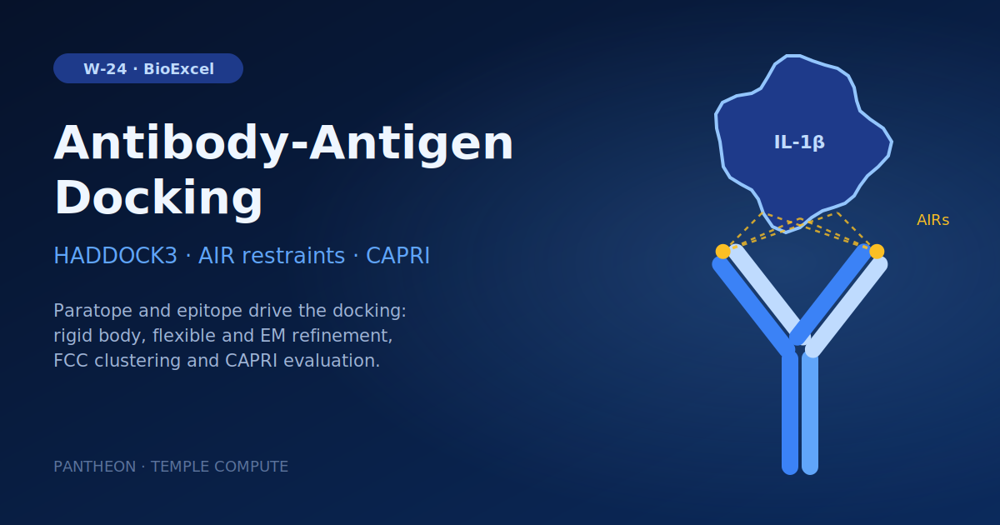

# W-24 · HADDOCK3 Protein-Protein Docking


Information-driven antibody-antigen docking with HADDOCK3: prepare gevokizumab and IL-1β, build ambiguous restraints from the paratope and epitope, then rigid-body docking, refinement, clustering and CAPRI evaluation.




## Overview

This workflow runs an antibody-antigen information-driven docking protocol with **HADDOCK3**, using the BioExcel Building Blocks (biobb_io, biobb_pdb_tools, biobb_haddock). It reproduces the official HADDOCK3 antibody-antigen tutorial with the gevokizumab antibody (PDB: 4G6K) and the Interleukin-1β antigen (PDB: 4I1B), using the known complex (PDB: 4G6M) as a reference for CAPRI scoring. Both antibody chains (heavy + light) are cleaned, trimmed to their variable domains, and merged into a single-chain model with `biobb_pdb_tools`; paratope/epitope active and passive residues are converted into ambiguous interaction restraints (AIR); and the docking itself proceeds through HADDOCK3's staged protocol — topology generation, rigid-body sampling, flexible refinement, energy minimization, clustering, and CAPRI evaluation at each stage. Horus provisions the full HADDOCK3/AmberTools/biobb conda environment automatically for each stage.

## Pipeline

```
fetch_antibody / fetch_antigen / fetch_complex   Download 4G6K, 4I1B, 4G6M from the PDBe (pdb)
   │
Antibody prep (H + L chains, run separately then merged)
   ab_H_tidy ─ab_H_selchain─ab_H_delhetatm─ab_H_fixinsert─ab_H_selaltloc─ab_H_keepcoord─ab_H_selres(1-120)─ab_H_tidy_final
   ab_L_tidy ─ab_L_selchain─ab_L_delhetatm─ab_L_fixinsert─ab_L_selaltloc─ab_L_keepcoord─ab_L_selres(1-107)─ab_L_tidy_final
      │  (biobb_pdb_tidy / selchain / delhetatm / fixinsert / selaltloc / keepcoord / selres)
   ab_zip_HL ──► ab_merge ──► ab_reres ──► ab_chain ──► ab_chainxseg ──► ab_tidy_final
      (zip, merge H+L, renumber, set chain A, chain→seg, final tidy)

Antigen prep
   ag_tidy ─ag_delhetatm─ag_selaltloc─ag_keepcoord─ag_chain(B)─ag_chainxseg─ag_tidy_final

Reference complex prep (for CAPRI scoring — same H/L/antigen pipeline applied to 4G6M)
   cx_H_* / cx_L_* ──► cx_zip_HL ──► cx_ab_merge ──► cx_ab_reres ──► cx_ab_chain ──► cx_ab_chainxseg ──► cx_ab_tidy_final
   cx_ag_* ──► cx_zip_AB ──► cx_merge ──► cx_tidy_final

Restraints
   write_ab_actpass                     Paratope active residues (static list)
   passive_from_active                  Epitope passive residues around antigen (haddock3_passive_from_active)
   actpass_to_ambig                     Ambiguous interaction restraints (AIR) table (haddock3_actpass_to_ambig)
   restrain_bodies                      Multi-body restraints tying antibody H+L chains (haddock3_restrain_bodies)

Docking (HADDOCK3 staged protocol)
   topology ──► rigid_body ──► capri_eval_1 ──► sele_top(top 8) ──► flex_ref ──► capri_eval_2
       ──► em_ref ──► capri_eval_3 ──► clust_fcc ──► sele_top_clusts(top 4/cluster) ──► capri_eval_4 ──► contact_map
```

## Prerequisites

- **uv** (recommended) or pip — to install horus-runtime
- **micromamba**, **mamba**, or **conda** — the workflow executor builds a shared conda environment from `conda_env.yaml` to provision HADDOCK3, AmberTools, and the biobb stack

## Quick Start

```bash
# Install uv if you don't have it
curl -LsSf https://astral.sh/uv/install.sh | sh

# From the workflow directory, install horus-runtime
cd workflows/bioexcel_building_blocks/w19-haddock3-protein-protein-docking
uv sync
# or: pip install horus-runtime horus-environments

# Run the workflow
uv run horus run workflow.yaml
```

The first run builds the conda environment (this takes a few minutes). Subsequent runs reuse the cached environment at `../.horus_conda_env`.

## Inputs

Root artifacts in `workflow.yaml`; tc-os shows them in the campaign form.

| id | Kind | Default | Range | Meaning |
|---|---|---|---|---|
| `rigid_body_models` | number | 10 | 10–10000, step 10 | Models sampled by rigid-body docking (the tutorial uses 10 for speed; HADDOCK production runs use 1000). |
| `refine_top_models` | number | 8 | 1–1000, step 1 | Best rigid-body models passed to flexible and energy-minimisation refinement. |
| `models_per_cluster` | number | 4 | 1–50, step 1 | Top models kept from each FCC cluster for the final evaluation. |

Expert settings stay in the biobb property files under `configs/`.
To change a value locally, edit its `value:` in `workflow.yaml`, then `rm -rf params/`: Horus writes
`params/<id>.txt` only when it is missing and fingerprints that file for the skip check.

## Running in Temple Compute

Import the workflow (or open it from the library) and start a campaign: set how many
rigid-body models to sample (10 in the tutorial, 1000 for a production run), how many to
refine and how many to keep per cluster; keep `refine_top_models` at or below
`rigid_body_models`. The three HADDOCK3 docking stages carry `resources` hints (8 CPU,
16 GB, 4-8 h), so an auto-provisioned target picks an 8-core general-purpose machine; the
~70 preparation steps are light.

## Inputs / Outputs

The workflow fetches 4G6K (antibody), 4I1B (antigen) and 4G6M (reference complex) from the PDBe. The structures are not inputs: the chain IDs, VH/VL residue ranges and paratope/epitope residue lists in `configs/` and in `write_ab_actpass` / `passive_from_active` are specific to these entries, so another antibody-antigen pair means editing those together. The sampling depth (`rigid_body_models`, `refine_top_models`, `models_per_cluster`) is the input.

**Outputs** (all under `workflow_results/results/`):
- `4G6K_clean.pdb`, `4I1B_clean.pdb` — prepared single-chain antibody and antigen structures
- `4G6M_clean.pdb` — prepared reference complex, used only for CAPRI scoring
- `4G6K_actpass.txt`, `4I1B_actpass.txt` — paratope active / epitope passive residue lists
- `ambig-paratope-NMR-epitope.tbl`, `antibody-unambig.tbl` — AIR and multi-body restraint tables
- `1_top_mol1.zip`, `1_top_mol2.zip`, `haddock_wf_data` — HADDOCK3 topology and running workspace
- `2_docking.zip` (rigid body), `5_flexref.zip` (flexible refinement), `7_emref.zip` (energy minimization) — model ensembles at each docking stage
- `3_caprieval.zip`, `6_caprieval2.zip`, `8_caprieval3.zip`, `11_caprieval4.zip` — CAPRI quality scores after each stage
- `4_selected.zip`, `9_clustfcc.zip`, `10_seletopclusts.zip` — top-scoring and clustered model selections
- `12_contact_map.zip` — contact maps for the final cluster representatives

## Configuration

`configs/fetch_antibody.yaml`, `fetch_antigen.yaml`, `fetch_complex.yaml` set the PDB codes (4G6K, 4I1B, 4G6M). `configs/selres_1_120.yaml` and `selres_1_107.yaml` define the antibody VH/VL domain residue ranges. `configs/selchain_A.yaml`, `selchain_H.yaml`, `selchain_L.yaml` select individual chains. `configs/flex_ref.yaml` and `em_ref.yaml` control the refinement parameters (the rigid-body sampling and the selections are inputs); `configs/clust_fcc.yaml` controls FCC clustering thresholds.

## References

- [BioExcel Building Blocks (biobb)](https://github.com/bioexcel/biobb)
- [biobb_haddock](https://github.com/bioexcel/biobb_haddock)
- [biobb_pdb_tools](https://github.com/bioexcel/biobb_pdb_tools)
- [HADDOCK3](https://github.com/haddocking/haddock3)
- [HADDOCK3 antibody-antigen tutorial](https://www.bonvinlab.org/education/HADDOCK3/HADDOCK3-antibody-antigen/)
- [BioExcel HADDOCK3 tutorial](https://biobb-wf-haddock.readthedocs.io)
