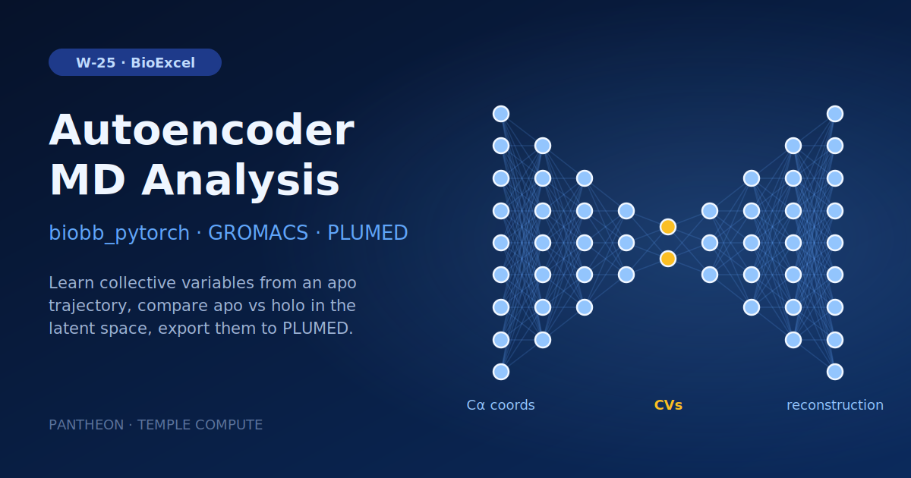

# W-25 · AutoEncoders for MD Analysis


Train an autoencoder on an apo MD trajectory, compare its latent space with the holo trajectory, check reconstruction by RMSF, and export the model as PLUMED collective variables for enhanced sampling.




## Overview

This workflow trains a multilayer **AutoEncoder (AE)** on molecular dynamics trajectory data for feature extraction, dynamical-differences mapping, and enhanced-sampling collective-variable (CV) generation, using the BioExcel Building Blocks (biobb_pytorch, biobb_analysis, biobb_gromacs, biobb_io). It fetches apo and holo MD trajectories of the SARS-CoV-2 replicase polyprotein 1ab (PDB: 6W9C) from the MDDB database, fits and featurizes both (Cα Cartesian coordinates), builds and trains an AutoEncoder on the apo dataset, evaluates it on both apo and holo data to compare their latent-space representations, computes RMSF profiles (including on an autoencoder-reconstructed holo trajectory) to assess reconstruction quality, and finally exports the trained model as a PLUMED-compatible collective variable for enhanced-sampling simulations. Horus provisions the full PyTorch/GROMACS/biobb conda environment automatically for each stage.

## Pipeline

```
Training (apo, 6W9C)
fetch_train_trajectory       Download apo trajectory 6W9C_apo from MDDB (mddb)
   │
fit_train_trajectory          Fit/align trajectory, rot+trans (gmx_image)
   │
featurize_train_trajectory     Featurize as Cα Cartesian coordinates (mdfeaturizer)
   │
build_model ──► train_model     Build AutoEncoder architecture, train on apo dataset (build_model / train_model)

Evaluation (holo, 6W9C)
fetch_test_trajectory        Download holo trajectory 6W9C_holo from MDDB (mddb)
   │
fit_test_trajectory           Fit/align to apo reference, rot+trans (gmx_image)
   │
featurize_test_trajectory      Featurize as Cα Cartesian coordinates (mdfeaturizer)
   │
evaluate_model                  Evaluate trained AE on apo dataset (evaluate_model)
   │
reconstruct_trajectory           Reconstruct holo trajectory from AE latent space (feat2traj)

RMSF comparison
make_ndx_apo / make_ndx_holo     GROMACS Cα index files (make_ndx)
gmx_rmsf_apo / gmx_rmsf_holo / gmx_rmsf_holo_recon   RMSF of apo, holo, and reconstructed-holo trajectories (gmx_rmsf)

Enhanced sampling export
make_plumed                      Convert trained model to PLUMED CV (.ptc) + bias input files (make_plumed)
```

## Prerequisites

- **uv** (recommended) or pip — to install horus-runtime
- **micromamba**, **mamba**, or **conda** — the workflow executor builds a shared conda environment from `conda_env.yaml` to provision PyTorch, GROMACS, and the biobb stack

## Quick Start

```bash
# Install uv if you don't have it
curl -LsSf https://astral.sh/uv/install.sh | sh

# From the workflow directory, install horus-runtime
cd workflows/bioexcel_building_blocks/w20-autoencoders-md-analysis
uv sync
# or: pip install horus-runtime horus-environments

# Run the workflow
uv run horus run workflow.yaml
```

The first run builds the conda environment (this takes a few minutes). Subsequent runs reuse the cached environment at `../.horus_conda_env`.

## Inputs

Root artifacts in `workflow.yaml`; tc-os shows them in the campaign form.

| id | Kind | Default | Range | Meaning |
|---|---|---|---|---|
| `n_frames` | number | 10000 | 100–10000, step 100 | Frames downloaded from MDDB for the apo (training) and holo (test) trajectories, from frame 1. |
| `n_cvs` | number | 3 | 1–10, step 1 | Size of the autoencoder latent space, i.e. the number of collective variables. |
| `max_epochs` | number | 100 | 1–2000, step 1 | Maximum training epochs. |
| `batch_size` | number | 128 | 8–4096, step 8 | Training batch size. |

Expert settings stay in the biobb property files under `configs/`.
To change a value locally, edit its `value:` in `workflow.yaml`, then `rm -rf params/`: Horus writes
`params/<id>.txt` only when it is missing and fingerprints that file for the skip check.

## Running in Temple Compute

Import the workflow (or open it from the library) and start a campaign: set the number
of frames to download, the latent dimensions (collective variables), the training epochs
and the batch size. Training carries a `resources` hint (4 CPU, 16 GB, 2 h) and
featurization/evaluation 2 CPU / 8 GB, so an auto-provisioned target picks a
general-purpose machine; the model is small, so CPU training is enough.

## Inputs / Outputs

The workflow fetches the apo (MDDB MCV1900210) and holo (MCV1900212) 6W9C trajectories from the MDDB database; `n_frames` sets how many frames. The trajectories are not inputs: the autoencoder's input layer (933 = 3 × 311 C-alpha atoms) is sized for this protein, so another system means editing the layer sizes in `build_model` as well.

**Outputs** (all under `workflow_results/results/`):
- `6W9C_apo.pdb/.xtc`, `6W9C_apo_fit.xtc` — apo training trajectory, raw and fitted
- `6W9C_apo.pt`, `6W9C_apo_stats.pt` — featurized apo dataset and statistics
- `model.pth` — untrained AutoEncoder architecture
- `apo_trained_model.pth`, `model_training_metrics.npz` — trained model and training curves
- `6W9C_holo.pdb/.xtc`, `6W9C_holo_fit.xtc` — holo test trajectory, raw and fitted
- `6W9C_holo.pt`, `6W9C_holo_stats.pt` — featurized holo dataset and statistics
- `apo_eval_results.npz` — model evaluation / latent-space results
- `6W9C_apo.ndx`, `6W9C_holo.ndx` — GROMACS Cα index files
- `6W9C_apo_rmsf.xvg`, `6W9C_holo_rmsf.xvg`, `6W9C_holo_recon_rmsf.xvg` — RMSF profiles
- `6W9C_holo_recon.xtc/.pdb` — holo trajectory reconstructed from the AE latent space
- `plumed_model.ptc`, `plumed.dat`, `features.dat` — PLUMED-ready collective-variable model and input files

## Configuration

The MDDB downloads, the AutoEncoder architecture and the training settings are inlined in the `fetch_*_trajectory`, `build_model` and `train_model` commands (layer sizes, activations, learning rate, train/val split), with the frames, latent size, epochs and batch size as inputs. `configs/make_plumed.yaml` controls the PLUMED bias (metadynamics parameters) and printed collective variables.

## References

- [BioExcel Building Blocks (biobb)](https://github.com/bioexcel/biobb)
- [biobb_pytorch](https://github.com/bioexcel/biobb_pytorch)
- [PLUMED](https://www.plumed.org)
- [MDDB — MoDEL Database](https://mddbr.eu/)
- [BioExcel AutoEncoder tutorial](https://biobb-wf-autoencoder.readthedocs.io)
