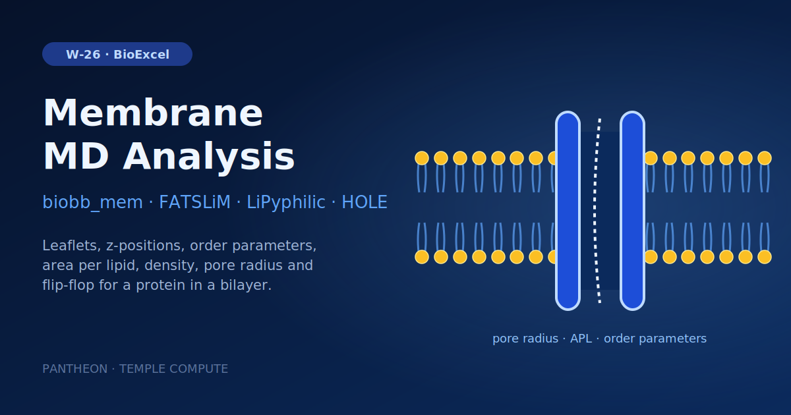

# W-26 · Protein-Membrane MD Analysis


Analyse a protein-membrane MD trajectory from MDDB: leaflets, lipid z-positions, order parameters, area per lipid, density profile, channel pore radius and lipid flip-flop.




## Overview

This workflow analyzes a membrane molecular dynamics simulation, using the BioExcel Building Blocks (biobb_io, biobb_mem, biobb_analysis). The example system is a heteropentameric GABA-gated chloride channel embedded in a DPPC lipid bilayer (MDDB accession: A023K, from the MemProtMD project). After fetching and fitting the trajectory so the membrane lies in the xy-plane, the workflow identifies membrane leaflets (FATSLiM, Lipyphilic) and computes a full set of membrane-analysis metrics: per-leaflet lipid z-positions and bilayer thickness, deuterium order parameters of the acyl tails, area per lipid (2D Voronoi tessellation), density profile along the membrane normal, channel pore-radius profile through the protein, and lipid flip-flop events between leaflets. Horus provisions the full FATSLiM/Lipyphilic/MDAnalysis/biobb conda environment automatically for each stage.

## Pipeline

```
download_trajectory        Download structure + trajectory for A023K from MDDB (mddb)
   │
fit_membrane                 Fit trajectory to membrane normal, rot+trans (gmx_image)
   │
fit_protein                   Fit trajectory to protein, XY translation only (gmx_image)
   │
identify_leaflets_fatslim      Identify membrane leaflets (fatslim_membranes)
   │
assign_leaflets                 Per-frame leaflet assignment (lpp_assign_leaflets)
   │
   ├── compute_zpositions           Lipid z-positions, whole membrane (lpp_zpositions)
   ├── compute_zpositions_around     Lipid z-positions around the protein (lpp_zpositions)
   ├── compute_order_parameters       Deuterium order parameters of acyl tails (gorder_aa)
   ├── compute_area_per_lipid          Area per lipid, 2D Voronoi tessellation (fatslim_apl)
   ├── compute_density_profile          Membrane density profile along z (cpptraj_density)
   ├── compute_pore_dimensions           Channel pore-radius profile (mda_hole)
   └── compute_flip_flop                 Lipid flip-flop events across leaflets (lpp_flip_flop)
```

## Prerequisites

- **uv** (recommended) or pip — to install horus-runtime
- **micromamba**, **mamba**, or **conda** — the workflow executor builds a shared conda environment from `conda_env.yaml` to provision FATSLiM, Lipyphilic, MDAnalysis, and the biobb stack

## Quick Start

```bash
# Install uv if you don't have it
curl -LsSf https://astral.sh/uv/install.sh | sh

# From the workflow directory, install horus-runtime
cd workflows/bioexcel_building_blocks/w21-protein-membrane-md-analysis
uv sync
# or: pip install horus-runtime horus-environments

# Run the workflow
uv run horus run workflow.yaml
```

The first run builds the conda environment (this takes a few minutes). Subsequent runs reuse the cached environment at `../.horus_conda_env`.

## Inputs

Root artifacts in `workflow.yaml`; tc-os shows them in the campaign form.

| id | Kind | Default | Range | Meaning |
|---|---|---|---|---|
| `mddb_project` | string | A023K | `[A-Za-z0-9]+` | MDDB accession of a protein in a DPPC membrane (structure, trajectory and GROMACS .tpr are downloaded). |
| `frame_stride` | number | 1000 | 1–10000, step 1 | Keep every Nth trajectory frame when downloading. |
| `pore_frame_step` | number | 20 | 1–1000, step 1 | Analyse the channel pore radius every Nth downloaded frame (HOLE). |

Expert settings stay in the biobb property files under `configs/`.
To change a value locally, edit its `value:` in `workflow.yaml`, then `rm -rf params/`: Horus writes
`params/<id>.txt` only when it is missing and fingerprints that file for the skip check.

## Running in Temple Compute

Import the workflow (or open it from the library) and start a campaign: give an MDDB
accession of a protein in a DPPC membrane (default A023K), the frame stride for the
download and the frame step of the pore analysis. The lipid and pore analyses carry
`resources` hints (2 CPU, 8 GB, 1 h), so an auto-provisioned target picks a small
general-purpose machine.

## Inputs / Outputs

The workflow fetches the structure (`.pdb`), trajectory (`.xtc`) and topology (`.tpr`) of MDDB entry `mddb_project` (default A023K, a GABA-gated chloride channel). The lipid selections in `configs/` assume a DPPC bilayer, so another entry should also be DPPC (or edit those selections). Output file names keep the `A023K` prefix.

**Outputs** (all under `workflow_results/results/`):
- `A023K_10.pdb`, `A023K_10.xtc`, `A023K.tpr` — downloaded structure, trajectory, and topology
- `A023K_fit.xtc`, `A023K_fit2.xtc` — membrane-normal-fitted and protein-XY-fitted trajectories
- `leaflets.ndx` — FATSLiM leaflet index groups
- `leaflets_data.csv` — per-frame Lipyphilic leaflet assignment (also reused as input for flip-flop detection)
- `zpositions.csv`, `zpositions_around.csv` — lipid z-position / bilayer-thickness data (whole membrane and protein-local)
- `order.csv` — deuterium order parameters
- `apl.csv` — area-per-lipid data
- `density.dat` — density profile along the membrane normal
- `hole.vmd`, `hole_profile.csv` — channel pore-radius profile
- `flip_flop.csv` — detected lipid flip-flop events

## Configuration

The MDDB project and frame stride are inputs; the download settings are inlined in `download_trajectory`. `configs/assign_leaflets.yaml`, `compute_zpositions.yaml`, `compute_zpositions_around.yaml`, `identify_leaflets_fatslim.yaml` control the lipid headgroup selection (`resname DPPC and element P`) used to identify leaflets. `configs/fit_membrane.yaml` and `fit_protein.yaml` control the GROMACS fitting mode (rot+trans vs. transxy) and reference selection.

## References

- [BioExcel Building Blocks (biobb)](https://github.com/bioexcel/biobb)
- [biobb_mem](https://github.com/bioexcel/biobb_mem)
- [FATSLiM](https://pythonhosted.org/fatslim/)
- [Lipyphilic](https://lipyphilic.readthedocs.io)
- [MDDB](https://mddbr.eu/)
- [BioExcel protein-membrane MD analysis tutorial](https://biobb-wf-mem.readthedocs.io)
