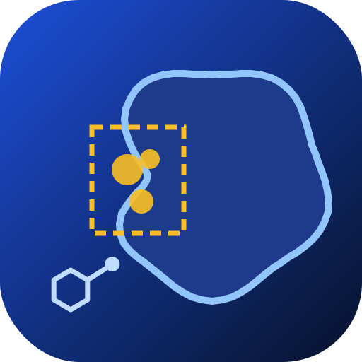
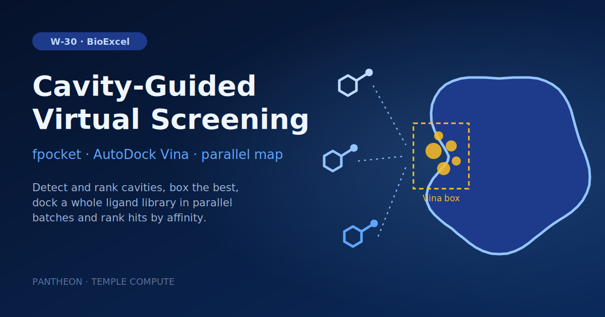

# W-30 · Cavity-Guided Virtual Screening



Find the most druggable cavity of a receptor with fpocket, box it, and dock a ligand library into it with AutoDock Vina as a parallel map, ranked by affinity.




## Overview

End-to-end structure-based virtual screening with BioExcel Building Blocks: fetch
a receptor, detect its cavities with fpocket, pick the most druggable one, and
dock a ligand library into it with AutoDock Vina, ranked by binding affinity.

This is a port of the [`biobb_vs_workflows`](https://github.com/bioexcel/biobb_vs_workflows)
repository, which ships the same science as two argparse CLIs (`cavity_analysis`
and `vs_autodock`) glued together by hand. Two things change in the port. The
cavity and screening halves are **fused into one DAG**, so the pocket number
flows from detection into docking instead of being read off a summary file and
retyped. And the per-ligand loop — which the source README describes as having
"no parallelization between ligands" — becomes a real engine-level fan-out, one
concurrent clone per batch.

It needs HPC for the same reason every screen does: docking is embarrassingly
parallel and linear in library size. The bundled 8-ligand example runs in about
two minutes on a laptop; a 100k-compound library is a cluster job, and the only
thing that changes is `batch_size` and the clones' `target:`.

## Quick start

```bash
# Install uv if you don't have it
curl -LsSf https://astral.sh/uv/install.sh | sh

cd workflows/bioexcel_building_blocks/w22-cavity-guided-virtual-screening
uv sync
# or: pip install horus-runtime horus-environments

# Docker is required: the fpocket-backed steps run in a Linux container.
uv run horus run workflow.yaml
```

## Compute Pattern

| Stage | Task(s) | Executor | Concurrency | Est. walltime (example) |
|---|---|---|---|---|
| Receptor fetch/upload + prep | `fetch_pdb`, `extract_protein`, `str_check_add_hydrogens` | conda | serial | ~10 s |
| Cavity detection | `fpocket_run`, `fpocket_filter` | docker | serial | ~50 s |
| Pocket selection | `select_pocket`, `fpocket_select`, `box` | conda + docker | serial | ~5 s |
| Library split | `split_ligands` | conda | serial | <1 s |
| **Docking** | `dock[00..NN]` | conda | **N clones in parallel** | ~100 s per batch of 2 |
| Ranking | `rank` | conda | serial | ~5 s |

Only the docking stage scales. Everything before it runs once on the receptor,
which is why the split is where the batch-size dial lives.

## Tools & Dependencies

- **horus-runtime** ≥ 0.8.0 (`horus_map`), **horus-environments**, **horus-docker**
- **BioBB blocks**: `biobb_io.pdb`, `biobb_structure_utils.extract_molecule`,
  `biobb_structure_utils.str_check_add_hydrogens`, `biobb_vs.fpocket_run`,
  `biobb_vs.fpocket_filter`, `biobb_vs.fpocket_select`, `biobb_vs.utils.box`,
  `biobb_chemistry.babel_convert`, `biobb_vs.vina.autodock_vina_run`
- **conda env** (`conda_env.yaml`): python 3.11 (vina has no py3.12 build),
  biobb_common/io/structure_utils/chemistry/vs, MDAnalysis, OpenBabel 3.1.1
- **container**: `quay.io/biocontainers/biobb_vs:5.2.1--pyhdfd78af_0` for the
  fpocket-backed steps
- **external binaries**: `obabel` (pose conversion in `rank`), `vina` and
  `fpocket` (via the env and the container)

## Horus Configuration

Every task targets `local`. The pipeline splits into two branches off
`extract_protein` — cavity detection and receptor protonation — which rejoin at
`split_ligands`:

```
fetch_pdb ─► extract_protein ─┬─► fpocket_run ─► fpocket_filter ─► select_pocket ─► fpocket_select ─► box ─┐
                              │                        ▲                                                   │
                              │                        └── (summary) ──┘                                   │
                              └─► str_check_add_hydrogens ──────────────────────────────────────────┐      │
                                                                                                    ▼      ▼
                                        examples/ligands.sdf ─────────────────────────────────► split_ligands
                                                                                                       │
                                                                                     ligand_batches/batch_NNN/
                                                                                                       ▼
                                                                        dock[00..NN]  (horus_map: N concurrent clones)
                                                                                                       │
                                                                                       results/docked/<slot>/
                                                                                                       ▼
                                                                                                     rank
```

Two wiring details are worth knowing before you edit this workflow.

**The pocket number travels as a generated config file.** `fpocket_select` takes
its pocket only through `--config`, so `select_pocket` writes
`results/fpocket_select.yaml` as an *output artifact* and an ordinary edge feeds
it to `fpocket_select`. A task producing its downstream neighbour's config is how
a runtime-chosen value reaches a CLI with no flag for it.

**Shared data rides inside each map slice.** `split_ligands` copies the prepared
receptor and the docking box into every `batch_NNN/` folder, so each clone is
self-contained and target-agnostic: on an auto-provisioned or remote target it
only needs its own slice.

To move docking onto a cluster, give the `dock` map a `target:` (e.g. a Slurm
target); its `resources:` block already sizes each clone. Nothing else in the DAG changes.

## Inputs

Root artifacts in `workflow.yaml`; tc-os shows them in the campaign form.

| id | Kind | Default | Range | Meaning |
|---|---|---|---|---|
| `pdb_id` | string | 3HEC | PDB ID, or empty | 4-character PDB code to download (default 3HEC). Leave empty to use the uploaded receptor instead. |
| `structure` | file | `examples/3hec.pdb` | PDB | PDB file used when pdb_id is empty. Default: 3HEC from the RCSB PDB. |
| `ligand_library` | file | `examples/ligands.sdf` | SDF | SDF (or SMILES) library of candidate ligands to screen against the receptor. |
| `rank_by` | choice | druggability_score | `druggability_score`, `score`, `volume` | fpocket metric used to pick the cavity to dock into. |
| `batch_size` | number | 2 | 1–500, step 1 | Ligands docked by each parallel clone. |
| `exhaustiveness` | number | 8 | 1–64, step 1 | AutoDock Vina search exhaustiveness per ligand. |
| `top_n` | number | 10 | 1–1000, step 1 | Best-ranked ligands whose poses are written to results/poses/. |

Expert settings stay in the biobb property files under `configs/`.
To change a value locally, edit its `value:` in `workflow.yaml`, then `rm -rf params/`: Horus writes
`params/<id>.txt` only when it is missing and fingerprints that file for the skip check.

## Running in Temple Compute

Import the workflow (or open it from the library) and start a campaign: give a PDB ID
(default 3HEC) or clear it and upload a receptor, upload the ligand library (SDF or SMILES),
and set the cavity ranking metric, ligands per batch, Vina exhaustiveness and the number
of poses to keep. Each docking clone carries a `resources` hint (2 CPU, 4 GB, 1 h) and up
to 8 run at once, so an auto-provisioned target sizes one general-purpose machine for
the map; raise `max_concurrency` on `dock` for larger libraries.

## Input / Output

**Input**

- `pdb_id` — the PDB code to screen against (default `3HEC`, p38α); clear it to use the uploaded `structure` instead
- `ligand_library` — the ligand library (default `examples/ligands.sdf`, 8 ZINC compounds).
  `.smi` (`SMILES [name]`, one per line) works too, dispatched on extension.
- `configs/*.yaml` — one per BioBB step

**Output** (under `horus_workflow_results/`)

- `results/scores.csv` — the ranking, most-negative affinity first. Header is
  `Rank,Affinity,Index,Identifier`, matching the source workflow's `scores.csv`.
- `results/screening_summary.json` — total / docked / failed counts, success
  rate, the best hit, and a per-ligand failure list with the stage and error
- `results/poses/<ligand>_poses.pdb` — the top-K poses as PDB
- `results/pocket_report.json` — every candidate cavity, which survived
  filtering, and why the winner won
- `results/docked/<slot>/` — one slot per clone, with that batch's PDBQT outputs,
  Vina logs, and `status.json`

Bundled example result: pocket 1 selected (druggability 0.876), 8/8 ligands
docked, best affinity −5.157 kcal/mol (`ZINC000004204034_0`).

## Parameterization

| What | Where |
|---|---|
| Target receptor | `pdb_id`, or `structure` upload |
| Ligand library | `ligand_library` upload (default `examples/ligands.sdf`) |
| **Parallelism** | `batch_size` (ligands per clone); `dock` → `max_concurrency` (clones at once, 8) |
| Docking accuracy/speed | `exhaustiveness` (4 fast, 8 default, 32 thorough); Vina `--cpu` follows the `dock` `resources.cpus` (2) |
| Cavity filter windows | `configs/fpocket_filter.yaml` |
| Which pocket wins | `rank_by` (`druggability_score`, `score`, `volume`) |
| Restrict to a known site | `select_pocket` task → `--residue-selection` (MDAnalysis syntax, e.g. `"resid 37 or resid 49"`) + `--distance-threshold` |
| Box size | `configs/box.yaml` → `offset` |
| How many poses | `top_n` |

`batch_size` is the dial that matters. It trades clone count against per-clone
environment start-up: one clone per ligand maximises parallelism and per-ligand
resume granularity, but pays an env activation per ligand.

## Implementation Notes

- **The bundled filter windows are loose on purpose.** 3HEC's ATP-site cavity
  scores 0.341 on fpocket's `score` despite a druggability of 0.876, so the
  source workflow's defaults (`score: [0.4, 1]`) reject *every* pocket and
  fpocket_filter reports "No matches found". `configs/fpocket_filter.yaml`
  documents both windows; tighten them for a holo structure.
- **osx-arm64 cannot build the conda env.** `biobb_vs` pins `fpocket ==4.1`,
  which conda-forge builds for linux-64 and osx-64 but not osx-arm64. On Apple
  Silicon, prefix the run with `CONDA_SUBDIR=osx-64 CONDA_OVERRIDE_OSX=10.16` to
  build under Rosetta. Linux — CI, clusters — is unaffected.
- **A failed ligand is data, not a task failure.** `dock_batch.py` never exits
  non-zero: horus-runtime has no per-task `allow_failure`, so a clone that fails
  either aborts the run (`fail_fast`) or blocks the gather (`continue`), and one
  unparseable ligand would cost the whole screen. Per-ligand failures land in
  `status.json` and flow into `screening_summary.json`, which is exactly the
  source workflow's try/except semantics.
- **`dock_batch.py` chdirs before calling BioBB.** A map clone's id is `dock[0]`,
  and that id becomes its directory name. BioBB stages files into a sandbox under
  the current directory and shells out unquoted, so a bracketed path is treated
  as a glob, matches nothing, and fails with `zsh:1: no matches found`. The
  script runs from `results/docked/<slot>/work/` instead, which is bracket-free.
  This is a workaround for an engine-level issue, not a BioBB quirk — any map
  workflow whose tasks shell out will hit it.
- **Ranking parses `REMARK VINA RESULT` directly**, taking only the first match
  per file, because Vina writes poses best-first. One deliberate fix over the
  source: it tests `if affinity is not None` rather than `if affinity:`, which
  silently dropped any ligand scoring exactly 0.0.
- Each helper script has a `--selftest` flag (`python3 scripts/rank.py
  --selftest`) with assert-based checks and no dependencies on the chemistry
  stack.

## Open Questions

- Should the receptor be fetchable as a local PDB too, for targets that aren't
  in the PDB? Today it is always fetched by code.
- `select_pocket` ranks by a single metric. A combined score (druggability ×
  volume fit to the ligand library) would likely pick better pockets.
- Docking currently re-expands and re-copies every map slice on resume, since
  `MapExpander.is_complete()` is permanently `False`. Fine at 8 ligands, O(N) I/O
  at 100k.

## References

- Source workflows: [bioexcel/biobb_vs_workflows](https://github.com/bioexcel/biobb_vs_workflows)
- [BioExcel Building Blocks](https://mmb.irbbarcelona.org/biobb/) documentation
- fpocket: Le Guilloux, Schmidtke & Tuffery, *BMC Bioinformatics* (2009)
- AutoDock Vina: Eberhardt, Santos-Martins, Tillack & Forli, *J. Chem. Inf. Model.* (2021)
- Related: [W-13 Protein-Ligand Docking (fpocket)](../w08-protein-ligand-docking-fpocket/README.md) — single-ligand version of the same chemistry
- Related: [W-06 Fan-out / Map / Gather](../../engine-showcases/w01-fanout-map-gather/README.md) — the engine construct this workflow is built on
