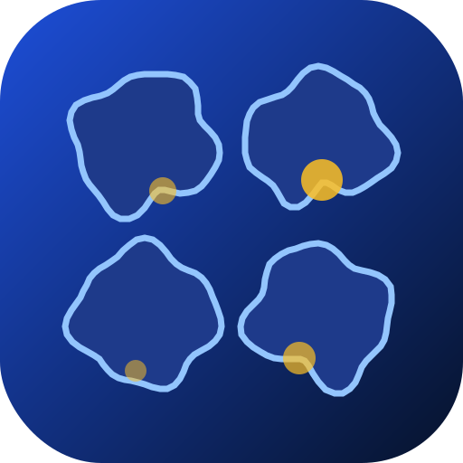
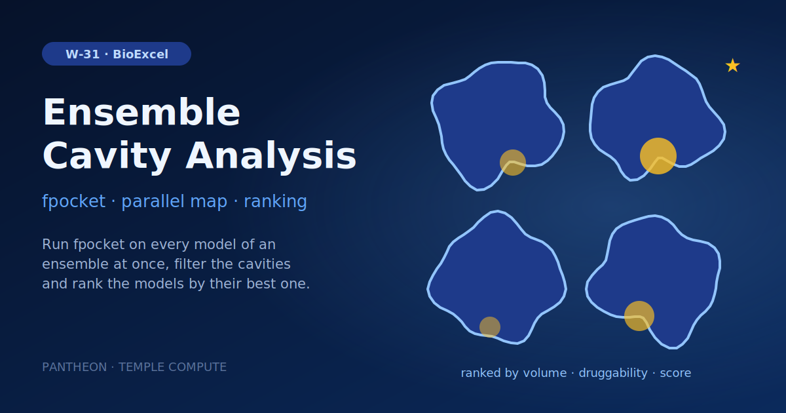

# W-31 · Cavity Analysis



Detect and filter cavities with fpocket on every structure of a conformational ensemble in parallel, then rank the models by their best cavity's volume, druggability and score.




## Overview

Detects and ranks druggable cavities across a conformational ensemble. Given a
folder of structures — MD cluster representatives, NMR models, or any set of
related conformations — it runs fpocket on each, filters the cavities by score,
druggability, and volume, optionally keeps only those near a site of interest,
and ranks the models by their best cavity.

This is a port of the `cavity_analysis` CLI from
[`biobb_vs_workflows`](https://github.com/bioexcel/biobb_vs_workflows). It
answers the question that comes *before* a virtual screen: a protein is not one
shape, and a pocket that is closed in the crystal structure may be open in half
the ensemble. Ranking conformations by cavity quality tells you which one to
dock into — feed the winner to [W-30](../w22-cavity-guided-virtual-screening/README.md).

The source runs its models in a serial `for` loop; here each model is a
concurrent map clone, which is the whole point since models are independent.

## Quick start

```bash
# Install uv if you don't have it
curl -LsSf https://astral.sh/uv/install.sh | sh

cd workflows/bioexcel_building_blocks/w23-cavity-analysis
uv sync
# or: pip install horus-runtime horus-environments

# The first run builds the conda environment (takes a few minutes).
uv run horus run workflow.yaml
```

## Compute Pattern

| Stage | Task(s) | Executor | Concurrency | Est. walltime (example) |
|---|---|---|---|---|
| Model preparation | `prepare_models` | conda | serial | <1 s |
| **Cavity analysis** | `analyze[00..NN]` | conda | **N clones in parallel** | ~30 s per model |
| Ranking | `summarize` | conda | serial | <1 s |

Scaling is linear in ensemble size and entirely in the map stage. A 100-model
ensemble is 100 independent ~30 s tasks — a natural cluster array job.

## Tools & Dependencies

- **horus-runtime** ≥ 0.8.0 (`horus_map`), **horus-environments**
- **BioBB blocks**: `biobb_structure_utils.extract_molecule`,
  `biobb_vs.fpocket_run`, `biobb_vs.fpocket_filter`
- **repo-local step**: `filter_residue_com`, ported from
  `cavity_analysis.py:243-358` — not a BioBB block
- **conda env** (`conda_env.yaml`): python 3.11, biobb_common,
  biobb_structure_utils, biobb_vs (which supplies fpocket), MDAnalysis, PyYAML

No container: unlike [W-30](../w22-cavity-guided-virtual-screening/README.md),
every step here calls the BioBB python API in-process, so fpocket comes from the
conda environment.

## Horus Configuration

```
examples/structures/*.pdb ──► prepare_models ──► models/model_NNN/
                                                        │
                                                        ▼
                                  analyze[00..NN]  (horus_map: N concurrent clones)
                                   extract_molecule
                                     ─► fpocket_run
                                       ─► fpocket_filter
                                         ─► filter_residue_com
                                                        │
                                                 results/analyzed/<slot>/
                                                        ▼
                                                   summarize ──► summary_by_volume.yml
                                                                 summary_by_drug_score.yml
                                                                 summary_by_score.yml
                                                                 cavity_report.json
```

**Why `prepare_models` exists.** The map fans out over the *children* of a
folder, and `analyze_model.py` works on one model folder (structure plus its
working files), so each structure is first wrapped in its own `model_NNN/`
folder. It also accepts a single `.pdb` instead of a folder. Folders are zero-padded because children are fanned out
in name-sorted order — unpadded `model_10` would sort before `model_2`.

**Why the four analysis steps are one task.** A map must declare exactly one
output folder, so the per-model pipeline runs inside a single clone rather
than as four chained tasks. That is also what allows a per-model failure to be
caught and recorded instead of aborting the run, and it matches the source,
which runs the same four steps in a Python loop body.

To move analysis onto a cluster, give the `analyze` map a `target:`; its
`resources:` block already sizes each clone. Nothing else changes.

## Inputs

Root artifacts in `workflow.yaml`; tc-os shows them in the campaign form.

| id | Kind | Default | Range | Meaning |
|---|---|---|---|---|
| `structures` | folder | `examples/structures/` | folder | Folder of PDB models (MD cluster representatives, NMR models, or any conformational ensemble) to analyse. |
| `min_druggability` | number | 0.2 | 0–1, step 0.05 | Cavities with a lower fpocket druggability score are dropped. |
| `min_volume` | number | 100 | 0–5000, step 50 | Smaller cavities are dropped. |
| `max_volume` | number | 5000 | 100–20000, step 100 | Larger cavities are dropped; keep it above min_volume. |

The score window, residue selection and chain filters stay as flags of the `analyze` map (see Parameterization).
To change a value locally, edit its `value:` in `workflow.yaml`, then `rm -rf params/`: Horus writes
`params/<id>.txt` only when it is missing and fingerprints that file for the skip check.

## Running in Temple Compute

Import the workflow (or open it from the library) and start a campaign: upload a folder
of PDB models (MD cluster representatives, NMR models, any ensemble; default three MD
clusters) and set the druggability and volume windows. Each analysis clone carries a
`resources` hint (1 CPU, 2 GB, 30 min) and up to 8 run at once, so an auto-provisioned
target sizes one small general-purpose machine for the map.

## Input / Output

**Input**

- `structures` — a folder of PDB models (default `examples/structures/`, three MD
  cluster representatives). A single `.pdb` file also works.

**Output** (under `horus_workflow_results/results/summaries/`)

- `summary_by_volume.yml` — models ordered by their largest cavity
- `summary_by_drug_score.yml` — models ordered by their most druggable cavity
- `summary_by_score.yml` — models ordered by their best-scoring cavity
- `cavity_report.json` — how many models were analysed, how many kept a cavity,
  which model won on each metric, and any failures

Each summary holds the same data in a different order: every model that kept at
least one cavity, with the full fpocket metrics of its surviving cavities. Three
orderings exist because the metrics disagree, and which one matters depends on
what the cavity is for.

Per-model detail stays in `results/analyzed/<slot>/`: `summary.json` (every cavity
fpocket found, pre-filter), `filtered_pockets.zip` (the survivors), `model.pdb`
(the prepared structure), and `status.json`.

Bundled example result: 3 models analysed, 2 kept cavities, 4 cavities total,
`cluster1` best on all three metrics. `cluster2` is correctly reported as having
no druggable cavity — its best druggability score is 0.033.

## Parameterization

| What | Where |
|---|---|
| Input ensemble | `structures` upload (default `examples/structures/`) |
| Cavity filter windows | `min_druggability`, `min_volume`, `max_volume`; `analyze` → `--score` (`lo,hi`) |
| Restrict to a known site | `analyze` map → `--residue-selection` (MDAnalysis syntax, e.g. `"resid 31 or resid 21"`) + `--distance-threshold` |
| Keep only some chains | `analyze` map → `--chains A` (comma-separated) |
| Keep cofactors/ions | `analyze` map → `--skip-extraction` |

The default windows (score 0–1, druggability 0.2–1, volume 100–5000 ų) are
looser than the source defaults (`0.4`/`0.4`/`200`), which reject every cavity in
this ensemble. Tighten them for a larger or better-formed set of structures.

## Implementation Notes

- **A model with no cavity is a result, not a failure.** fpocket_filter writes
  nothing when no cavity falls inside the windows, so `analyze_model.py` treats a
  missing filtered zip as zero surviving cavities. The model is simply absent
  from the summaries and counted in `cavity_report.json`.
- **A failed model does not block the run.** `analyze_model.py` never exits
  non-zero: horus-runtime has no per-task `allow_failure`, so a failing clone
  would block the gather task and cost the whole ensemble. Failures land in
  `status.json` and are surfaced in `cavity_report.json`. This is *stricter*
  than the source, where a failing model aborts the run outright.
- **`analyze_model.py` chdirs before calling BioBB.** A map clone's id is
  `analyze[0]`, and that becomes its directory name; BioBB stages files into a
  sandbox under the current directory and shells out unquoted, so the brackets
  are glob-expanded and match nothing. The script runs from
  `results/analyzed/<slot>/work/` instead. See the
  [W-30 README](../w22-cavity-guided-virtual-screening/README.md#implementation-notes).
- **osx-arm64 cannot build the conda env**, because `biobb_vs` pins
  `fpocket ==4.1`, which conda-forge builds for linux-64 and osx-64 only. On
  Apple Silicon prefix the run with
  `CONDA_SUBDIR=osx-64 CONDA_OVERRIDE_OSX=10.16`.
- **Chain names are stringified before being passed to BioBB**, because YAML 1.1
  reads a bare `N` or `Y` as a boolean and a chain really can be named `N`. Same
  guard the source workflow uses.
- Each helper script has a `--selftest` flag with assert-based checks and no
  dependency on the chemistry stack.

## Open Questions

- **The trajectory front end is not ported.** The source can take a raw
  trajectory and cluster it with `gmx_cluster` (plus a retry loop that widens the
  RMSD cutoff when the combined centroid PDB grows too large). This workflow
  starts from an already-clustered ensemble. Porting it would need a `loop:`
  block and a GROMACS environment — and note the source's retry loop has a bug:
  `num_atoms` is never recomputed inside the `while`, so it runs either 10 times
  or not at all (`cavity_analysis.py:954-981`).
- Cluster populations are not carried through, since they only exist on the
  trajectory path. The source adds a `population` key to each model's summary.
- Should the winning model be handed to W-30 automatically? Today the two
  workflows are chained by hand.

## References

- Source workflow: [bioexcel/biobb_vs_workflows](https://github.com/bioexcel/biobb_vs_workflows)
- fpocket: Le Guilloux, Schmidtke & Tuffery, *BMC Bioinformatics* (2009)
- [BioExcel Building Blocks](https://mmb.irbbarcelona.org/biobb/) documentation
- Downstream: [W-30 Cavity-Guided Virtual Screening](../w22-cavity-guided-virtual-screening/README.md)
- Related: [W-06 Fan-out / Map / Gather](../../engine-showcases/w01-fanout-map-gather/README.md)
