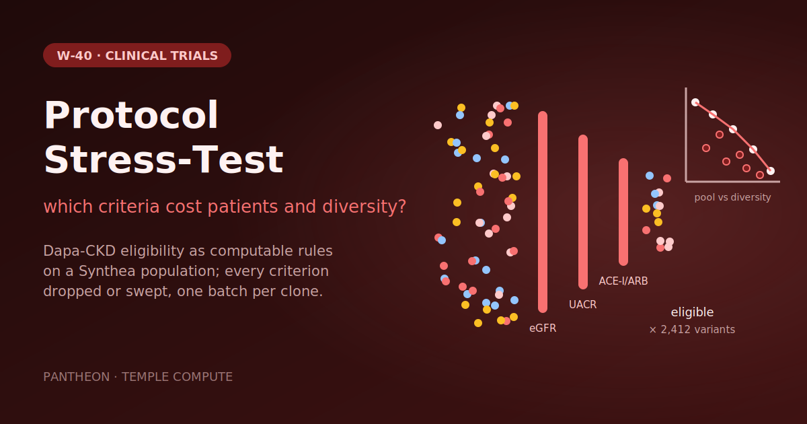

# W-40 · Protocol Stress-Test


A public trial's eligibility criteria as computable rules on a Synthea population, with thousands of protocol variants fanned out to rank each criterion by the patients and the diversity it costs.




## Overview

This workflow takes the eligibility criteria of a real, public trial and turns them into computable rules. It applies them to a synthetic population and evaluates thousands of protocol variants in parallel, with each criterion removed or its threshold swept. The output ranks criteria by the patients and the demographic diversity each one costs. It quantifies one hard metric: a screen-failure proxy, defined below.

The protocol is **NCT03036150 (Dapa-CKD)**, "A Study to Evaluate the Effect of Dapagliflozin on Renal Outcomes and Cardiovascular Mortality in Patients With Chronic Kidney Disease". ClinicalTrials.gov lists AstraZeneca as its lead sponsor. We chose it over DECLARE-TIMI 58 (NCT01730534) because more of its criteria map to data that Synthea simulates, and several have numeric thresholds and time windows that can be swept. DECLARE-TIMI 58's "High Risk for Cardiovascular events" criterion has no thresholds to sweep. This workflow uses only the public registry record. It is not affiliated with or endorsed by the sponsor or by ClinicalTrials.gov.

**Result of the default run** (seed 42, 5,000 synthetic patients alive at 2026-01-01). These figures come from `results/summary.json`:

- 814 patients pass the prescreen (an active CKD diagnosis and age ≥18).
- Under the full computable protocol, 8 of them are eligible, so the screen-failure proxy is 99.0%.
- **The most costly criterion is I4a (UACR 200–5000 mg/g).** Removing it lifts the eligible pool from 8 to 23 patients (screen-failure proxy 97.2%).
  - 15 prescreened patients fail only this criterion.
- Removing I5 (ACE-I/ARB for ≥4 weeks) gives 21 eligible patients (13 fail only I5).
- Removing I3 (eGFR 25–75) gives 12 (4 fail only I3).
- Of the 2,412 variants evaluated, the largest pool is 61 eligible patients (screen-failure proxy 92.5%). That variant uses:
  - UACR ≥30 mg/g;
  - no ACE-I/ARB duration requirement;
  - eGFR 15–60;
  - a 4-week cardiovascular-event washout.

These are synthetic results that show the method. They say nothing about the real trial; see [Limitations](#limitations).

```
parse_criteria   (optional LLM draft + diff vs reviewed rules)   ─────────────────────────┐
plan_shards ──> generate_population  [horus_map, one Synthea JVM per shard]               │
                      └──> build_features ──┐                                             │
generate_variants ──────────────────────────┴──> evaluate [horus_map, one clone per batch] ──> gather_report
```

## Compute Pattern

| Stage | Kind | Executor / target | CPU / RAM (advisory `resources:`) | Walltime (measured) |
|---|---|---|---|---|
| parse_criteria | task | uv env (`anthropic`), local | 1 CPU | <1 s skipped; one API call when a key is set |
| configure | task | shell (`python3`, stdlib), local | 1 CPU | <0.1 s |
| plan_shards | task | uv env, local | 1 CPU | 3 s on first run (includes building the shared env) |
| generate_population | `horus_map`, 4 clones, `max_concurrency: 2` | uv env (`jdk4py`), local or SLURM | 4 CPU / 4 GB / 1 h each | 7 min 36 s for all 4 shards |
| build_features | task | uv env (`polars`), local | 2 CPU / 8 GB / 30 min | 12 s |
| generate_variants | task | shell (`python3`, stdlib), local | 1 CPU | 0.1 s |
| evaluate | `horus_map`, 49 clones | uv env (`polars`, `numpy`), local or SLURM | 1 CPU / 2 GB / 15 min each | about 1 to 2 s per clone |
| gather_report | task | uv env (`matplotlib`), local | 2 CPU / 4 GB / 15 min | 1 to 2 s |

A full default run (`--no-skip-all`, Synthea jar and uv environment already cached) took **7 min 42 s** of wall-clock time on a 16-core laptop. The first run, which also built the uv environment, took about 8 minutes; the stage times in the table come from it. The one-time 192 MB jar download is not included. Synthea dominates the runtime. Each shard's JVM peaked at about 2.6 GB RSS, which is why the population map is capped at two concurrent clones.

The variant sweep is the HPC story. Each batch file is one independent job, so the same YAML can fan out across a cluster by pointing `evaluate` (and `generate_population`) at a SLURM target. At the default size the evaluation is cheap. It scales linearly with the number of variants and the population size, which is where the fan-out pays off.

## Tools & Dependencies

- [horus-runtime](https://pypi.org/project/horus-runtime/) ≥0.8.0 (`horus_map`, value limits) and [horus-environments](https://pypi.org/project/horus-environments/) ≥0.1.5 (`uv_python_environment`).
- [Synthea](https://github.com/synthetichealth/synthea) v4.0.0, a pinned release jar verified by SHA-256 and cached in `~/.cache/pantheon/` (override with `PANTHEON_CACHE`). Apache-2.0.
- Java from the [jdk4py](https://pypi.org/project/jdk4py/) wheel inside the task's uv environment. No system JDK, conda or Docker is needed.
- polars, numpy, pyarrow and matplotlib, pinned in `workflow.yaml`.
- Optional: the [Anthropic Python SDK](https://pypi.org/project/anthropic/) for the LLM draft.

## Horus Configuration

- **Executors:** `uv_python_environment` for every data task, and `shell` for the stdlib-only `generate_variants`. No conda or Docker.
  - The data tasks share one environment via `environment_dir: ../../.horus_uv_env_w40`, so every map clone reuses it.
  - `plan_shards` builds that environment before any map clone starts, so clones never race to create it.
  - `parse_criteria` has its own small environment.
- **Fan-out:** `generate_population` and `evaluate` are `kind: horus_map` tasks. A map runs one clone per direct child of its `over.input_id` folder, with the child bound to `${shard}` or `${batch}`, and writes each clone's output to `<output>/<slot>/`. The downstream task reads the whole folder through an ordinary edge.
- **Targets:** every task runs on `kind: local`.
  - `workflow.yaml` has commented SLURM target anchors (`_slurm_population`, `_slurm_evaluate`) in the style of `drug-discovery/w04-cmd`, with empty `partition` and `account`.
  - To use them, run `uv add horus-slurm`, uncomment an anchor, fill in your site values, and set the task's `target:`.
  - **This workflow has not been run on SLURM.**
- **Incremental runs:** tasks are fingerprinted. Editing `examples/criteria.reviewed.json` re-runs feature building, evaluation and the report, but not Synthea.
- **Run ID:** the horus CLI does not expose a run ID to tasks. `provenance.json` records the `gather_report` task's execution directory name instead.

## Quick start

```bash
# Install uv if you don't have it
curl -LsSf https://astral.sh/uv/install.sh | sh

cd workflows/clinical-trials/w01-protocol-stress-test
uv sync
uv run horus run workflow.yaml

# Optional: let the LLM draft the rules too (the diff appears in the report)
ANTHROPIC_API_KEY=... uv run horus run workflow.yaml
```

Network access is needed only on the first run (the uv environment and the 192 MB Synthea jar) and for the optional LLM call. Results land in `horus_workflow_results/results/`. Open `report.html`.

Self-tests (each script builds a tiny fixture and asserts on it):

```bash
for s in plan_shards generate_variants parse_criteria; do python3 scripts/$s.py --selftest; done
for s in generate_population build_features evaluate gather_report; do
  uv run --with polars==2.0.0 --with numpy==2.4.6 --with pyarrow==26.0.0 --with matplotlib==3.11.2 python scripts/$s.py --selftest
done
```

## Input / Output

**Inputs** (committed in `examples/`, see `examples/SOURCES.md`):

| File | Content |
|---|---|
| `protocol/NCT03036150.json` | ClinicalTrials.gov API v2 record, retrieved 2026-10-16. Never fetched at runtime. |
| `criteria.reviewed.json` | The human review gate: feature definitions with SNOMED CT / LOINC / RxNorm codes, the prescreen, and one rule per criterion with its sweep grid. |
| `config.json` | Index date, population size, shards and seed, variant batch size, LLM model. |

**Outputs** (`horus_workflow_results/results/`):

| File | Content |
|---|---|
| `report.html` | Self-contained report: headline, hero chart, per-criterion costs, non-simulated criteria, threshold sweeps, Pareto frontier, LLM diff, data coverage, provenance. |
| `hero.png` | 1200×630 chart of the patients regained per removed criterion. |
| `summary.json` | Every reported number. Identical across runs with the same seed. |
| `provenance.json` | NCT ID, SHA-256 of the protocol snapshot, criteria and config, Synthea version, jar hash, seeds and state, population counts, package versions, execution directory, timestamp. |
| `variants.csv` | One row per variant: params, hash, eligible count, screen-failure proxy, composition, diversity, and per-criterion fail and sole-cause counts. |
| `features.parquet`, `prescreen.json` | Patient-level features and prescreen summary. |
| `criteria_draft.json`, `criteria_diff.json` | LLM draft and its diff against the reviewed rules, or `status: skipped`. |

### Rule schema

Each criterion in `criteria.reviewed.json` has these fields:

| Field | Meaning |
|---|---|
| `id` | Criterion identifier, e.g. `I3` |
| `short` | Short label used in the chart and tables |
| `text` | The criterion as written in the protocol |
| `type` | `inclusion` or `exclusion` |
| `field` | The feature the rule tests |
| `codes` | SNOMED CT, LOINC or RxNorm codes |
| `operator` | `between`, `gte`, `within_days`, `is_true` or `equals` |
| `value` | Threshold or range |
| `lookback_days` | How recent the measurement must be |
| `computable` | `false` keeps the criterion out of the simulation; it is listed in the report |
| `reason` | Why and how the criterion was implemented, or why it can't be |
| `sweep` | Values to sweep (`low`/`high` lists for `between`, otherwise a `value` list) |

When data is missing, an inclusion rule fails (no evidence of eligibility) and an exclusion rule passes (no evidence of the excluding condition).

### Metric definitions

| Metric | Definition |
|---|---|
| Prescreened population P | Patients alive at the index date with an active CKD diagnosis (stage 1–4, ESRD or diabetic kidney disease) and age ≥18: the patients a site would send to screening. |
| Eligible | Prescreened patients who pass every applied computable criterion. |
| Screen-failure proxy | 1 − eligible / prescreened. |
| Composition | Share female, share aged ≥65 and ≥75, and share per race/ethnicity group (Hispanic, otherwise Synthea race) among eligible patients. |
| Diversity | Gini-Simpson index over race/ethnicity groups, 1 − Σ pₖ²: the probability that two randomly drawn eligible patients belong to different groups. Null when fewer than 2 are eligible. |
| Sole-cause exclusions | Prescreened patients who fail only that criterion under the baseline protocol. |
| Δ screen-failure, Δ diversity | Leave-one-out variant minus baseline. |
| Pareto frontier | Variants not beaten on both eligible count and diversity. |

## Parameterization

The common knobs are typed workflow inputs. The `configure` task lays them over `config.json` and writes `results/config.json`, which every other task reads.

| id | Kind | Default | Range | Meaning |
|---|---|---|---|---|
| `protocol` | file | `examples/protocol/NCT03036150.json` | ClinicalTrials.gov API v2 JSON | The trial record (eligibility text) |
| `rules` | file | `examples/criteria.reviewed.json` | JSON | Reviewed computable criteria: thresholds, lookbacks, codes, sweep grids |
| `config` | file | `examples/config.json` | JSON | Advanced settings: age range, Synthea modules, JVM heap, `synthea_csv`, `variants.random_seed` |
| `population_size` | number | 5000 | 100–100000, step 100 | Synthetic patients to generate |
| `population_shards` | number | 4 | 1–64, step 1 | Parallel Synthea runs, one map clone each |
| `population_seed` | number | 42 | 0–1000000, step 1 | Seed of shard 0; shard i uses seed + i |
| `state` | string | `Massachusetts` | letters and spaces | US state for Synthea's demographics |
| `index_date` | string | `2026-01-01` | `YYYY-MM-DD` | Eligibility is evaluated at this date (also pins Synthea's reference and end date) |
| `variant_batch_size` | number | 50 | 10–1000, step 10 | Variants per `evaluate` clone |
| `random_combinations` | number | 0 | 0–20000, step 100 | Extra random multi-criterion variants |
| `llm_model` | string | `claude-opus-5-5` | model id | Model for the optional rule draft |

To change a value locally, edit its `value:` in `workflow.yaml`, then `rm -rf params/`: Horus writes `params/<id>.txt` only when it is missing. To use an existing Synthea CSV folder instead of generating, set `population.synthea_csv` in `config.json` (a folder with `patients.csv`, `conditions.csv`, `observations.csv`, `medications.csv`, `procedures.csv`). Synthea concurrency is `generate_population` → `max_concurrency` in `workflow.yaml`.

## Running in Temple Compute

Start a campaign from the library: the form shows the protocol, rules and config uploads (keep the examples for Dapa-CKD) and the population, date, variant and LLM inputs. Each Synthea shard asks for 4 CPU / 4 GB / 1 h and each evaluate batch for 1 CPU / 2 GB / 15 min, so an auto-provisioned target picks general-purpose machines and no GPU. Raise `population_shards` together with the `generate_population` `max_concurrency` to spread a large population. The LLM draft runs only when the target has `ANTHROPIC_API_KEY` set; without it the step logs a skip and the report omits the diff.

The default grid is eGFR low (5 values) × eGFR high (6) × UACR low (5) × ACE-I/ARB weeks (4) × cardiovascular washout (4). That gives 2,400 sweep variants, plus the baseline and 12 leave-one-out variants. One sweep point is identical to the baseline and is deduplicated by hash, leaving 2,412 variants.

## Implementation Notes

- **The review gate.** `parse_criteria` drafts rules with Claude only when `ANTHROPIC_API_KEY` is set.
  - It uses the model from `config.json`, structured JSON output and server-side refusal fallback.
  - The draft is only diffed against `criteria.reviewed.json`, and nothing downstream reads it. A failed or skipped call never blocks the pipeline.
  - The live API call has not been exercised: the default run had no key. The request and response handling was checked against a mocked HTTP transport.
- **Determinism.**
  - Synthea runs with a fixed `-s` and `-cs` per shard, and with `-r` and `-e` pinned to the index date. Two Synthea runs with the same seed produced the same rows in `patients.csv`, `conditions.csv` and `medications.csv` (row order can differ because Synthea is multithreaded; every downstream step is order-independent).
  - Variants are enumerated in a fixed order and hashed. Same-day ties in "latest lab" are broken by value.
  - A second full run with `--no-skip-all` produced byte-identical `summary.json` and `variants.csv`.
- **Export size.** The CSV exporter is limited to the five tables the features use. A full Synthea export was about 2 GB per 1,250 patients, dominated by claims.
- **eGFR (I3)** uses Synthea's own reported eGFR, LOINC 33914-3 in mL/min/{1.73_m2}. Synthea reports a second, different series under the same LOINC code in mL/min, which is filtered out.
  - The protocol specifies CKD-EPI. We recompute CKD-EPI 2021 from creatinine as the `egfr_ckdepi` column, but don't use it for eligibility: Synthea's creatinine is near 2.0 mg/dL at every CKD stage, so the recomputed value does not track the simulated disease.
- **UACR (I4a, I4b).** Synthea measures UACR (LOINC 14959-1) only for patients with type 2 diabetes, and its values stay below 600 mg/g.
  - In the default run, 225 of the 814 prescreened patients have a UACR. The others fail I4a for lack of data, which is most of I4a's 777 failures.
  - The 5000 mg/g upper bound never binds.
- **Medications** are matched by RxNorm code or by ingredient name (`(pril|sartan)` for ACE-I/ARB, `flozin` for SGLT2 inhibitors, a list of immunosuppressants for E2). "Days on therapy" counts from the start of the currently active prescription. Back-to-back refills are not chained.
- **Criteria Synthea cannot exercise:**
  - Type 1 diabetes, PKD, ANCA vasculitis and TIA are not modelled, so E5 removes nobody and E1 matches only lupus.
  - No SGLT2 inhibitor appears among the prescreened patients, so E4 removes nobody.
  - Every kidney-transplant patient in this population is also on tacrolimus, so E2 and E3 exclude the same 286 patients. Neither is a sole cause.

## Limitations

- **Synthetic US population.** Synthea simulates the US with Massachusetts demographics by default. Its patients are not real, and its disease and lab models are simplified.
- **Screen failure is a proxy**, defined as 1 − eligible / prescreened. It is not observed screen failure: the denominator is every adult with a CKD diagnosis, not the patients sites actually referred, so its absolute level (99.0% here) is not comparable to real trial screen-failure rates. Use it to compare variants and rank criteria.
- **The cohort is effectively diabetic CKD,** because UACR exists only for diabetic patients in Synthea. Dapa-CKD also enrolled non-diabetic patients.
- **Small eligible counts.** At the default 5,000 patients the baseline pool is 8, so composition and diversity figures are noisy. Increase `population.size` and `shards` for stable numbers (runtime scales roughly linearly).
- **The rules are an interpretation.** `criteria.reviewed.json` is our computable reading of public text, not the sponsor's operational definitions. Partial criteria are marked as such in their `reason`.
- **Not clinical evidence** and not advice about any real trial.

## Open Questions

- Run a larger population on a cluster to tighten the diversity estimates, then report how the ranking changes with size.
- Add a non-diabetic UACR source (for example a custom Synthea module) so I4a reflects the protocol rather than a gap in Synthea's coverage.
- Map "previous intolerance", "maximum tolerated dose" and the TIA component once a data source carries them.

## References

- Liu R, Rizzo S, Whipple S, et al. Evaluating eligibility criteria of oncology trials using real-world data and AI (Trial Pathfinder). *Nature* 592, 629–633 (2021). doi:[10.1038/s41586-021-03430-5](https://doi.org/10.1038/s41586-021-03430-5)
- Walonoski J, Kramer M, Nichols J, et al. Synthea: An approach, method, and software mechanism for generating synthetic patients and the synthetic electronic health care record. *JAMIA* 25(3), 230–238 (2018). <https://github.com/synthetichealth/synthea>
- ClinicalTrials.gov API v2, U.S. National Library of Medicine. <https://clinicaltrials.gov/data-api/api>. Record NCT03036150.
- Inker LA, Eneanya ND, Coresh J, et al. New creatinine- and cystatin C-based equations to estimate GFR without race. *N Engl J Med* 385, 1737–1749 (2021). (CKD-EPI 2021, used for the `egfr_ckdepi` sensitivity column.)
