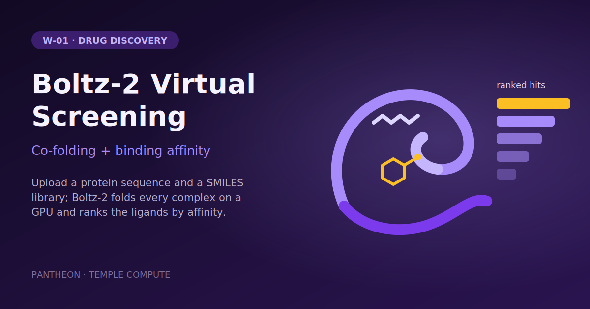

# W-01 · Boltz-2 Virtual Screening


Screen a ligand library against a protein sequence with Boltz-2: co-folded complex structures plus predicted binding affinity, ranked into a shortlist.




## Overview

Given a target protein and a library of candidate ligands, this workflow predicts
binding structure **and** affinity for each protein–ligand pair with
[Boltz-2](https://github.com/jwohlwend/boltz), then returns a ranked shortlist.
Boltz-2 (MIT/Recursion, 2025) gives affinity prediction at a fraction of the cost
of classical free-energy perturbation, making large virtual screens tractable.

The point on Horus: the expensive GPU only runs **one** stage. Cheap CPU prep and
ranking run anywhere; only `predict` asks for a GPU (see its `resources`), and Horus
moves the input and prediction archives across the boundary.

## Pipeline

```
prep    (CPU, stdlib)     target.fasta + ligands.smi ──► boltz_inputs.tar.gz (one YAML per ligand)
predict (1 GPU, uv env)   boltz predict              ──► predictions.tar.gz
rank    (CPU, stdlib)     affinity + confidence      ──► top_hits.csv
```

## Quick start

```bash
# Install uv if you don't have it
curl -LsSf https://astral.sh/uv/install.sh | sh

# Install the horus-runtime and plugins (one time)
uv sync

# Run the workflow (needs a CUDA GPU; set accelerator to cpu otherwise)
uv run horus run workflow.yaml
```

Outputs land in `horus_workflow_results/results/`: `boltz_inputs.tar.gz`,
`predictions.tar.gz`, and `top_hits.csv` (ranked best-first).

## Inputs

| id | Kind | Default | Range | Meaning |
|---|---|---|---|---|
| `fasta` | file | `examples/target.fasta` | FASTA | Target protein; the first record is used |
| `ligands` | file | `examples/ligands.smi` | SMILES | One `SMILES [name]` per line; the name becomes the output id |
| `use_msa` | boolean | on | on / off | Fetch the MSA from the ColabFold server (`--use_msa_server`); off runs single-sequence |
| `recycling_steps` | number | 3 | 1–10 | Boltz trunk recycling iterations |
| `sampling_steps` | number | 200 | 50–500, step 50 | Diffusion steps per structure |
| `diffusion_samples` | number | 1 | 1–10 | Structure samples per complex |
| `accelerator` | choice | `gpu` | `gpu`, `cpu` | Hardware Boltz runs on |

To change a value locally, edit its `value:` in `workflow.yaml`, then `rm -rf params/`:
Horus writes `params/<id>` only when it is missing, so a stale file keeps the old value.

## Output

`top_hits.csv`, best first (highest binder probability, then lowest predicted value):

| Column | Meaning |
|---|---|
| `rank` | 1 = best |
| `ligand` | name from `ligands.smi` |
| `affinity_probability_binary` | Boltz-2 probability that the ligand binds |
| `affinity_pred_value` | predicted affinity, log10(IC50 in µM); lower is tighter |
| `confidence_score` | structure confidence of the complex |

## Running in Temple Compute

Start a campaign from the library entry: the form shows the FASTA and SMILES uploads
and the Boltz settings (toggle, sliders, accelerator select), with the defaults above.
`predict` carries `resources: {cpus: 4, gpus: 1, memory_gb: 16, walltime: 8h}`, so an
auto-provisioned target gives it a single-GPU node; `prep` and `rank` are light and
run on the orchestrator's default target.

## References

- [Boltz-2 GitHub](https://github.com/jwohlwend/boltz) · [paper](https://www.biorxiv.org/content/10.1101/2024.05.24.595648)
