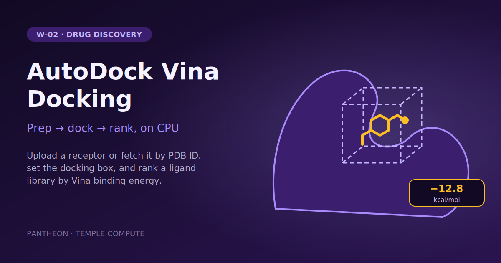

# W-02 · AutoDock Vina Docking


Dock a ligand library into a receptor (uploaded or fetched by PDB ID) with AutoDock Vina and get ranked binding energies per ligand and per pose.




## Overview

Given a **receptor** (PDB) and a **ligand library** (SMILES or 3D SDF), this
workflow does the whole molecular-docking pipeline end to end: it prepares every
input into the PDBQT format [AutoDock Vina](https://github.com/ccsb-scripps/AutoDock-Vina)
needs, docks each ligand into a defined search box, and returns ranked binding
energy tables (CSV). Vina's empirical scoring is fast enough to screen a library
on CPU, which makes it a natural cheap-first pass before more expensive physics
(FEP) or ML affinity models.

The point on Horus: prep and summary are light CPU steps; the docking step is the
compute-heavy stage and asks for a 16-core machine through its `resources`.
Horus provisions the per-stage environments from **conda-forge** (Meeko/OpenBabel
for prep, Vina for docking) and moves the data across the boundary automatically —
swapping where the docking stage runs is a one-line `target:` change.

## Pipeline

```
prep (2 CPU)             receptor.pdb (or RCSB pdb_id) + ligands.smi ──► vina_inputs.tar.gz
   │  OpenBabel → receptor.pdbqt, Meeko → ligands/*.pdbqt, box.json
dock (16 CPU, Vina)      AutoDock Vina per ligand   ──► docking_out.tar.gz
   │  best poses + REMARK VINA RESULT affinities
summary (local, CPU)     parse affinities           ──► summary.csv + poses.csv
```

## Quick start

```bash
# Install uv if you don't have it
curl -LsSf https://astral.sh/uv/install.sh | sh

# Install the horus-runtime and plugins (one time)
uv sync
# or: pip install horus-runtime horus-environments

# The prep/dock stages build conda envs from conda-forge, so a conda-family
# tool must be on PATH. workflow.yaml uses `micromamba` — set it to `conda`
# or `mamba` in the prep/dock executors if that's what you have.

# Run the workflow
uv run horus run workflow.yaml
```

Outputs land in `horus_workflow_results/results/`: `vina_inputs.tar.gz`,
`docking_out.tar.gz`, and the two energy tables `summary.csv` (ranked best-first)
and `poses.csv` (per pose).

## Inputs / Outputs

**Inputs**
- `receptor` — the target protein, uploaded as PDB, or `pdb_id` to fetch it from
  RCSB (protein `ATOM` records of the first model; waters, ions and ligands are
  dropped). Hydrogens are added automatically at pH 7.4; the bundled example is
  chain A of [1IEP](https://www.rcsb.org/structure/1IEP) (Abl kinase).
- `ligands` — one `SMILES [name]` per line (`name` becomes the table id), or a 3D
  `.sdf` file (auto-detected by extension).

**Outputs**
- `summary.csv` — one row per ligand, ranked best (most negative) first:
  `rank, ligand, best_affinity_kcal_mol, mean_affinity_kcal_mol, num_poses`.
- `poses.csv` — one row per pose: `ligand, pose, affinity_kcal_mol, rmsd_lb, rmsd_ub`.

Lower (more negative) affinity = stronger predicted binding.

## Parameters

| id | Kind | Default | Range | Meaning |
|---|---|---|---|---|
| `receptor` | file | `examples/receptor.pdb` (1IEP chain A) | PDB | Receptor to dock into, used when `pdb_id` is empty |
| `pdb_id` | string | empty | 4-char PDB code or empty | Fetch the receptor from RCSB instead of the upload |
| `ligands` | file | `examples/ligands.smi` | SMILES or SDF | Ligand library |
| `box_center` | string | `15.190 53.903 16.917` (1IEP ATP pocket) | `X Y Z` in Å, or empty | Docking box center; empty = blind docking on the receptor centroid |
| `box_size` | number | 20 | 10–60 Å | Edge of the cubic docking box; raise it for blind docking |
| `exhaustiveness` | number | 16 | 1–64 | Vina search effort per ligand |
| `n_poses` | number | 9 | 1–20 | Poses written and scored per ligand |

The box center must match the receptor: when you fetch or upload another
structure, set `box_center` to its pocket (or leave it empty for blind docking).
`scripts/prep.py --ref-ligand <file>` can also center the box on a bound ligand
when run by hand.

To change a value locally, edit its `value:` in `workflow.yaml`, then `rm -rf params/`:
Horus writes `params/<id>` only when it is missing, so a stale file keeps the old value.

## Running in Temple Compute

Start a campaign from the library entry: the form shows the receptor upload (Mol*
preview), the PDB ID field, the ligand upload and the box and search settings. The
`dock` task asks for 16 CPUs / 32 GB / 4 h and `prep` for 2 CPUs / 8 GB, so
auto-provisioned targets size each step on its own; `summary` is stdlib-only and light.

## Implementation notes

- **Dependencies come from conda-forge**, not pip: the whole stack (`vina`,
  `openbabel`, `meeko`, `rdkit`, `gemmi`, `numpy`, `scipy`) ships prebuilt there.
  This matters most for `vina` — its PyPI package has no macOS/arm64 wheel and
  builds from source (needs Boost), whereas conda-forge `vina` 1.2.7 provides
  Python bindings for **osx-arm64, osx-64, linux-64 and linux-aarch64**, so the
  docking stage runs anywhere, including Apple Silicon. (This uses the
  `channels` / `conda_requirements` fields added to `horus-environments`'
  `conda_python_environment` executor.)
- **Receptor prep uses OpenBabel** (`obabel -xr -p 7.4`) rather than Meeko's
  `mk_prepare_receptor.py`: it is far more robust across arbitrary/truncated
  crystal structures. Vina's default `vina` scoring function uses atom types, not
  receptor partial charges, so a rigid OpenBabel PDBQT is sufficient.
- **Ligand prep uses Meeko** (`mk_prepare_ligand.py`) for correct small-molecule
  atom typing and torsions; SMILES are first embedded to 3D with RDKit (ETKDG +
  MMFF).
- A ligand that fails to dock is logged and skipped (recorded in the archive's
  `manifest.json`) so one bad structure never sinks the screen.
- Each stage script has a dependency-free `--selftest`
  (`python scripts/<stage>.py --selftest`).

## References

- [AutoDock Vina](https://github.com/ccsb-scripps/AutoDock-Vina) ·
  [docs](https://autodock-vina.readthedocs.io) ·
  [1.2.0 paper](https://pubs.acs.org/doi/10.1021/acs.jcim.1c00203)
- [Meeko](https://github.com/forlilab/Meeko) · [OpenBabel](https://openbabel.org)
