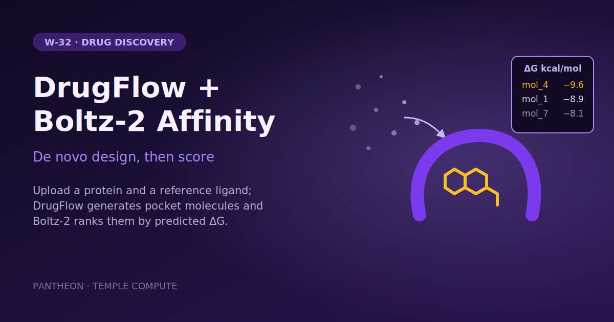

# W-32 · DrugFlow + Boltz-2 Affinity


Design new molecules for a binding pocket with DrugFlow, then score every design with Boltz-2 affinity and get a ΔG table ranked best-first.




## Overview

Given a protein and a reference ligand that defines a binding pocket, this
workflow generates novel drug-like molecules for that pocket with
[DrugFlow](https://github.com/LPDI-EPFL/DrugFlow) (LPDI-EPFL) and then scores
each generated molecule for binding affinity with
[Boltz-2](https://github.com/jwohlwend/boltz), returning a ΔG table ranked
best-first. It is a full de-novo design loop: propose, then score.

This **replaces the legacy `boltz-drugflow` Horus plugin**. The science logic
(sequence extraction, SDF parsing, Boltz YAML generation, affinity → ΔG
conversion) is lifted verbatim from that plugin's `run_boltz_affinity.py`
driver, restaged as a plain linear Horus workflow: one stage per step, each
independently resumable, no fan-out.

## Pipeline

```
download_checkpoint (shell: curl)                 Zenodo drugflow.ckpt (~170 MB)
                                                    ──► drugflow.ckpt
fetch_source        (shell: git)                  DrugFlow repo @ pinned commit
                                                    ──► drugflow_src/
generate            (conda env, 1 GPU)            protein.pdb + ref_ligand.sdf + drugflow.ckpt
                                                    ──► results/samples.sdf
prepare_inputs      (uv env: rdkit + biopython)   one YAML per molecule + smiles.json
                                                    ──► results/boltz_inputs/mol_1.yaml, ...
predict             (uv env: boltz, 1 GPU)        boltz predict
                                                    ──► results/predictions/affinity_*.json
rank                (shell, stdlib python3)       parse affinity_*.json, ΔG, sort
                                                    ──► results/deltaG_table.csv
```

`download_checkpoint` and `fetch_source` make the workflow self-contained apart
from the target PDB and the reference ligand: the first pulls the model
checkpoint from Zenodo, the second clones DrugFlow at a pinned commit (the code
is not published as a package; the conda env supplies its dependencies). Both are
skipped once their output exists. `prepare_inputs` writes one Boltz affinity YAML
per molecule into a single folder, which `predict` feeds to a single
`boltz predict` call.

## Quick start

```bash
# Install uv if you don't have it
curl -LsSf https://astral.sh/uv/install.sh | sh

# Install the horus-runtime and plugins (one time)
uv sync

# Run the workflow (needs micromamba and, by default, an NVIDIA GPU)
uv run horus run workflow.yaml
```

The first run builds DrugFlow's conda env from `conda_env_gpu.yaml` once, at
`horus_workflow_results/.horus_drugflow_env` (linux-64 only). On a host without a
GPU driver, export `CONDA_OVERRIDE_CUDA=12.1` so the CUDA build still solves, and turn
`use_gpu` off. Outputs land in `horus_workflow_results/`, `deltaG_table.csv` under
its `results/`.

## Inputs / Outputs

**Inputs**
- `examples/kras.pdb` — target protein structure.
- `examples/kras_ref_ligand.sdf` — reference ligand; defines the pocket.

**Outputs** (all under `horus_workflow_results/`)
- `drugflow.ckpt` — the DrugFlow checkpoint, downloaded by the workflow.
- `drugflow_src/` — DrugFlow source at the pinned commit.
- `results/samples.sdf` — the generated molecules.
- `results/boltz_inputs/` — one Boltz affinity YAML per molecule.
- `results/smiles.json` — `{molecule_name: canonical_smiles}`.
- `results/predictions/` — Boltz-2 output, one `affinity_*.json` per molecule.
- `results/deltaG_table.csv` — columns `molecule, smiles, affinity_pred_value,
  binding_probability, deltaG_kcal_per_mol`, sorted by ascending ΔG (best first).

## Parameters

| id | Kind | Default | Range | Meaning |
|---|---|---|---|---|
| `protein` | file | `examples/kras.pdb` | PDB | Target protein, same frame as the reference ligand |
| `ref_ligand` | file | `examples/kras_ref_ligand.sdf` | SDF | Bound reference ligand; defines the pocket |
| `n_samples` | number | 10 | 1–1000 | Molecules DrugFlow generates |
| `pocket_cutoff` | number | 8.0 | 4–12 Å, step 0.5 | Pocket = residues within this distance of the reference ligand |
| `seed` | number | 42 | 0–99999 | Seed for DrugFlow and Boltz-2 |
| `use_gpu` | boolean | on | GPU / CPU | `--device cuda:0` for DrugFlow and `--accelerator gpu` for Boltz-2; off runs both on CPU (slow) |
| `use_msa` | boolean | on | MSA server / single sequence | Boltz-2 `--use_msa_server` (public ColabFold) |
| `diffusion_samples` | number | 1 | 1–10 | Boltz-2 structure samples per molecule |

Fixed in `workflow.yaml`: the Zenodo checkpoint URL, the pinned DrugFlow commit
(`ed684167…`) and `--batch_size 32`. DrugFlow's optional `--molecule_size`,
`--n_steps` and `--filter` flags can be added to the `generate` command.

To change a value locally, edit its `value:` in `workflow.yaml`, then `rm -rf params/`:
Horus writes `params/<id>` only when it is missing, so a stale file keeps the old value.

## Running in Temple Compute

Start a campaign from the library entry: the form shows the protein and reference
ligand uploads (Mol* preview) and the design and scoring settings. `generate` and
`predict` each ask for one GPU (4 CPUs, 16 GB; 2 h and 4 h), so an auto-provisioned
target gives each a single-GPU node; the download, clone, prep and rank steps are light.

## Implementation Notes

**Environment.** `generate` runs in DrugFlow's upstream conda env
(`conda_env_gpu.yaml`, CUDA 12.1 pytorch; it also runs on CPU). `conda_env.yaml` is
the same env with CPU-only pytorch, for hosts where the CUDA build cannot be
installed: point `environment_file:` at it. Both add one pin upstream doesn't have,
`setuptools<81`: ProDy 2.4.0 does `import pkg_resources`, which setuptools removed
in 81, so an unpinned solve breaks `import prody`. Neither env solves on
`osx-arm64` (`pyg=2.5.1`, `ProDy=2.4.0`, `pytorch=2.2.1` have no arm64 builds).

**Containers.** The upstream image `igashov/drugflow:0.0.3` holds the same
dependencies. On a cluster you can swap the `generate` executor for
`horus-singularity`'s `kind: singularity` with `image:` a `.sif` built from it and
`nv: true` (add `horus-singularity` to `pyproject.toml`). The image ships the
dependencies, not the code, so keep the `cd ${drugflow_src}`: `src/generate.py`
imports `src.*` and needs the repo root as its working directory.

**Checkpoint download.** `download_checkpoint` downloads to `drugflow.ckpt.part`
and only `mv`s it into place on success — a truncated file left at the final
path would satisfy `skip_if_complete` and be reused as a corrupt checkpoint on
every later run. The task skips once `drugflow.ckpt` exists in the run directory.

**CPU vs GPU.** `use_gpu` drives both stages: `--device cuda:0` / `cpu` for
DrugFlow and `--accelerator gpu` / `cpu` for Boltz-2. Both are *slow* on CPU.

**Boltz input naming.** Each molecule's YAML is named after the molecule,
because the YAML stem becomes Boltz's prediction name (`affinity_<stem>.json`)
and is the key `rank` joins against `smiles.json`.

**ΔG formula.** Boltz-2's `affinity_pred_value` is ~log10(IC50) with IC50 in µM.
Treating IC50 as a Kd proxy at 298 K:

```
ΔG ≈ 1.364 · (affinity_pred_value − 6)   kcal/mol
```

This is an approximation, good for **ranking** candidates, not an exact free
energy.

**MSAs.** The predict stage uses `--use_msa_server`, i.e. the *public* ColabFold
server, so it needs outbound network access from wherever `predict` runs and is
subject to that server's rate limits. The legacy plugin defaulted to the other
mode: a local `colabfold_search` against an on-disk database. That was not
ported because it needs a second environment — `boltz` requires `numpy<2`
while `colabfold` requires `numpy>=2.0.2`, so the two cannot share one env — plus
a multi-hundred-GB sequence database. On a cluster without outbound access this
is the stage that will fail.

**Tests.** `scripts/rank.py` is stdlib-only and unit-tested:

```bash
uv run --no-project --with pytest pytest scripts/test_rank.py
```

## References

- [DrugFlow GitHub](https://github.com/LPDI-EPFL/DrugFlow) · checkpoint on [Zenodo](https://zenodo.org/records/14919171)
- [Boltz-2 GitHub](https://github.com/jwohlwend/boltz)
- Docker image: `igashov/drugflow:0.0.3`
