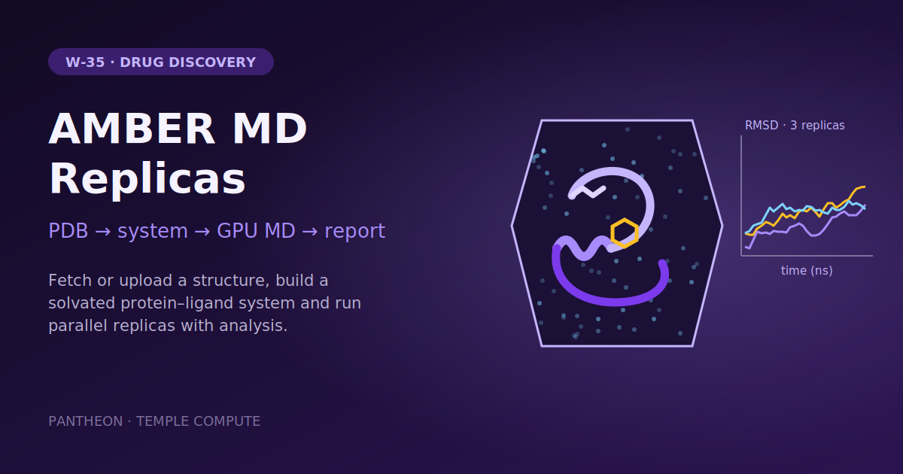

# W-35 · cMD Replicas (AMBER)


From a PDB ID or an uploaded structure to a solvated protein–ligand system, N parallel AMBER MD replicas on GPUs, per-replica analysis and a clustered HTML report.




## Overview

End-to-end conventional molecular dynamics (cMD) with AMBER: from a PDB ID
to a protonated, solvated system with an optional GAFF2 ligand, N parallel replicas of a 10-step equilibration and chunked
production on GPUs, per-replica trajectory analysis, and one HTML report with
clustering. The MD protocol is ported from
[MolBioMedUAB/protocols](https://github.com/MolBioMedUAB/protocols)'
`MD/cMD/create_md_custom.sh`; preparation, analysis and the parameters around
it are added here.

Preparation and analysis run in one conda-forge environment (AmberTools 26:
pdb4amber, tleap, antechamber, parmchk2, parmed, cpptraj; PROPKA; Open Babel;
OpenMM), built on first use and reused. The MD itself runs on one of two
engines (`md_engine`), both fed the same rendered `.mdin` files: **OpenMM**
(default; from that conda env, runs on any NVIDIA GPU node) through
`scripts/mdin_openmm.py`, or **pmemd.cuda** from a licensed AMBER install
(`amber_env`). Replicas fan out with Horus's `horus_map`, one GPU job per
replica per phase.

## Pipeline

```
fetch_pdb (local)            PDB ID (or uploaded PDB) --> structure.pdb
  |-- extract_ligand (local)      structure + residue name --> ligand pose .pdb
  |     parameterize_ligand (CPU) pose --> ligand.mol2 + ligand.frcmod (GAFF2, AM1-BCC)
  |-- build_complex (CPU)    structure + ligand --> system.prmtop/.inpcrd/.pdb, prep_report.json
  '-- build_system (CPU)     protein-only alternative (outputs unused in the default graph)
prepare_replicas (local)     renders min/md templates from the MD settings --> replicas/<i>/
horus_map equilibrate (N x GPU)  10 steps: min, heat, restrained NPT, min, NPT, free NPT/NVT
horus_map produce     (N x GPU)  chunked production (NVT or NPT)
horus_map analyze     (N x CPU)  cpptraj: RMSD, RMSF, Rg, H-bonds, ligand RMSD/contacts
report                (CPU)      k-means over all replicas --> report.html, summary.csv, clusters/
```

### Swapping blocks

Blocks exchange plain files, so any block can be replaced by connecting
your own file to the next block's input:

| You have | Delete | Connect to |
|---|---|---|
| your own PDB | nothing: clear `pdb_id` and upload it as `structure_upload` | |
| a docked/prepared ligand pose (.pdb/.sdf/.mol2) | `extract_ligand` | `ligand_in` of `parameterize_ligand` |
| ligand.mol2 + ligand.frcmod you parameterized | `extract_ligand`, `parameterize_ligand` | `ligand_mol2_in` / `ligand_frcmod_in` of `build_complex` |
| a protein-only system | the ligand blocks and `build_complex` | `build_system`'s `protein_prmtop`/`protein_inpcrd` to `prepare_replicas` |
| a ready prmtop/inpcrd | everything before `prepare_replicas` | `system_prmtop_in` / `system_inpcrd_in` of `prepare_replicas` |

`examples/` has a protein PDB (`1aki.pdb`) and a ready 1AKI system
(`system.prmtop`/`.inpcrd`) to try the last rows. The report needs nothing
from the build blocks: `analyze` reads the system composition from the
topology.

## Prerequisites

- `micromamba` (or conda/mamba: set `_tools.conda`) where the CPU blocks run. The
  tools environment is built once at `horus_workflow_results/.horus_ambertools_env`;
  on a cluster, set `_tools.environment_dir` to an absolute shared path.
- For `md_engine: openmm` (default), an NVIDIA driver for CUDA 12 on the GPU
  nodes; OpenMM itself comes from the tools env.
- For `md_engine: pmemd`, `pmemd.cuda` on the GPU nodes (licensed AMBER;
  conda-forge AmberTools has no pmemd at all). Pick or add the line that loads it
  in `amber_env`; the default "Already on PATH" assumes it is there.
- `prepare_replicas` runs on the orchestrator and needs only `python3`.

## Quick start

```bash
uv sync          # horus-runtime + horus-slurm + horus-environments
uv run horus run workflow.yaml
```

Every task runs on the local target with `resources` hints. On a Slurm cluster,
fill in `partition`/`account` in the `_cpu`, `_gpu_equilibrate` and `_gpu_produce`
anchors at the top of `workflow.yaml` and point the CPU blocks at `*cpu`,
`equilibrate` at `*gpu_equilibrate` and `produce` at `*gpu_produce`.

## Running in Temple Compute

Import the folder or start a campaign from the library entry: the form shows the
PDB ID, the structure upload and every build, MD and analysis setting below, with
sliders for the ranged numbers. Resource hints: parameterization, builds and the
report 2 CPU / 8 GB; `analyze` 4 CPU / 16 GB per replica; `equilibrate` and
`produce` one GPU (4 CPU, 16 GB) per replica, 5 h and 10 days. With the default
`md_engine: openmm` an auto-provisioned GPU node needs nothing else; `pmemd`
needs licensed AMBER on the node (see Prerequisites).

## Inputs

**Structure, ligand and system build**

| Input | Default | Used by | Meaning |
|---|---|---|---|
| `pdb_id` | `3HTB` | fetch_pdb | RCSB ID; needs a PDB-format file. Empty = use `structure_upload` |
| `structure_upload` | `examples/1aki.pdb` | fetch_pdb | PDB used when `pdb_id` is empty |
| `ligand_resname` / `ligand_chain` | `JZ4` / first copy | extract_ligand, parameterize_ligand | ligand to extract; name it keeps in the system |
| `ligand_charge` | 0 | parameterize_ligand | net formal charge (AM1-BCC) |
| `protonate_ligand` | on | parameterize_ligand | Open Babel hydrogens at the pH; off keeps the file's hydrogens |
| `chains` | all | build | e.g. `A,B`; every hetero group is removed (MSE becomes MET) |
| `keep_waters` | off | build | keep crystal waters |
| `protonation` / `ph` | PROPKA / 7.0 | build | PROPKA sets HIS (HIE/HIP), ASP (ASH), GLU (GLH), LYS (LYN); `reduce` = HIS tautomers only |
| `forcefield` / `water` | ff14SB / TIP3P | build | ff19SB should go with OPC |
| `box` / `padding` | truncated octahedron / 12 Å | build | |
| `salt_mM` | 150 | build | NaCl by SLTCAP on top of neutralization |
| `hmr` | off | build | hydrogen mass repartitioning (allows 4 fs) |
| `md_engine` | OpenMM | equilibrate, produce | `openmm` (conda, any NVIDIA GPU node) or `pmemd` (licensed `pmemd.cuda`); same `.mdin` protocol |
| `amber_env` | Already on PATH | equilibrate, produce | with `pmemd`: shell line that provides `pmemd.cuda` (Picard, CSUC and a generic `module load Amber` are listed) |

**MD protocol**

| Input | Default | Meaning |
|---|---|---|
| `n_replicas` | 3 | independent replicas |
| `temperature` | 300 K | |
| `length_ns` / `chunk_ns` | 200 / 10 | production per replica, as consecutive chunks |
| `timestep_fs` | 0 = auto | 4 fs with HMR, else 2 fs; >2 fs without HMR is refused |
| `prod_ensemble` | NVT | NVT or NPT (Monte Carlo barostat) |
| `save_every_ps` | 10 | production frame interval |
| `write_solvent` | on | off writes solute-only trajectories (`ntwprt`, ~10x smaller) |
| `equil_scale` | 1.0 | scales all equilibration lengths (15 ns at 1.0); 0.1 for tests |
| `restraint_scale` | 1.0 | scales the 250/100/100/10 (solute) and 10/10/1/0.1 (backbone) schedule |
| `restraint_mask` | auto | solute heavy atoms, or any Amber mask |
| `heat_start_k`, `cutoff`, `gamma_ln`, `pressure_bar` | 100 K, 9 Å, 3 ps⁻¹, 1 bar | |
| `seed` | -1 | -1 random; a number gives each replica/step its own derived `ig` |

**Analysis:** `analysis_stride` (every Nth frame, default 1), `n_clusters`
(k-means on backbone, default 5, 0 skips).

Every number has a range in `workflow.yaml` (e.g. `n_replicas` 1–20, `length_ns`
1–2000, `temperature` 250–400 K, `ph` 0–14), which tc-os shows as sliders.

The equilibration schedule (step lengths, restraint weights, which steps
draw new velocities) is the `PROTOCOL` table in `scripts/prepare_replicas.py`;
the namelists are `templates/min.in` and `templates/md.in` (archived as
`templates.tar.gz`; rebuild with `tar -czf templates.tar.gz -C templates .`).

The default inputs build T4 lysozyme L99A with 2-propylphenol (3HTB + JZ4).
One ligand per `build_complex`; for a protein-only system see
[Swapping blocks](#swapping-blocks).

## Outputs

- `results/report.html`: system and protocol summary, per-replica plots
  (backbone RMSD vs first frame and vs the built structure, CA RMSF, Rg,
  H-bond count, ligand RMSD and contacts, potential energy, temperature,
  density for NPT), cluster populations per replica with Mol* views of the
  representatives, top H-bonds and ligand contacts, the system composition
  and every MD setting.
- `results/summary.csv`: one row per replica (chunks, ns, frames, mean RMSD,
  Rg, H-bonds, ligand RMSD).
- `results/clusters/`: representative PDBs and the per-frame assignment.
- `system/`: `system.prmtop`, `system.inpcrd`, `system.pdb`,
  `prep_report.json` (removed hetero groups, protonation changes,
  disulfides, ligand charge, ions, box, warnings).
- `ligand/`: extracted pose, `ligand.mol2`, `ligand.frcmod`.
- Per replica: `equilibrated_out/<i>/`, `produced_out/<i>/` (chunks) and
  `analyzed_out/<i>/` (cpptraj `.dat` files, dry trajectory).

## Design notes

- **Two map stages for MD:** a `horus_map` clone runs one flat command on
  one item, so equilibration and production are separate stages (and SLURM
  jobs with their own walltime). Each stage copies the slot forward, so
  every item is self-contained; value inputs reach the clones only through
  the slot's rendered mdin files and `protocol.json`.
- **Resume:** `equilibrate.sh` and `production.sh` skip steps and chunks
  whose restart exists and whose mdout has pmemd's closing TIMINGS section, so a
  requeued job in the same directory continues instead of starting over.
- **Two engines, one protocol:** `scripts/mdin_openmm.py` takes pmemd's flags
  and the `&cntrl` keys `prepare_replicas.py` renders (minimization, Langevin
  `ntt=3`, Monte Carlo barostat, positional restraints by AMBER mask via
  ParmEd, `ntwx`/`ntwr`/`ntpr`/`ntwprt`, `iwrap`) and writes the same files:
  ASCII restart, NetCDF trajectory, an mdout with pmemd-style `NSTEP`/`Etot`/
  `Density` records and the closing TIMINGS section, and an mdinfo. Resume,
  live monitor, analysis and report work unchanged. Not mirrored: pmemd's
  pressure printout (`PRESS` reads 0.0) and its exact random streams, so the
  two engines give statistically, not bitwise, equivalent runs.
- **Analysis next to the data:** `analyze` runs on the cluster so the
  production trajectories never need to move; only the small results and
  a dry strided trajectory go to `report`.

## Live monitoring (while a replica runs)

Declared outputs (`equilibrated`, `produced`) only upload when a task
succeeds, so a long or failing run would otherwise show nothing. To cover
that, `scripts/live_monitor.sh` (copied into every slot) runs beside pmemd
in both `equilibrate` and `produce` and writes a small digest to
`$HORUS_SIDE_ARTIFACTS_DIR`. Horus pulls that directory every ~30 s while the
task runs, and once more when it fails or is cancelled. The digest appears
in each replica's **side products** in the UI:

| File | What | Viewer |
|---|---|---|
| `current_mdout.log` | newest mdout (AMBER errors end up here) | text |
| `current_mdinfo.txt` | newest mdinfo (ns/day, ETA, current energies) | text |
| `energies.csv` / `energies.svg` | every MD energy record so far; EPtot/Temp/Density plot with step boundaries | table / image |
| `trajectory.pdb` | newest `.nc`, solvent and H stripped, at most `LIVE_FRAMES` models | Mol* (plays as a trajectory) |
| `rmsd.csv` | CA RMSD of those frames against the first one | table |

- **Settings:** `LIVE_INTERVAL` (default 60 s) and `LIVE_FRAMES` (default 50).
  Export them in the task environment.
- **Outside Horus:** the monitor is a no-op (`HORUS_SIDE_ARTIFACTS_DIR` unset).
- **If it goes bad:** cancel the run from the UI. That stops the jobs (on Slurm,
  `scancel`), and the final digest is still uploaded.
- **Self-check:** `bash scripts/live_monitor.sh --selftest` checks the mdout
  parser and the plot. Trajectory frames need `cpptraj`, which AmberTools
  provides once the AMBER module is loaded (live monitor) and the tools
  environment provides (analysis).

## Verification

- Self-checks (no AMBER needed): `--self-test` on `scripts/fetch_pdb.py`,
  `extract_ligand.py`, `parameterize_ligand.py`, `build_system.py`,
  `scripts/prepare_replicas.py --self-test` (rendered nstlim/dt/cut/restraints
  per step, HMR at 4 fs, NPT production, seeds), `scripts/analyze.py --self-test`,
  `scripts/report.py --self-test`, `bash scripts/live_monitor.sh --selftest`.
- `env/amber-stub.sh` is a drop-in for the AMBER module that writes fake
  pmemd outputs (including the completion line the resume check reads), to
  exercise `equilibrate.sh`/`production.sh` without a GPU.
- Real tests with conda-forge AmberTools: fetch 3HTB -> extract JZ4 ->
  parameterize -> build_complex and build_system; then (`sander` standing
  in for pmemd) 2 replicas with `equil_scale` and `chunk_ns` cut to
  picoseconds through `analyze.py` and `report.py`.
- OpenMM engine (`scripts/mdin_openmm.py --selftest`: namelist parser, restart
  round trip): the 1AKI example system (18,019 atoms) through all 10
  equilibration steps and 2 production chunks at picosecond lengths on the CPU
  platform (2.5 min). Restraints selected by AMBER mask (1001 solute heavy
  atoms, 387 backbone atoms), density rising 0.885 -> 0.952 g/cc through the
  NPT steps, cpptraj reads the NetCDF trajectories and restarts (velocities,
  truncated octahedron box), `report.py` parses the mdout records, and a re-run
  skips every finished step. The CUDA platform was not exercised (no GPU here).

## References

- [MolBioMedUAB/protocols](https://github.com/MolBioMedUAB/protocols) --
  `MD/cMD/create_md_custom.sh`, the source protocol this workflow ports.
