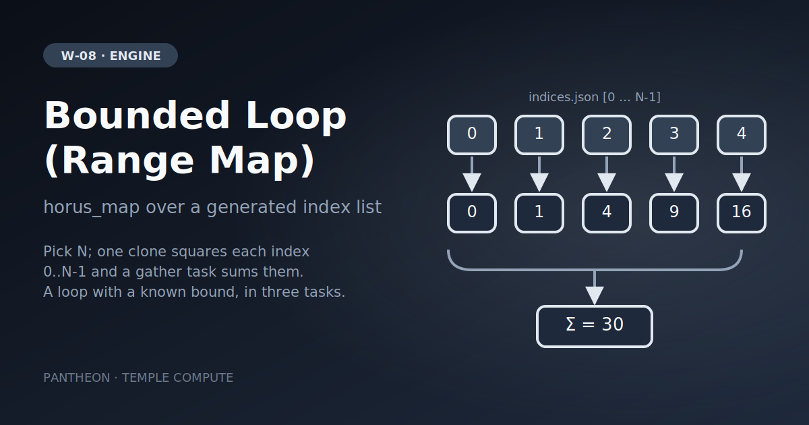

# W-08 · Bounded Loop (Range Map) Showcase


Run N clones of one task over the indices 0..N-1 with a `horus_map`, then sum their outputs: a bounded loop in three tasks.




## Overview

A minimal, deterministic demonstration of a **bounded loop** in horus-runtime:
a tiny task writes the index list `[0, 1, ..., N-1]` as JSON, and a `horus_map`
iterates that list, one clone per index. Iterating a `json` artifact hands each
clone a one-element JSON file holding its index. Each clone squares its index;
a gather stage sums them. For a loop that decides at runtime whether to continue,
see the `loop:` construct in the horus-runtime docs.

## Pipeline

```
indices (local)            iterations = N ──► indices.json  [0, 1, ..., N-1]

iterate[0..N-1] (horus_map over indices.json, all clones at once)
   │  each clone: reads its own index, squares it
   │  ──► squares/<slot>/square.txt

gather (local)             squares/ (N slots) ──► results/total.txt
   │  sums every clone's square.txt: 0² + 1² + 2² + 3² + 4² = 30 for N = 5
```

## Quick start

```bash
# Install uv if you don't have it
curl -LsSf https://astral.sh/uv/install.sh | sh

cd workflows/engine-showcases/w03-loop-map
uv sync
# or: pip install horus-runtime

uv run horus run workflow.yaml
```

Outputs land in `horus_workflow_results/`: `squares/` (one slot per clone) and
`results/total.txt`, which is `30` for the default N = 5.

## Inputs / Outputs

**Outputs**
- `squares/<slot>/square.txt` — `i * i` for each clone `i` in `0..N-1`.
- `results/total.txt` — the sum of all squares.

## Parameterization

| id | Kind | Default | Range | Meaning |
|---|---|---|---|---|
| `iterations` | number | 5 | 1–100, step 1 | Number of clones; `results/total.txt` is `(N-1) * N * (2N-1) / 6` |

To change it locally, edit its `value:` in `workflow.yaml`, then `rm -rf params/`:
Horus writes `params/<id>.txt` only when it is missing.

## Running in Temple Compute

Start a campaign from the library and slide `iterations`: the canvas shows one clone
per index. Every task takes milliseconds, so no `resources` hints are set.
