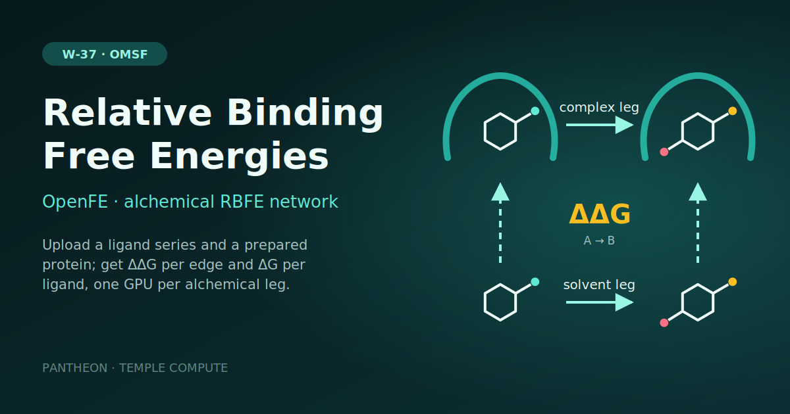

# W-37 · OpenFE Relative Binding Free Energies (TYK2)


Relative binding free energies for a congeneric ligand series with OpenFE: upload the ligands and a prepared protein, get ddG per edge and dG per ligand.




## Overview

Relative binding free energies (RBFE) for a congeneric TYK2 inhibitor series with
[OpenFE](https://openfree.energy). This is a native Horus port of two entries in the
[OMSF workflow directory](https://directory.omsf.io/workflows/):
"Relative Free Energies with the OpenFE CLI"
([`rbfe_tutorial/cli_tutorial.md`](https://github.com/OpenFreeEnergy/ExampleNotebooks/tree/main/rbfe_tutorial))
and "Partial charges with OpenFE CLI"
([`cli_tutorials/cli_charge_molecules.md`](https://github.com/OpenFreeEnergy/ExampleNotebooks/blob/main/cli_tutorials/cli_charge_molecules.md)),
which becomes the charging step.

The tutorial is plan, run, gather. The run step is one `openfe quickrun` per leg
(complex and solvent leg of each edge), each hours on a GPU. The tutorial leaves
that fan-out to a hand-written `sbatch` loop. Here it is a `horus_map`: one clone per
transformation JSON, on the local machine or one Slurm GPU job per leg, with gather
and the report waiting for all of them.

## Horus Configuration

```
charge_ligands  (local, conda)   openfe charge-molecules  (AM1-BCC, ambertools), all ligands
plan_network    (local, conda)   scripts/plan.py: Kartograf + minimal spanning network
                                 --> transformations/<leg>.json + ligand_network.graphml
quickrun        (horus_map)      openfe quickrun per leg   (local, or Slurm GPU via *gpu)
gather          (local, conda)   openfe gather --report ddg / raw / dg --> ddg.tsv, raw.tsv, dg.tsv
report          (local, shell)   scripts/report.py --> report.html (tables + Mol*)
```

| Piece | Kind | Used by |
|---|---|---|
| executors | `shell` (stdlib Python); `conda_python_environment` (one openfe 1.13.0 env at `horus_workflow_results/.horus_conda_env`) | shell: report; conda: charge, plan, quickrun, gather |
| targets | `local` (`*local`); `slurm` with a local inner target (`*gpu`, partition/account per site) | everything local; `quickrun` can switch to `*gpu` |
| map | `horus_map` over the `transformations/` folder, one clone per leg JSON, `max_concurrency: 2` | `quickrun` |
| inputs | root `file` artifacts `ligands`, `protein` (uploads); root `number` / `choice` artifacts (`params/<id>.txt`), see Parameters | charge, plan, gather, report |
| resources | `resources` hints on charge (4 CPU / 8 GB), plan (2 CPU / 8 GB) and each quickrun leg (4 CPU, 1 GPU, 16 GB, 24 h) | auto-provisioned targets, Slurm |

## Compute Pattern

For the defaults (10 TYK2 ligands, 9 edges, 18 legs; 3 repeats x 11 windows x
(1 ns + 5 ns) per leg) on the intended hardware, one GPU per leg:

| Stage | Where | CPU / GPU | Time |
|---|---|---|---|
| charge_ligands | local | 4 CPU | a few min (10 ligands) |
| plan_network | local | 1 CPU | ~1 min |
| quickrun (map) | local / Slurm | 1 GPU + 4 CPU per leg, `max_concurrency` legs at a time | hours per leg (198 ns of hybrid-topology sampling); not measured here |
| gather, report | local | CPU | seconds |

The openfe conda env is built once on the first run (a few minutes). Each complex leg
needs ~1.5 GB host RAM. The `cpu` platform is only practical for very short sampling:
one force evaluation of the ~37k-atom complex leg takes ~0.2 s on 2 CPU threads.

## Tools & Dependencies

- [openfe](https://github.com/OpenFreeEnergy/openfe) 1.13.0 (MIT) from conda-forge,
  with openmm 8.4.0, ambertools, kartograf. See `conda_env.yaml`.
- Official containers for the same version: `ghcr.io/openfreeenergy/openfe:1.13.0`
  (Docker) and `oras://ghcr.io/openfreeenergy/openfe:1.13.0-apptainer` (Apptainer).
- Horus: `horus-runtime`, `horus-environments` (conda executor), `horus-slurm`.
- `micromamba` (or conda/mamba) on the target for the conda executor.

## Quick start

```bash
# Install uv if you don't have it
curl -LsSf https://astral.sh/uv/install.sh | sh

# From the repo root
cd workflows/omsf/w01-openfe-rbfe-tyk2

# Install the horus-runtime and plugins (one time)
uv sync

# Run with the defaults (needs a CUDA GPU on the local machine; see below for Slurm)
uv run horus run workflow.yaml --no-tui
```

The first run builds the openfe conda env from `conda_env.yaml` once, at
`horus_workflow_results/.horus_conda_env` (a few minutes; every openfe task reuses it).
A second `horus run` skips every task whose outputs are already there.

## Running on Slurm GPUs

1. Fill `partition` and `account` in the `_gpu` anchor.
2. On the `quickrun` task change `target: *local` to `target: *gpu`, and raise
   `max_concurrency` to the number of GPU jobs you want at once (the 10 default
   ligands give 9 edges, so 18 legs).
3. Set `time_limit` in `_gpu` to your site's maximum. A leg that is killed (timeout,
   preemption) is re-run on the next `horus run` and `openfe quickrun --resume` picks up
   the units it already finished from `horus_workflow_results/quickrun[N]/work`.

The conda-forge openmm build ships the CUDA platform plugin even when the env is solved
on a host without a GPU, so the shared env built by `charge_ligands` on the login/local
node also runs on the GPU node. It pulls `cuda-version` 13.x; if your GPU nodes have an
older driver, add `cuda-version=12` to `conda_env.yaml`.

To use the official container instead of the conda env, swap the `executor` of the
openfe tasks (all of them run `command` runtimes except `plan_network`, which stays on
conda). Add `horus-docker` or `horus-singularity` to `pyproject.toml` first
(`uv add horus-docker` / `uv add horus-singularity`):

```yaml
# Docker (needs the NVIDIA Container Toolkit for GPUs)
executor:
  kind: docker
  image: ghcr.io/openfreeenergy/openfe:1.13.0
  gpus: all
  user: "1000:1000" # your uid:gid (`id -u`:`id -g`), else results/ ends up root-owned

# Apptainer, typical on HPC: pull once, then point at the .sif
#   apptainer pull openfe.sif oras://ghcr.io/openfreeenergy/openfe:1.13.0-apptainer
executor:
  kind: singularity
  exe: apptainer
  image: /path/to/openfe.sif
  nv: true
```

Both executors mount the artifact folders only. `quickrun` keeps its work dir at
`../work` relative to the clone's run folder, so under a container that folder also
needs a bind mount and the container's working directory must be the run folder
(e.g. Docker `working_dir: ${task.working_dir}` plus a `volumes` entry for
`horus_workflow_results`); without it the leg still runs but `--resume` has nothing to
resume from.

## Input / Output

**Input**: two files, uploadable in tc-os or replaced in `examples/` locally:
`ligands` (SDF, 3D poses in the site; every record is charged and planned) and
`protein` (prepared PDB). The defaults are `examples/tyk2_ligands.sdf` and
`examples/tyk2_protein.pdb`, copied from OpenFreeEnergy/ExampleNotebooks at commit
`d083c283b96e976d2e90c03d94e57e3ef6bc2c8c`.

**Output** (in `results/`):

| File | What | Renders as |
|---|---|---|
| `ddg.tsv` | ddG per edge with uncertainty (`openfe gather --report ddg`) | table |
| `raw.tsv` | dG per leg and repeat (`--report raw`) | table |
| `dg.tsv` | MLE dG per ligand (`--report dg`); a one-line note for networks it cannot handle (see below) | table |
| `report.html` | both tables, network edges, Mol* view of TYK2 with the ligands | HTML page |
| `ligand_network.graphml` | the planned network with atom mappings | file |
| `alchemicalNetwork.json` | the full alchemical network, as `plan-rbfe-network` writes it (not a declared artifact) | file |
| `charged_ligands.sdf` | ligands with AM1-BCC charges | file |
| `transformations/` | one transformation JSON per leg | folder |
| `legs/<slot>/` | per leg: `result.json`, `quickrun.log` | folder |

## Parameters

Root value artifacts in `workflow.yaml`. The defaults are the openfe 1.13.0
`RelativeHybridTopologyProtocol` defaults, i.e. what `openfe plan-rbfe-network` uses.
`scripts/plan.py` range-checks them and runs the protocol's own divisibility checks
before planning.

| id | Kind | Default | Range | Meaning |
|---|---|---|---|---|
| `ligands` | file | `examples/tyk2_ligands.sdf` | SDF | Ligand series, 3D poses in the binding site |
| `protein` | file | `examples/tyk2_protein.pdb` | PDB | Prepared receptor |
| `n_repeats` | number | 3 | 1–10, step 1 | Repeats per leg (`protocol_repeats`); `gather --report dg` needs >= 2 |
| `lambda_windows` | number | 11 | 2–32, step 1 | Lambda windows per leg; `n_replicas` is set equal |
| `equilibration_ns` | number | 1.0 | 0.1–20, step 0.1 | Equilibration per replica (ns) |
| `production_ns` | number | 5.0 | 0.5–50, step 0.5 | Production per replica (ns) |
| `time_per_iteration_ps` | number | 2.5 | 0.5–10, step 0.5 | MD time between replica-exchange attempts (ps); must divide the lengths and intervals |
| `minimization_steps` | number | 5000 | 0–100000, step 500 | Minimization steps before equilibration |
| `real_time_analysis_ps` | number | 250 | 0–5000, step 50 | Online free energy analysis interval (ps); 0 turns it off |
| `checkpoint_interval_ns` | number | 1.0 | 0.25–10, step 0.25 | Checkpoint interval (ns), what `quickrun --resume` restarts from |
| `compute_platform` | choice | `cuda` | `cuda`, `opencl`, `cpu` | OpenMM platform |

To change a value, edit its `value:` in `workflow.yaml` (or in the tc-os UI), then
`rm -rf params/`. Horus writes `params/<id>.txt` only when it is missing and
fingerprints that file for the skip check, so a stale file keeps the old value.
Optionally also `rm -rf horus_workflow_results/results` for a clean start; it is not
needed for correctness, since the map drops slots it no longer uses and each slot is
cleared before its leg runs.

Other knobs: charging cores (`charge_ligands` `resources.cpus`, 4, passed to `-n`),
the quickrun `target` (`*local` or `*gpu`) and `max_concurrency` (2).

## Running in Temple Compute

Import the workflow (or open it from the library) and start a campaign: the form shows
the two uploads (with a Mol* preview) and the sampling settings as sliders, with the
production defaults above. Every heavy task carries `resources` hints, so an
auto-provisioned target sizes itself from them: charging and planning fit a general
purpose 2xlarge-class machine, and each quickrun leg asks for one GPU (4 vCPU, 16 GB,
24 h), i.e. one single-GPU node per leg. Raise the quickrun `max_concurrency` to run
more legs at once.

## Implementation Notes

- Planning goes through the openfe Python API (`scripts/plan.py`) instead of
  `openfe plan-rbfe-network`, because the CLI settings YAML only takes `mapper`,
  `network` and `partial_charge` keys and so cannot shorten sampling. The script uses
  the CLI's own loaders and defaults (`openfecli.parameters`), so the mapper (Kartograf),
  scorer, network (minimal spanning tree) and solvent match the CLI, and only the
  sampling settings listed under Parameters are set from the variables.
- Charges are computed once in `charge_ligands` and read from the SDF; `plan.py`
  fails if a ligand has none, so nothing is recharged.
- On the OpenMM `cpu` platform the hybrid-topology forces are slow (~0.2 s per force
  evaluation of the ~37k-atom complex leg on 2 threads), and 1000 minimization steps
  alone took over 25 min, so `cpu` is only usable with ps-scale sampling. Very short
  production with few samples per state makes openfe's fixed 1000-sample MBAR
  bootstrap slow; keep `time_per_iteration_ps` small enough for ~20 samples per state.
  `OPENMM_CPU_THREADS` is set from the quickrun `resources.cpus` (4).
- The solvent padding stays at the protocol default (1.5 nm). With 1.0 or 1.2 nm the
  solvent-leg box ended up smaller than twice the 0.9 nm cutoff and the leg failed.
- A failing leg fails the map (default `on_item_failure: fail`), which cancels the
  other running legs.
- `openfe gather --report dg` refuses networks with fewer than 3 edges or fewer than
  2 repeats per edge. For such a network (e.g. 3 ligands, or `n_repeats` 1) `gather`
  writes a note to `dg.tsv` instead and the report shows the ddG and raw per-leg values.
- Each leg writes `legs/<slot>/result.json` (gather reads the leg identity from the
  JSON, not the file name) and the slot is emptied before the leg runs, so a slot reused
  for a different leg never keeps the old result.
- The openfe work directory (trajectories, checkpoints, the quickrun resume cache) is
  `horus_workflow_results/quickrun[N]/work`, outside the `legs/` output, so Horus does
  not fingerprint or transfer GBs of trajectories and gather only walks small files.
  `--resume` is a no-op on a fresh leg; the cache key hashes the output path and the
  transformation, so a cache from another leg is never reused.
- Progress bars from `openfe` are `\r`-only, so `charge_ligands` and `quickrun` log to a
  file and print the tail.

## Open Questions

- The defaults (CUDA, full sampling) and the container executors were not run here
  (no GPU or Slurm on the test host); the pipeline was run end to end on CPU with
  3 ligands, 1 repeat, 4 windows and ps-scale sampling (~20 min on 5 CPU cores).
  Not verified: that `openfe` is on `PATH`
  under `apptainer exec` for the `-apptainer` image (exec skips the runscript), and the
  container bind mount for the quickrun work dir described above.
- Whether one default leg (198 ns of hybrid-topology sampling) fits in 24 h depends on
  the GPU; on older cards it may need a resume or two.

## References

- OpenFE docs: <https://docs.openfree.energy>
- Upstream tutorials (MIT): <https://github.com/OpenFreeEnergy/ExampleNotebooks>
- OMSF workflow directory: <https://directory.omsf.io/workflows/>

## License and credit

The workflow glue is MIT like this repository. The TYK2 inputs and tutorials are from
OpenFreeEnergy/ExampleNotebooks (MIT); openfe is MIT. Credit to the Open Free Energy
team for the tutorials and the software.
