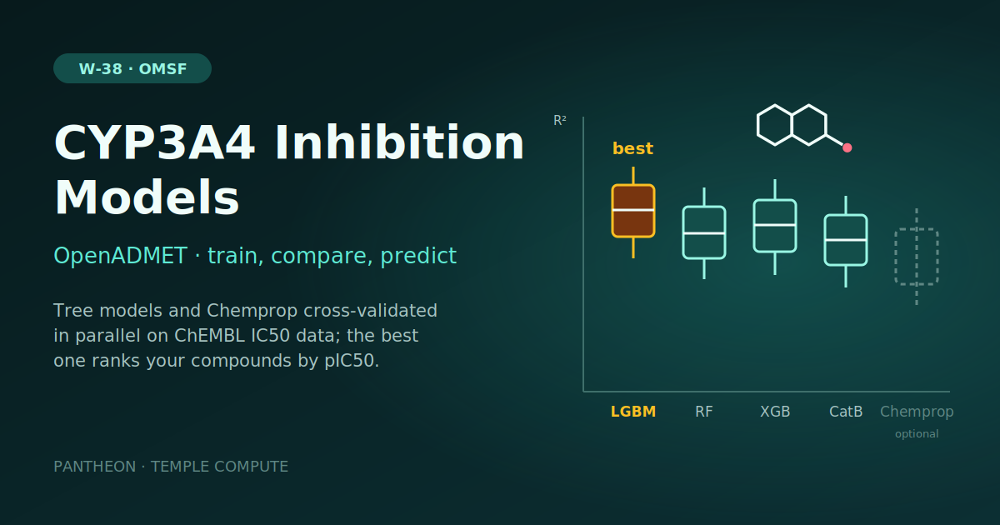

# W-38 · OpenADMET CYP3A4 Inhibition Models


Train and cross-validate OpenADMET models on CYP3A4 IC50 data in parallel, compare them statistically, and predict new compounds with the best one.




## Overview

A native Horus port of the **OpenADMET Showcase** from the
[OMSF workflow directory](https://directory.omsf.io/workflows/): predict how
strongly small molecules inhibit CYP3A4, a common drug-drug-interaction
anti-target. Upstream it is one notebook
([OpenADMET/openadmet-demos](https://github.com/OpenADMET/openadmet-demos),
`showcase/OpenADMET_Models_Showcase.ipynb`, plus `demos/02`-`05`). Here each
notebook stage is its own task:

1. take a training set (default: the ChEMBL35 CYP3A4 IC50 aggregate) and a set of compounds to predict (default: 10,000 ZINC compounds), both uploadable,
2. write one `openadmet anvil` cross-validation recipe per model type,
3. train every model in parallel (one map clone each),
4. compare the models statistically with `openadmet compare`,
5. predict the inference set with the best model (`openadmet predict`),
6. tabulate CV metrics and the top predicted inhibitors.

The workflow runs on CPU only: no GPU, no CUDA libraries. The four tree
models (the default) train in minutes. Chemprop (a graph neural network) can
be added to `models`, but on CPU it takes hours.

## Pipeline

```
make_recipes  (local, conda)   OPENADMET_* headers, recipes/<model>/{recipe.yaml,data.csv}
   │
train         (map, conda)     openadmet anvil, one clone per model (all at once)
   ├──────────────┐
compare           predict      openadmet compare  |  best mean CV R2 -> openadmet predict
                     │
                  report       metrics.csv, top_predictions.csv
```

## Quick start

```bash
# Prerequisites: uv and micromamba (or mamba/conda, see below)
curl -LsSf https://astral.sh/uv/install.sh | sh

cd workflows/omsf/w02-openadmet-cyp3a4

# Install the horus-runtime and plugins (one time)
uv sync

# Run the workflow with the default parameters
uv run horus run workflow.yaml
```

Executor: `conda_python_environment` with `micromamba` (set `conda:` in the
`_conda` anchor to `mamba` or `conda` if that is what you have). The first
conda task builds the env from `conda_env.yaml` into
`horus_workflow_results/.horus_conda_env/` (a few minutes). Later runs reuse
it as is, without checking it against `conda_env.yaml`: after editing that
file, delete `horus_workflow_results/.horus_conda_env/` (or set
`recreate: true` for one run) so the next run rebuilds it.

The env pins the CPU builds of pytorch and catboost, so it solves the same on
any linux-64 host, with or without a GPU.

## Parameters

Root value artifacts of `workflow.yaml`. Each is written to
`params/<id>.txt` (next to `workflow.yaml`) the first time a task uses it and
reaches the tasks only through `${id}`.

| id | Kind | Default | Range | Meaning |
|---|---|---|---|---|
| `dataset` | file | `examples/ChEMBL_IC50_CYP3A4_CHEMBL340_aggregated.parquet` (ChEMBL35 CYP3A4 IC50 aggregate, [OpenADMET/data-catalogs](https://github.com/OpenADMET/data-catalogs) at `65dd4ee3`) | parquet | Training set: any OpenADMET data-catalogs aggregated parquet, one row per compound, with `OPENADMET_CANONICAL_SMILES` (input) and `pchembl_value_mean` (target) columns |
| `compounds` | file | `examples/compounds_for_inference.csv` (openadmet-demos `showcase/` at `8b2c5f34`, 10,000 ZINC compounds) | CSV | Compounds to predict; needs an `OPENADMET_CANONICAL_SMILES` column (`OPENADMET_INCHIKEY` is copied to the top list if present) |
| `models` | multichoice | `lgbm`, `rf`, `xgboost`, `catboost` | those four and `chemprop` (hours on CPU); at least 1 | Models to train, compare and pick from |
| `cv_folds` | number | `5` (upstream) | 2–10, step 1 | k of the repeated k-fold CV |
| `cv_repeats` | number | `5` (upstream) | 1–10, step 1 | Repeats of the k-fold CV |

`make_recipes.py` and `models.py` reject an unknown model, a
repeated model and a non-integer or out-of-range CV count with an error
naming the parameter. The best model is
picked by mean CV R2 (`--metric` of `models.py predict`).

To change a value, edit its `value:` in the root `artifacts:` list of
`workflow.yaml` (or on the artifact in the tc-os UI), then delete the
materialized files:

```bash
rm -rf params/
```

`${id}` renders the root `value:`, but the skip check fingerprints
`params/<id>.txt`, which Horus writes only when it is missing. Without the
delete, finished tasks are skipped with the old value. `params/` is run
state, not something to commit.

## Running in Temple Compute

Import the workflow (or open it from the library) and start a campaign: the
form shows the two data uploads, the model picker (chips) and the CV folds
and repeats as sliders. Everything runs on CPU. The `resources` hints size
auto-provisioned machines: one 8-vCPU machine per training clone (12 h cap),
a 4-vCPU machine for `predict`, and a small one for recipes and comparison.

## Compute Pattern

| Stage | Where (defaults) | Time |
|---|---|---|
| make_recipes | local CPU (builds the env on first run) | seconds, plus the env build |
| train (map) | 4 clones (lgbm, rf, xgboost, catboost), 8 threads each, at once when the target has the CPUs | minutes per tree model (chemprop, if added: hours) |
| compare | local CPU | under a minute |
| predict | best model on all 10,000 compounds | a few minutes |
| report | local | seconds |

## Tools & Dependencies

- [openadmet-models](https://github.com/OpenADMET/openadmet-models) **v0.2.0**
  (git tag, commit `cdf3e9f7`). It is not on PyPI or conda-forge, so the env
  file installs it from that commit. v0.2.0 has every CLI command and flag the
  showcase uses (`anvil --recipe-path/--output-dir`, `compare
  --model-stats-fns/--labels/--task-names/--output-dir/--report`, `predict
  --input-path/--input-col/--model-dir/--output-csv/--accelerator`), so no
  `main` commit is needed. `predict --accelerator` defaults to `gpu` in
  v0.2.0, so `models.py` always passes `cpu`.
- `conda_env.yaml`: the runtime part of upstream
  `devtools/conda-envs/openadmet-models.yaml` (pytorch, chemprop, lightgbm,
  xgboost, catboost, rdkit, the OpenADMET molfeat fork at a pinned commit, and
  so on), with the CPU builds of pytorch (`pytorch=2.14.1=cpu*`) and catboost
  (`catboost=1.2.10=cpu*`). Test and notebook tools and the optional
  TabPFN/TabICL/NePaRe extras are left out. Every package is pinned to the
  versions of a working solve. One env serves every task.
- Data: the two URLs in **Parameters**, downloaded at run time.

### Container option

OpenADMET publishes `ghcr.io/openadmet/openadmet-models:main`. That tag
moves, so it is not the default, and we have not run the workflow in it. The
container executors are optional extras of this folder's `pyproject.toml`.

Docker (a workstation with a Docker daemon): run `uv sync --extra docker`,
then replace the `_conda` anchor with:

```yaml
_conda: &conda
  kind: docker
  image: ghcr.io/openadmet/openadmet-models:main
  env:
    OADMET_NO_RICH_LOGGING: "1"
    MPLBACKEND: Agg
```

Apptainer (Slurm clusters, where Docker is rarely available): run
`uv sync --extra apptainer`, then replace the `_conda` anchor with:

```yaml
_conda: &conda
  kind: singularity
  image: docker://ghcr.io/openadmet/openadmet-models:main
  exe: apptainer # or singularity
  env:
    OADMET_NO_RICH_LOGGING: "1"
    MPLBACKEND: Agg
```

On Slurm, the train map still needs `target: *slurm`.

## Horus Configuration

- **Parameters**: see **Parameters** above.
- **train** is a `horus_map` over `recipes/` with `max_concurrency: 5`, so
  every model can train at once. Each clone declares `resources` (`cpus: 8`,
  `memory_gb: 8`). The local target ignores them; a shared cloud machine runs
  only as many clones at once as its size allows (an 8-vCPU machine runs them
  one after another, a 32-vCPU machine runs all four at once). Each child
  folder (`recipes/lgbm/`, `recipes/rf/`, ...) holds
  `recipe.yaml` and its own copy of the data. The recipe points at
  `{{ ANVIL_DIR }}/data.csv`, so the slot works on any target the clone is
  copied to. Each clone writes its anvil output to `trained/<slot>/model/`.
  Slots are numbered (`0`, `1`, ...), and the model name is read from
  `model/anvil_recipe.yaml`.
- **Slurm**: in `workflow.yaml`,
  1. set `partition` and `account` in the `_slurm` anchor,
  2. on the train task, change `target: *local` to `target: *slurm`.

  The env lives in `horus_workflow_results/` and must be on a filesystem the
  nodes share. The executor has no lock, so if `train` could be the first
  conda task (for example after deleting the env), build the env once before
  the run instead of letting the clones race to create it:

  ```bash
  micromamba env create -y -f conda_env.yaml \
    -p horus_workflow_results/.horus_conda_env
  ```
- Threads: the recipes set `n_jobs: 8` (catboost: `thread_count`) on the
  featurizers and models, the train task's `resources.cpus` and the `_slurm`
  anchor's `cpus_per_task`; change `N_JOBS` in `scripts/make_recipes.py` and
  those two together. `-1`
  is not used because catboost reads it as every core on the host, not the
  allocation, and the upstream featurizers default to it, so the recipes
  always set the count explicitly.

## Input / Output

**Inputs**: the `dataset` parquet and the `compounds` CSV, uploadable in
tc-os or replaced in `examples/` locally (see **Parameters**). The defaults
are committed copies of the pinned upstream files.

**Outputs** (under `horus_workflow_results/`):

| File | Renders as | What |
|---|---|---|
| `results/metrics.csv` | table | One row per model: mean and 95% CI of R2, MAE, MSE, Spearman, Kendall tau over the CV folds, and which model was picked |
| `results/top_predictions.csv` | table | Top 50 compounds by predicted pIC50 (strongest predicted inhibitors) |
| `results/predictions.csv` | table | Every predicted compound, `OADMET_PRED_openadmet-chembl_OPENADMET_LOGAC50` column (the `OADMET_STD_...` column stays empty: a single model has no ensemble spread) |
| `results/comparisons/` | PDFs + JSON | `openadmet compare` report: `anova.pdf`, `mcs_plots.pdf`, `mean_diffs.pdf`, `normality_plots.pdf`, `paired_plots.pdf`, `posthoc.pdf`, `Levene.json`, `Tukey_HSD.json` |
| `trained/<slot>/model/` | files | anvil output: `model.pkl`/`model.pth`, `cross_validation_metrics.json`, `regression_metrics.json`, CV plots (PNG), `anvil_recipe.yaml` |
| `data/cleaned_cyp3a4.csv` | table | Training data with the `OPENADMET_*` headers |

## Expected runtime

- Measured on this repo's 16-core shared dev host, CPU only, the four tree
  models with `cv_folds: 5`, `cv_repeats: 1`, env already built: **8 min 49 s**
  (fetch (since removed) and make_recipes about 1 s each, train 7 min 43 s with all four
  clones at once, each clone 6.5 to 7.7 min, compare 36 s, predict 65 s on all
  10,000 compounds, report < 1 s). About 67 CPU-minutes in total, under
  2 GB RAM. lgbm was picked (mean CV R2 0.58; xgboost 0.57, rf 0.57,
  catboost 0.55). A cold env build adds a few minutes.
- The upstream default `cv_repeats: 5` refits each model 5 times as often,
  so expect train to take roughly 5 times longer.
- On a cloud machine, train time follows its vCPU count: about 16 vCPUs
  matches the run above, 32 vCPUs runs all four 8-CPU clones at once. A
  re-run of a finished workflow takes seconds: every task is skipped by
  `skip_if_complete`.

## Implementation Notes

- No notebook code is copied. The glue is two scripts:
  `scripts/make_recipes.py` (cleaning as in showcase cells 9-13, parameter
  checks, recipe generation) and `scripts/models.py` (compare, best-model
  pick + predict, report). Each has a `--selftest` unit test of its glue;
  run it with the env's python:
  `horus_workflow_results/.horus_conda_env/bin/python scripts/models.py --selftest`.
- Recipes follow upstream `showcase/anvil_lgbm-cv.yaml` (sklearn models) and
  `showcase/chemprop/anvil_recipe.yaml` (Chemprop). Upstream ships no rf,
  xgboost or catboost recipe. Those use the same featurization (RDKit 2D
  descriptors + ECFP4), split and CV as lgbm. Their overrides of the library
  defaults are: rf `n_estimators: 100`; xgboost and catboost
  `n_estimators: 500` and `learning_rate: 0.05`; `random_state: 42` on all
  three.
- Deliberate differences from the upstream showcase recipes: the CV sets
  `random_state: 42` (upstream lgbm sets none), the Chemprop CV sets
  `max_val: 10` / `min_val: 3` plot limits (upstream sets neither), Chemprop uses `dropna: true` (upstream
  `false`) and its plot title says pAC50, not LogAC50. The showcase also
  compares a third, multitask model (`OPENADMET_LOGAC50_cyp3a4`, notebook
  cell 18); that model is out of scope for this port.
- `compare` and `predict` both run straight after `train`: `predict` picks
  the best model itself from the CV metrics, so it does not wait for
  `compare`.
- `openadmet anvil` renames an `--output-dir` that already exists, so each
  clone trains into a fresh `model/` subfolder of its slot.
- anvil prints many sklearn warnings. They go to `trained/<slot>/anvil.log`,
  and the task log shows only the tail, or the last 40 lines on failure.
- `openadmet compare` needs its `--output-dir` to exist; `models.py` creates it.
- `models` is a multichoice; Horus renders it as separate shell words, so
  `make_recipes.py --models` takes one or more names (a comma list also works).

## Open Questions

- The container swaps and the Slurm target have not been run.
- Chemprop on GPU is out of scope: it would need the CUDA builds back in
  `conda_env.yaml`, a GPU target, and a map split so the tree models stay
  on CPU nodes.

## License and credit

The workflow glue in this folder is MIT (repo license). It reproduces the
OpenADMET Showcase from
[OpenADMET/openadmet-demos](https://github.com/OpenADMET/openadmet-demos)
(Apache-2.0) and runs
[openadmet-models](https://github.com/OpenADMET/openadmet-models) (Apache-2.0)
on data from [OpenADMET/data-catalogs](https://github.com/OpenADMET/data-catalogs)
(Apache-2.0; derived from ChEMBL 35, CC BY-SA 3.0). Recipes generated by
`make_recipes.py` are derived from the upstream showcase recipes and carry an
Apache-2.0 credit header. Credit for the science, models and data goes to the
OpenADMET contributors. The files in `examples/` are unmodified copies of
those pinned upstream files and keep their licenses (the training parquet is
CC BY-SA 3.0 via ChEMBL).

## References

- OMSF workflow directory: https://directory.omsf.io/workflows/
- OpenADMET demos: https://demos.openadmet.org · https://github.com/OpenADMET/openadmet-demos
- openadmet-models: https://github.com/OpenADMET/openadmet-models
- Model comparison guidelines followed by `openadmet compare`: https://chemrxiv.org/engage/chemrxiv/article-details/672a91bd7be152b1d01a926b
